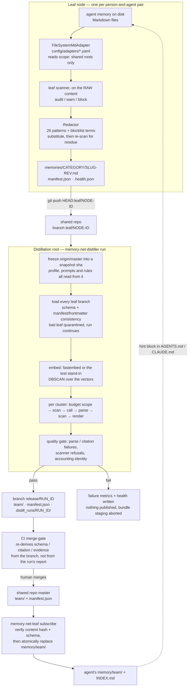
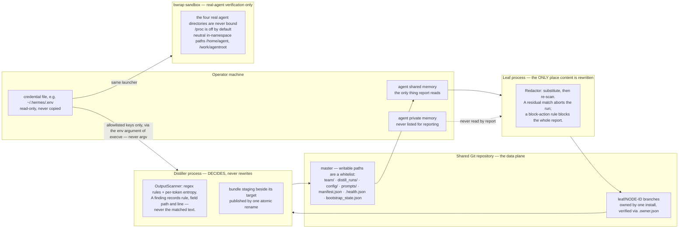

English | [中文](README.zh-CN.md)

<div align="center">

# Agent-Native Organizational Memory Architecture

**`aomt`** — turn a fleet of AI agents into one compounding organizational brain.

[](https://github.com/ljxalpha/agent-native-org-memory/actions/workflows/ci.yml)
[](LICENSE)
[](https://www.python.org/)

</div>

> **Every agent is learning things worth keeping — and your organization can't see any of it.**
> aomt distills the memory scattered across your agents into shared organizational
> knowledge, and feeds it back to every agent.

Your company is already running a growing fleet of AI agents, and every one of them is
learning *alone*. The lesson one agent paid for in a two-hour debugging session never
reaches the agent that hits the same wall tomorrow. The risk three teams independently
stumbled into is never named. The better approach one engineer's agent discovered never
spreads. **aomt is the missing layer that turns that scattered, perishable memory into
two things at once: a durable organizational asset fed back to every agent, and a live
view — in one place — of what your organization is learning, struggling with, and
getting right.**

---

## The problem: every agent's memory is a silo

<div align="center">

</div>

Before AI agents, the smallest unit of work was a **person**, and knowledge moved
person-to-person — slowly. Now the unit is a **person *and* their agent**, and the
work *inside* that unit got an order of magnitude faster. The channels *between*
units did not. Three structural defects follow:

- **Humans are back on the critical path.** An agent needs something another team's
  agent already learned — and a person has to relay it. Minutes of real work stall
  for hours of waiting.
- **Each agent is capped by one human's knowledge.** It knows its base model plus
  whatever its single operator happens to tell it. The organization's most valuable
  knowledge — tacit, cross-domain, the global view — escapes it entirely.
- **Hard-won lessons evaporate.** Cross-team knowledge only flows when one human
  writes it down *and* another goes looking. In practice that chain almost never
  completes.

Siloed agent memory is not a minor inefficiency. It is the new organizational
bottleneck — and it gets more expensive with every agent you add.

The full thesis — the shift to person-agent units, why a hand-maintained knowledge
base can't substitute, and the flywheel in detail — is in **[VISION.md](VISION.md)**.

---

## The loop: distill once, feed back to all

<div align="center">

</div>

*(The diagram above is the **target** shape. What is actually wired today is drawn
in Mermaid below, and every box in those diagrams points at a file you can open.)*

aomt harvests the working memory your agents already produce and distills it with an
LLM into **source-cited, secret-redacted organizational knowledge**. One loop yields
two products.

**For leadership — organizational intelligence you couldn't get before.**
The distillation surfaces patterns no single agent or person can see:

| | |
|---|---|
| 🟡 **Common problems, surfaced** | the same failure hitting three teams — named once, fixed once |
| 🟡 **Latent risks, flagged early** | a negative signal recurring across many agents becomes an early warning |
| 🟡 **Best practices, diffused** | one engineer's better approach reaches the whole org, fast |
| 🟡 **Efficiency bottlenecks, exposed** | where work stalls or gets duplicated across teams, made visible |

**For every agent — knowledge that flows back.**
Each agent (a *leaf*) automatically reports the shareable parts of its memory; the
*distillation root* clusters and refines those reports into team knowledge, then
delivers it back down into each agent's local memory. No one writes a doc. No one
copies a note.

---

## Architecture, as implemented

Three properties hold the design together: **agent-native** (harvested from memory
agents already produce), **Git-backed** (provenance, history, review gates and
rollback come for free), and **pluggable by configuration** (reporting policy,
distillation profile, product format, memory backend and delivery are all externalized).



Two things this diagram deliberately shows:

- **The leaf never reads the agent's private memory.** Only roots declared
  `scope: shared` are listed for reporting; a `personal` root (Claude Code's
  `~/.claude/CLAUDE.md`, for instance) is parsed and then never read by `report`
  (`memory_net/shared/adapters/filesystem_md.py`). Private and shared memory are
  separated *positionally*, in disjoint directories — there is no ACL and no
  encryption, and the README should not imply one.
- **Feed-back is a whole-directory replace.** `subscribe` builds the new `team/`
  in a temporary directory and `os.replace`s it into position, so a partial write
  can never be what the agent reads. Anything already sitting in the target
  directory is replaced (`filesystem_md.write_team`).

### One distillation run, end to end

The ordering in this diagram is the design. Every gate sits where it does because
moving it one step later would make it unable to prevent the thing it exists to prevent.

```mermaid
flowchart TD
  S(["memory-net-distiller run --repo REPO"]) --> PF

  PF["preflight — needs no profile:<br/>credentials + the openai extra,<br/>only when --provider deepseek can actually call out"]
  PF --> FZ["freeze origin/master → snapshot sha"]
  FZ --> PB["read the profile as raw bytes from the snapshot<br/>sha256 of those bytes lands in metrics.json"]
  PB --> VP["validate_profile — production has no defaults:<br/>9 keys required; mock and hermes_tool refused;<br/>the test embedding stand-in refused; mode must be enforce"]
  VP --> VE["validate the EFFECTIVE provider:<br/>--provider, --fallback-provider, and a replayed<br/>bundle's own per-call backends"]
  VE --> EP["EmbeddingPolicy.probe — load the real model now,<br/>before any leaf is read or any token is spent"]
  EP --> CTX["build and freeze one RunContext:<br/>run identity+clock · RunBudget · OutputScanner · BundleRecorder"]
  CTX --> CLU["cluster the leaf records"]

  CLU --> LOOP{"for each cluster"}
  LOOP --> SOFT["open a per-cluster budget scope<br/>soft ceiling reached → skipped_budget, no new cluster"]
  SOFT --> S1["SCAN 1 — outbound: system prompt, user prompt, metadata<br/>a hit here stops the prompt from ever leaving the process"]
  S1 --> RSV["RunBudget.reserve, then AttemptLedger.reserve<br/>both strictly before the request is issued"]
  RSV --> CALL["POST /chat/completions<br/>system+user as two messages · response_format=json_object<br/>· max_tokens honoured · SDK retries disabled"]
  CALL --> STL["settle / settle_unknown / release<br/>exactly one terminal state per attempt"]
  STL --> S2["SCAN 2 — inbound, ONLY on a recording run: response text + raw_meta<br/>the recorder demands that verdict before it writes<br/>a non-recording run persists no raw response and skips it"]
  S2 --> PARSE["parse: take the sibling object that carries a products array<br/>two candidates → refuse rather than guess"]
  PARSE --> S3["SCAN 3 — parsed products, still in memory, nothing on disk"]
  S3 --> RENDER["render: every citation resolved against the frozen<br/>snapshot; per-category min_citations / min_contributors"]
  RENDER --> LOOP

  LOOP -->|all clusters done| GATE{"quality + accounting gate"}
  GATE -->|"parse / citation failures, scanner refusal,<br/>or counts that do not add up"| FAIL["write failure metrics.json + .health.json<br/>abort the staged bundle · publish nothing"]
  GATE -->|pass| MAN["build master manifest.json → SCAN 4"]
  MAN --> BUNDLE["commit the record bundle:<br/>re-scan every staged file — path string, size, and the<br/>full content of every regular file — then os.replace"]
  BUNDLE --> WRITE["atomically replace team/<br/>write distill_runs/RUN_ID/ — metrics, snapshot, clusters,<br/>unclustered, product snapshot, manifest copy"]
  WRITE --> PUB["write review_request.json into the release commit<br/>git add the whitelisted paths → push release/RUN_ID"]
  PUB --> PR["--open-pr, off by default:<br/>opening a pull request is an outward action"]
```



### Data and trust boundaries



Where the two scanners differ is the whole point. The **leaf side rewrites** — it
must, because the record is going to be published. The **output side only decides** —
rewriting a model's answer would mean the recorded bundle no longer holds what the
model actually said, which is the one thing a bundle is for.

### Record and replay: two tracks, one contract

```mermaid
flowchart LR
  subgraph LIVE["Track A — recording, costs real quota"]
    L1["--provider deepseek --record-dir DIR"] --> L2["every call scanned in two stages"]
    L2 --> L3["staging dir beside DIR"]
    L3 --> L4["commit: full re-scan, then atomic rename"]
    L4 --> L5["bundle: calls.jsonl · requests/NNNN-HASH.json ·<br/>cluster_assignment.json · snapshot.json · record_metrics.json"]
  end

  subgraph OFFLINE["Track B — replay, costs nothing"]
    R1["--replay BUNDLE --replay-mode strict"] --> R2["ordered cursor, positional match;<br/>a differing prompt is a mismatch, not a silent live call"]
    R2 --> R3["replay_hits / replay_misses / replay_live_calls<br/>in metrics.json"]
    R3 --> R4["17-clause contract compared against a mock run"]
  end

  L5 -->|"tests/fixtures/golden_bundle/vNNN"| R1
  R4 --> CI["blocking in CI on every PR<br/>no credentials, green on fork pull requests"]
```



A production profile will replay a bundle **only if every call in it names an
acceptable backend** — the per-call provenance the bundle carries, which replay
preserves rather than rewriting. A bundle recorded against the mock, or one that
cannot say where it came from, is refused. That is what makes the offline
regression evidence about the real backend rather than about itself.

---

## Why it is built this way

Ten decisions that shaped the code, each with the file that carries it.

**1. The production backend is a direct OpenAI-compatible endpoint, not an agent CLI.**
An agent CLI takes one text prompt, so the `system` / `user` role boundary does not
survive the wire — and leaf records are untrusted input that could then rewrite the
instruction they were supposed to be data for. There is also no service-level
structured-output constraint, and no reported `usage`, so a run could only estimate
its own spend. A production profile therefore refuses `mock` and `hermes_tool`
outright.
→ `memory_net/distiller/llm/openai_compat.py`, `memory_net/distiller/profile.py`

**2. Leak detection happens before persistence, never after.**
The outbound scan runs *before* the inner provider is called: once a prompt has left
the process, refusing to write it down protects nothing. Every lane is wrapped for that
scan, recording or not — not recording means the prompt is never written down, not that
it is never sent. The raw-response scan, by contrast, exists only on a recording run,
because that is the only run where a raw response reaches disk; on every run the model's
output is gated once it has been parsed, before anything is rendered. And the writer does
not trust that someone upstream scanned: `BundleRecorder.record` requires a `ScanVerdict`
as an argument, and refuses one that carries hits.
→ `memory_net/distiller/llm/recording.py`, `memory_net/distiller/output_scanner.py`

**3. A scanner hit fails the whole run, not the cluster.**
Skipping the offending cluster would let the run exit successfully, publish everything
else, and leave a single counter as the only trace. If this input and this prompt just
produced sensitive content, that says nothing good about the clusters after it either.
The counts travel *with* the exception so the failure can state what stopped it.
→ `memory_net/distiller/pipeline.py` (`DistillationAborted`), `orchestrator._distill_gate_error`

**4. The bundle is committed transactionally.**
Staging sits beside its target — `os.replace` is atomic only within one filesystem,
and a staging area under `/tmp` routinely is not on the same one. Leftover staging is
never reused or cleaned up: it may belong to a run still in flight. Before the rename,
every staged file is re-scanned — the path string, and the full content of every
regular file, not just the ones whose name ends in `.json`. The transaction boundary
ends at the commit: a later publish failure *keeps* the bundle, because it records
calls that were already paid for and is the only replay material for a retry.
→ `memory_net/distiller/llm/recording.py`, `orchestrator._scan_staged_bundle`

**5. Strict replay needs a normalization algorithm, not a field list.**
`products_active` is *keyed* by `distillation_id`, which embeds the run id;
`citation_backrefs`, `subject_index` and every `snapshot_ref` are derived from those
keys. There is no field to strip. So identifiers are collected, remapped to positional
names ordered by facts that derive from neither clock nor run id, substituted across
the whole tree — keys and embedded substrings alike — clocks zeroed, and content
hashes recomputed over the normalized document rather than dropped.
→ `memory_net/distiller/normalize.py`

**6. A production profile is forced onto a real embedding backend.**
The `test-cheap` stand-in produces three-dimensional word counts. Paired with DBSCAN
parameters tuned for semantic distance it clusters real data into nonsense while every
metric looks completely ordinary. So production refuses it, the backend is loaded and
probed before any leaf is read, and `embedding_test_only` is written into
`metrics.json` — because products made from stand-in vectors are structurally
identical to real ones and nothing else would tell them apart afterwards.
→ `memory_net/distiller/clustering/policy.py`, `memory_net/distiller/profile.py`

**7. The attempt ledger deliberately over-counts.**
The unit is a *real request* — what a retry loop multiplies and what an endpoint
bills — and it is reserved *before* the request goes out, because a record written
afterwards can report an overspend but never prevent one. A 429 or a 5xx is treated
as billable: the response body cannot distinguish "rejected at the gate" from
"throttled mid-inference", and guessing optimistically is exactly the direction that
overspends. The count is recovered by replaying an append-only JSONL file, because
after a crash the surviving lines are the only truth. The ceiling is a code constant;
the environment variable may only *lower* it.
→ `memory_net/distiller/llm/ledger.py`, `memory_net/distiller/runctx.py`

**8. The merge gate re-derives its verdict from the branch.**
The distiller already checked schema, citations and evidence rules — but the gate has
to hold even if the run that pushed the branch was buggy, was replayed, or was not
this code at all. A gate that trusts the producer's own report is not a gate. It reads
a checkout, uses zero credentials and touches no network, which is what lets it stay
green on a fork pull request.
→ `memory_net/distiller/merge_gate.py`, `.github/workflows/ci.yml`

**9. Everything a run reads comes from one frozen snapshot.**
The profile, the prompts and the scanner rule file are all read with `git show` at the
snapshot sha, not from the working tree. Reading the working tree would leave the run's
recorded `master_snapshot_sha` looking clean while the configuration that actually ran
was never in that snapshot. The profile is read as *bytes*, because the provenance hash
has to match a blob in the repository and a text channel normalizes line endings.
→ `memory_net/distiller/cli.py`, `orchestrator._snapshot_prompts`

**10. The run fails if its own counts do not balance.**
Every cluster reaches exactly one of seven mutually exclusive terminal states, and at
the record level `input_records == records_cited + records_unclustered`. If either
identity breaks, something went unaccounted for and there is no way to tell from the
outside whether it was a skip or a whole product — so the run fails rather than
publishing on top of metrics nobody can use as evidence.
→ `memory_net/distiller/metrics.py`, `memory_net/distiller/pipeline.py`

Two more worth naming: **credentials only ever travel in the `env` argument of
`execve`** (`argv` is world-readable, so the launcher offers no eval-able output mode
and no `env` subcommand — `memory_net/shared/env_allowlist.py`); and **the JSON parser
refuses ambiguity** — it scans every sibling object and takes the one carrying
`products[]`, and raises when two of them do, because both readings validate and the
wrong guess publishes silently (`pipeline._raw_decode_object`).

---

## Maturity: what is proven, and what is not

This project is engineered carefully, but "carefully engineered" is not "field
proven". Here is the honest line for each part.

| Area | Status | What that means exactly |
|---|---|---|
| Distillation backend `deepseek` | **Production path** | Real endpoint, role-separated messages, run budget + cross-process attempt ledger. Usage is taken from the service when it reports both counters and is labelled `usage_source: reported`; when it does not, the run estimates and says `estimated` rather than claiming a report it never got. The golden bundle in `tests/fixtures/golden_bundle/` is a recording of a real run of it. |
| `hermes_tool` bridge | **Experimental** | Proves `LLMProvider` can host an out-of-process backend. The reference bridge script's own backend is a deterministic mock, by design. Refused by a production profile. |
| `anthropic` provider | Implemented | Budgeted and ledgered, but not the production baseline and not the equivalence reference. |
| Adapter: `claude-code` | Tested path | The only adapter without `support_status: experimental` — it is stable by the loader's default, not by an explicit declaration. |
| Adapters: `codex`, `hermes`, `openclaw` | **Experimental** | Paths taken from real read-only inspection of an install; redacted fixtures and read-path regressions ship. Loading one requires `MEMORY_NET_ALLOW_EXPERIMENTAL_ADAPTER=1`. |
| Adapter: `opencode` | **Experimental, paths unverified** | The file carries an explicit `EXPERIMENTAL / UNVERIFIED: template only` banner: its paths are a convention, not an observed layout. |
| Real-agent consumption of an injected hint | **One unrepeated paired experiment** | For `hermes`: a fresh sentinel returned by the arm with the hint and not by an otherwise identical control. One observation, in a fixed order, from a sampling model — that is not a success rate, and it is why the adapter stays experimental. Fixtures and tooling are **not** consumption evidence. |
| Three-leaf stability | **Accelerated synthetic soak** | CI runs 5 cycles over three isolated synthetic leaves with per-leaf health assertions. The 24-hour lane is the same script with `--duration-seconds 86400` and is an operator step — the accelerated run is not evidence of a 24-hour run. |
| Review / release gate | Branch + artifact + CI gate | The run pushes `release/RUN_ID`, writes a pointers-only `review_request.json` into the release commit, and CI's `merge-gate` re-validates the branch. **Platform-side branch protection is not empirically verified**; without a token the validator says so out loud and exits 0. |
| Production regression in CI | Two tiers | Tier A — offline golden-bundle strict replay plus stub contract tests — blocks every PR. Tier B — a live smoke run against the real endpoint — is `workflow_dispatch` only and skips when no credential is present. |
| Non-coding agents, org-level roots, live dashboard | **Roadmap** | Not shipped. See [VISION.md](VISION.md). |

Scale of the test surface, for calibration: **over 1,200 tests**, all blocking in CI
alongside `ruff`, `black`, `isort`, and `mypy --strict` over `memory_net`.

---

## Get started

```bash
python3 -m pip install -e ".[dev]"   # Python 3.11+ (Linux/macOS; Windows via WSL2)
pytest
```

The fastest way to watch the whole loop run — report → distill → review/release →
subscribe — with no network and no tokens, is the offline regression:

```bash
bash tests/integration/local_repo.sh
```

In a real team it is the same loop, wired to your own shared repo and agents (paths
below are placeholders):

```bash
# 1. stand up a shared memory repo (once per team)
scripts/bootstrap_repo.sh --repo /tmp/team-memory.git

# 2. install a leaf, once per member. This is what clones the repo, materializes
#    the config generation the leaf runs from, injects the hint into the agent's
#    instruction file, and registers cron + the daemon.
scripts/install_leaf.sh \
  --repo /tmp/team-memory.git --agent claude-code \
  --node-id alice-claude-01 --agent-root ~/my-agent \
  --package-ref <pinned package ref>

# 3. the distiller distills team knowledge onto a release branch — the review/release gate
git clone /tmp/team-memory.git ./distill-work
python3 -m memory_net.distiller.cli run --repo ./distill-work --provider mock
```

Steps 2 and 3 are the whole deployment: from there the leaf daemon runs
`config_sync`, `report`, `subscribe` and `health` on an interval. The individual
commands exist and can be driven by hand —

```bash
python3 -m memory_net.leaf.cli report \
  --repo ./leaf-work --node-id alice-claude-01 --agent-root ~/my-agent \
  --adapter config/adapters/claude-code.yaml \
  --redaction config/redaction_patterns.yaml
```

— but `subscribe` deliberately refuses to run until a config generation is active
and its subscribe contract matches the one recomputed from `origin/master`: writing
team knowledge into an agent under a contract that has since drifted is exactly the
failure the check exists to prevent. The installer is what puts that state in place;
`tests/integration/local_repo.sh` materializes it explicitly, which is worth reading
if you want to see the minimum by hand.

Step 3 uses the shipped default profile, which is a **mock** run costing zero
tokens. A live run selects the production profile instead, and takes its credentials
from the environment through the launcher — never from a file the provider opens itself:

```bash
python3 -m pip install -e ".[dev,llm]"       # the OpenAI client is an opt-in extra
scripts/aomt-with-env -- memory-net-distiller run \
  --repo ./distill-work --config config/distill.deepseek.yaml --provider deepseek
```

Full command surface:

```bash
python3 -m memory_net.leaf.cli --help       # report / subscribe / health / hints / daemon / start / stop / trigger / status
python3 -m memory_net.distiller.cli --help  # run [--provider mock|anthropic|hermes_tool|deepseek]
```

Console scripts `memory-net-leaf` and `memory-net-distiller` are installed with the
package. Default config lives in `config/`, adapter config in `config/adapters/`,
prompt templates in `prompts/`. Note that four of the five shipped adapters are
experimental and require `MEMORY_NET_ALLOW_EXPERIMENTAL_ADAPTER=1` to load.

---

## Two-repository model

This repository holds **code, tests, scripts, and CI**. At runtime, nodes interact
with a **separate shared Git repository** that holds the actual data and runtime
configuration:

| What | Where |
|---|---|
| Python packages, scripts, tests, CI | this repo |
| Runtime `config/` + `prompts/` | shared repo `master` |
| Leaf reports (`memories/`, `manifest.json`, `.health.json`) | shared repo `leaf/NODE-ID` branches |
| Distilled products (`team/`, `manifest.json`) | shared repo `master` |
| Per-run evidence (`metrics.json`, `snapshot.json`, `clusters.jsonl`, `unclustered.json`) | shared repo `distill_runs/RUN_ID/` |

The `config/` and `prompts/` here are bootstrap templates and test fixtures; the
runtime source of truth is always the shared repo's `master`.

Recorded call bundles are not on that list. They hold complete prompts and complete
responses, so `--record-dir` is documented to point at a staging directory *outside*
the repository (`docs/tuning_loop.md`). That is a procedure, not a constraint the CLI
enforces: the flag accepts any path. What the code does guarantee is narrower — the
publish step stages only the whitelisted paths, and refuses outright if the working
tree carries anything outside the whitelist.

---

## Documentation

- **`mvp_tech_design.md`** — the technical design (architecture, interfaces, schemas,
  Git layout, milestones). Source of truth.
- **`VISION.md`** — the problem, the approach, and the flywheel.
- **`docs/runbook.md`** — operating and failure-handling procedures.
- **`docs/tuning_loop.md`** — record, change a prompt, replay, compare; and how to
  refresh the golden bundle.
- **`todo.md`** — roadmap and task tracker.
- **`AGENTS.md`** — contributor working rules and conventions.

## Contributing

See [CONTRIBUTING.md](CONTRIBUTING.md). In short: keep the suite green
(`ruff check .`, `black --check .`, `isort --check-only .`, `mypy memory_net`,
`pytest`), make atomic `[Type] Scope: Description` commits, and update the design
docs alongside code.

## Naming

The project and PyPI distribution are **`aomt`**; the import package is still
**`memory_net`**, and the CLI commands, the `MEMORY_NET_HOME` env var, the
`~/.memory-net` home directory, and the `memory-net/*` config-schema prefixes keep the
legacy **`memory-net`** identifier (much as `ripgrep` ships `rg`).

## License

[Apache-2.0](LICENSE) © 2026 ljxalpha
