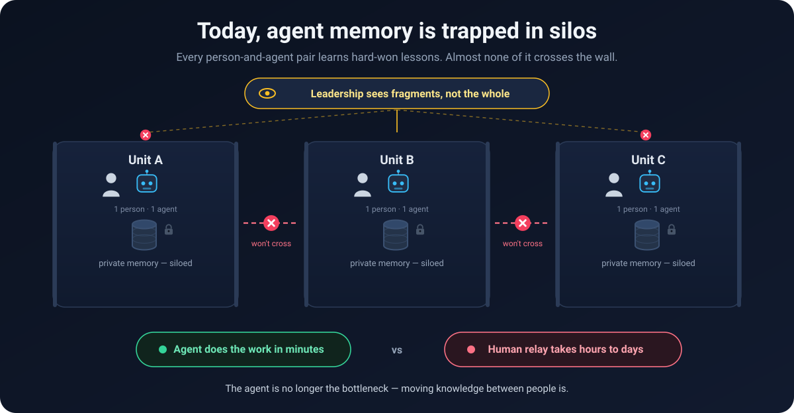
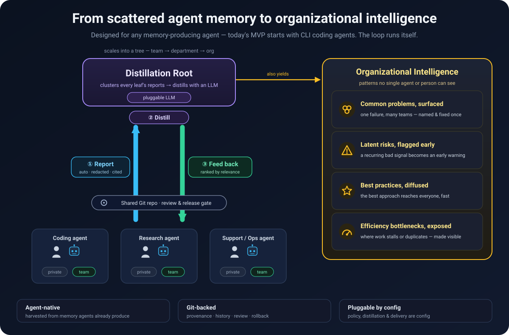
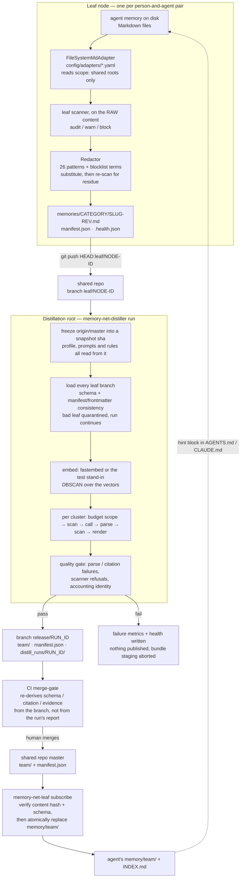
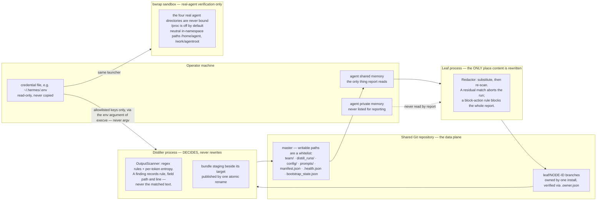

[English](README.md) | 中文

<div align="center">

# Agent 原生组织记忆架构

**`aomt`** — 把一支 AI agent 队伍，汇聚成一个不断复利的组织大脑。

[](https://github.com/ljxalpha/agent-native-org-memory/actions/workflows/ci.yml)
[](LICENSE)
[](https://www.python.org/)

</div>

> **每个 agent 都在习得值得保留的东西——而你的组织对此一无所见。**
> aomt 把散落在各个 agent 里的记忆蒸馏成可共享的组织知识，再回灌给每一个 agent。

你的公司里，正运行着一支不断壮大的 AI agent 队伍，而它们每一个都在**独自**学习。一个
agent 花两小时调试换来的教训，永远到不了明天撞上同一堵墙的另一个 agent；三个团队各自
独立踩中的风险，从未被命名；某位工程师的 agent 摸索出的更优解法，也从未扩散出去。
**aomt 正是那一层缺失的基础设施——它把这些散落、易逝的记忆，同时变成两样东西：一项回流
给每个 agent 的、可沉淀的组织资产，以及一幅集中于一处的实时图景——你的组织在学什么、卡在
哪里、又把什么做对了。**

---

## 问题：每个 agent 的记忆都是一座孤岛

<div align="center">

</div>

在 AI agent 出现之前，最小的工作单元是**人**，知识在人与人之间流动——很慢。如今，最小
单元变成了**“人 + 其 agent”**，单元*内部*的工作提速了一个数量级，但单元*之间*的通道
却没有升级。三个结构性缺陷随之而来：

- **人类又被拉回了关键路径。** 一个 agent 需要另一个团队的 agent 早已习得的东西，却要靠
  一个人来转述——几分钟的实际工作，要为几小时的等待而停摆。
- **每个 agent 的上限，就是某一个人的知识上限。** 它只知道自己的基座模型，加上与它协作
  的那唯一一个人恰好告诉它的内容。而组织里最有价值的知识——隐性的、跨域的、全局的视角
  ——恰恰从它身边彻底溜走。
- **来之不易的经验在蒸发。** 跨团队的知识只有在一个人写下来、*并且*另一个人主动去翻看时
  才会流动。现实里，这条链条几乎从不闭合。

孤岛化的 agent 记忆，不是一个小小的低效问题。它是新的组织瓶颈——而且你每加一个 agent，
它就更昂贵一分。

完整的论述——向“人 + agent”单元的转变、为何手工维护的知识库无法替代它、以及飞轮效应的
细节——都在 **[VISION.md](VISION.md)** 中。

---

## 回路：蒸馏一次，回流所有

<div align="center">

</div>

*（上图是**目标**形态。今天真正接通的部分，画在下面的 Mermaid 图里；那些图中的每一个
方框，都能在代码里找到对应文件。）*

aomt 汇聚你的 agent 本就在产生的工作记忆，用 LLM 将其蒸馏为**带来源引用、已做敏感信息
脱敏的组织知识**。同一条回路，产出两样东西。

**面向管理者 —— 你过去拿不到的组织级洞察。**
这份蒸馏会浮现出任何单个 agent 或个人都无法看到的模式：

| | |
|---|---|
| 🟡 **浮现共性问题** | 同一个故障同时击中三个团队——只需命名一次、修复一次 |
| 🟡 **提前预警潜在风险** | 同一个负面信号在众多 agent 的记忆里反复出现，即成早期预警 |
| 🟡 **扩散最佳实践** | 某位工程师更优的做法，迅速抵达整个组织 |
| 🟡 **暴露效率瓶颈** | 工作在哪里停滞、在哪里被跨团队重复建设，一目了然 |

**面向每个 agent —— 让知识回流。**
每个 agent（一个*叶子*）自动汇报其记忆中可共享的部分；*蒸馏根*将这些汇报聚类、精炼为团队
知识，再回流到每个 agent 的本地记忆中。没有人写文档，没有人抄笔记。

---

## 架构：已经实现的部分

三条性质支撑起整个设计：**agent 原生**（从 agent 本就产生的记忆中收割）、**基于 Git**
（溯源、历史、审核关卡与回滚都免费获得），以及**由配置驱动的可插拔**（汇报策略、蒸馏
profile、产物格式、记忆后端与回流策略全部外置）。

> 下面四张图与英文版**共用同一份 Mermaid 源**，以保证两个语言版本永不漂移。



这张图刻意点明两件事：

- **私有与共享的分界画在配置里，代码负责遵守它。** `report` 只列出声明为 `scope: shared`
  的根；`personal` 根（例如 Claude Code 的 `~/.claude/CLAUDE.md`）会被解析，但从不被读取
  （`memory_net/shared/adapters/filesystem_md.py`）。但**标签本身就是边界**——adapter
  采信自己 YAML 里写的东西，所以一份把私有目录标成 `shared` 的 adapter 同样会被照办。
  这正是叶子所依据的 adapter YAML 不是一个本地文件、而是从共享仓 `master` 物化出来的
  **内容寻址 config generation** 的一部分的原因。隔离是**位置上的**——互不相交的目录，
  加上经过评审的配置；这里既没有 ACL 也没有加密，README 不应暗示有。
- **回流是整目录替换。** `subscribe` 先在临时目录里构建新的 `team/`，再用 `os.replace`
  原子换入，因此 agent 永远读不到写了一半的状态；目标目录里原有的内容会被整体替换
  （`filesystem_md.write_team`）。

### 一次蒸馏 run 的全过程

这张图里的**顺序就是设计本身**。每一道闸都放在它现在的位置，因为往后挪一步，它就再也
拦不住它本来要拦的那件事。

```mermaid
flowchart TD
  S(["memory-net-distiller run --repo REPO"]) --> PF

  PF["preflight — needs no profile:<br/>credentials + the openai extra,<br/>only when --provider deepseek can actually call out"]
  PF --> FZ["freeze origin/master → snapshot sha"]
  FZ --> PB["read the profile as raw bytes from the snapshot<br/>sha256 of those bytes lands in metrics.json"]
  PB --> VP["validate_profile — production has no defaults:<br/>9 keys required; mock and hermes_tool refused;<br/>the test embedding stand-in refused; mode must be enforce"]
  VP --> VE["validate the EFFECTIVE provider:<br/>--provider, --fallback-provider, and a replayed<br/>bundle's own per-call backends"]
  VE --> EP["EmbeddingPolicy.probe — load the real model now,<br/>before any leaf is read or any token is spent"]
  EP --> CTX["build and freeze one RunContext:<br/>run identity+clock · RunBudget · OutputScanner · BundleRecorder"]
  CTX --> CLU["cluster the leaf records"]

  CLU --> LOOP{"for each cluster"}
  LOOP --> SOFT["open a per-cluster budget scope<br/>soft ceiling reached → skipped_budget, no new cluster"]
  SOFT --> S1["SCAN 1 — outbound: system prompt, user prompt, metadata<br/>a hit here stops the prompt from ever leaving the process"]
  S1 --> RSV["RunBudget.reserve, then AttemptLedger.reserve<br/>both strictly before the request is issued"]
  RSV --> CALL["POST /chat/completions<br/>system+user as two messages · response_format=json_object<br/>· max_tokens honoured · SDK retries disabled"]
  CALL --> STL["settle / settle_unknown / release<br/>exactly one terminal state per attempt"]
  STL --> S2["SCAN 2 — inbound, ONLY on a recording run: response text + raw_meta<br/>the recorder demands that verdict before it writes<br/>a non-recording run persists no raw response and skips it"]
  S2 --> PARSE["parse: take the sibling object that carries a products array<br/>two candidates → refuse rather than guess"]
  PARSE --> S3["SCAN 3 — parsed products, still in memory, nothing on disk"]
  S3 --> RENDER["render: every citation resolved against the frozen<br/>snapshot; per-category min_citations / min_contributors"]
  RENDER --> LOOP

  LOOP -->|all clusters done| GATE{"quality + accounting gate"}
  GATE -->|"parse / citation failures, scanner refusal,<br/>or counts that do not add up"| FAIL["write failure metrics.json + .health.json<br/>abort the staged bundle · publish nothing"]
  GATE -->|pass| MAN["build master manifest.json → SCAN 4"]
  MAN --> BUNDLE["commit the record bundle:<br/>re-scan every staged file — path string, size, and the<br/>full content of every regular file — then os.replace"]
  BUNDLE --> WRITE["atomically replace team/<br/>write distill_runs/RUN_ID/ — metrics, snapshot, clusters,<br/>unclustered, product snapshot, manifest copy"]
  WRITE --> PUB["write review_request.json into the release commit<br/>git add the whitelisted paths → push release/RUN_ID"]
  PUB --> PR["--open-pr, off by default:<br/>opening a pull request is an outward action"]
```



### 数据与信任边界



两个 scanner 的差别正是关键所在。**叶子侧改写**——它必须改写，因为那条记录马上就要被
发布出去；**输出侧只做判定**——改写模型的回答，会让录制下来的 bundle 不再是模型真正
说过的话，而那恰恰是 bundle 存在的唯一意义。

### record / replay 的双轨

```mermaid
flowchart LR
  subgraph LIVE["Track A — recording, costs real quota"]
    L1["--provider deepseek --record-dir DIR"] --> L2["every call scanned in two stages"]
    L2 --> L3["staging dir beside DIR"]
    L3 --> L4["commit: full re-scan, then atomic rename"]
    L4 --> L5["bundle: calls.jsonl · requests/NNNN-HASH.json ·<br/>cluster_assignment.json · snapshot.json · record_metrics.json"]
  end

  subgraph OFFLINE["Track B — replay, costs nothing"]
    R1["--replay BUNDLE --replay-mode strict"] --> R2["ordered cursor, positional match;<br/>a differing prompt is a mismatch, not a silent live call"]
    R2 --> R3["replay_hits / replay_misses / replay_live_calls<br/>in metrics.json"]
    R3 --> R4["17-clause contract compared against a mock run"]
  end

  L5 -->|"tests/fixtures/golden_bundle/vNNN"| R1
  R4 --> CI["blocking in CI on every PR<br/>no credentials, green on fork pull requests"]
```



生产 profile **只有在 bundle 中每一次调用都申报了可接受的后端时**，才允许回放它——依据
是 bundle 自带的逐调用溯源信息，回放会原样保留而不会改写它。用 mock 录出来的 bundle，
或者根本说不清自己来自哪里的 bundle，一律拒绝。正因如此，这条离线回归才是关于**真实
后端**的证据，而不是关于它自己的。

---

## 为什么这样设计

十个塑造了代码形态的决策，每一条都附上承载它的文件。

**1. 生产蒸馏后端是直连的 OpenAI 兼容端点，而不是把 agent CLI 当后端。**
agent CLI 只接受一段文本 prompt，`system` / `user` 的角色边界在链路上根本不存在——而叶子
记录是不可信输入，它可以就此改写那条本应把它当数据来处理的指令。同时也没有服务端的结构化
输出约束，没有服务端回报的 `usage`，于是 run 只能估算自己的花费。因此生产 profile 直接
拒绝 `mock` 与 `hermes_tool`。
→ `memory_net/distiller/llm/openai_compat.py`、`memory_net/distiller/profile.py`

**2. 泄漏判定发生在任何持久化之前，绝不在之后。**
出站扫描发生在调用内层 provider *之前*：prompt 一旦离开进程，再拒绝把它写下来已经保护
不了任何东西。**只要这次 run 有规则集，每一条 lane 都会被包上这道出站扫描**，无论是否录制
——不录制只意味着 prompt 不会被写下来，而不意味着它不会被发出去。相比之下，对**原始响应**
的扫描只存在于录制运行中，因为那是唯一会把原始响应落盘的运行；模型输出则是在解析成对象
之后、渲染之前再过一道闸。而且写入方不会假设上游有人扫过——`BundleRecorder.record` 强制
要求调用方出示一份 `ScanVerdict`，并拒绝带命中的判定书。

“只要有规则集”是一句实打实的限定，不是托词。一个既不随附规则文件、profile 又没有声明
`output_scanner` 块的仓库，会跑出一次**没有 scanner、因而没有这些闸**的 run——这条路径可达，
并且会打一条 warning。但它在生产下**不可达**：生产 profile 必须声明该块，而声明了块却在冻结
快照里找不到规则文件，会直接让 run 起不来。
→ `memory_net/distiller/llm/recording.py`、`memory_net/distiller/output_scanner.py`

**3. 扫描命中会让整个 run 失败，而不是跳过这个 cluster。**
跳过会让 run 正常退出、照常发布其余产物，只留下一个计数器作为唯一痕迹。如果这批输入和
这条 prompt 刚刚产出了敏感内容，那么对它后面的 cluster 也说明不了什么好事。计数随异常
一起传递，因而失败可以说清是什么拦住了它。
→ `memory_net/distiller/pipeline.py`（`DistillationAborted`）、`orchestrator._distill_gate_error`

**4. bundle 的提交是事务性的。**
staging 目录必须与目标同父目录——`os.replace` 只在同一个文件系统内才是原子的，而放在
`/tmp` 下的 staging 往往并不在同一个文件系统上。残留的 staging 既不复用也不清理：它可能
属于一个仍在运行的 run。在 rename 之前，每一个 staged 文件都会被重新扫描——路径字符串，
以及**每一个普通文件的完整正文**，而不只是那些名字以 `.json` 结尾的。事务边界到 commit
为止：之后的发布失败会**保留** bundle，因为它记录的是已经付过费的调用，也是重跑时唯一的
replay 素材。
→ `memory_net/distiller/llm/recording.py`、`orchestrator._scan_staged_bundle`

**5. 严格回放需要的是规范化算法，而不是一份字段清单。**
`products_active` 是**以 `distillation_id` 为键**的，而该 id 内嵌了 run id；
`citation_backrefs`、`subject_index` 以及每一处 `snapshot_ref` 都由这些键派生。根本没有
哪个字段可以“删掉”。于是：收集全部标识符 → 按与时钟和 run id 都无关的事实重映射为位置化
名称 → 在整棵树上替换（键名与内嵌子串一并替换）→ 时钟归零 → content hash 按归一化后的
文档**重算**而不是丢弃。
→ `memory_net/distiller/normalize.py`

**6. 生产 profile 强制使用真实 embedding 后端。**
`test-cheap` 替身产出的是三维词频向量。它与旁边那套按语义距离调过的 DBSCAN 参数搭配，会
把真实数据聚成毫无意义的簇，而所有指标看上去都完全正常。所以生产直接拒绝它；后端在读取
任何叶子、花掉任何 token 之前就被加载并探测；并且 `embedding_test_only` 会写进
`metrics.json`——因为替身向量跑出的产物与真向量产物结构完全一致，事后再无别的办法分辨。
→ `memory_net/distiller/clustering/policy.py`、`memory_net/distiller/profile.py`

**7. 调用账本刻意往多了记。**
计量单位是**一次真实请求**——重试会把它翻倍，端点也按它计费——并且在请求发出**之前**就
预留，因为事后写下的记录能报告超支，却永远阻止不了超支。429 与 5xx 一律按“可能已计费”
处理：响应体分不清“在门口就被拒”和“推理到一半被限流”，而往乐观方向猜正是导致超支的那个
方向。计数靠重放一个 append-only 的 JSONL 文件恢复，因为崩溃之后，幸存的那些行是关于
“已经花掉多少”的唯一真相。上限是代码常量；环境变量**只能调低**它。
→ `memory_net/distiller/llm/ledger.py`、`memory_net/distiller/runctx.py`

**8. 合并闸从分支内容重新推导结论。**
distiller 已经校验过 schema、citation 与证据规则——但这道闸必须在“推出这个分支的那次 run
有 bug / 是回放出来的 / 压根不是这份代码”的情况下依然成立。一道采信生产者自述的闸不是闸。
它只读一个 checkout，零凭据、零网络，这正是它能在 fork 的 pull request 上保持常绿的原因。
→ `memory_net/distiller/merge_gate.py`、`.github/workflows/ci.yml`

**9. 一次 run 读到的一切都来自同一份冻结快照。**
profile、prompt 模板、scanner 规则文件，全都用 `git show` 从快照 sha 读取，而不是从工作区
读。读工作区会让 run 记录下来的 `master_snapshot_sha` 看上去干干净净，而真正生效的配置
从未出现在那份快照里。profile 按**字节**读取，因为溯源哈希必须能对上仓库里的某个 blob，
而文本通道会归一化行尾。
→ `memory_net/distiller/cli.py`、`orchestrator._snapshot_prompts`

**10. 自己的账对不平，run 就失败。**
每个 cluster 恰好落入七个互斥终态之一；记录级则要求
`input_records == records_cited + records_unclustered`。任一恒等式不成立，就说明有东西
没被记账，而从外部无从判断丢掉的是一次跳过还是一整份产物——于是 run 直接失败，而不是在
一份没人能当证据用的指标之上继续发布。
→ `memory_net/distiller/metrics.py`、`memory_net/distiller/pipeline.py`

另有两条值得点名：**凭据只经由 `execve` 的 `env` 参数传递**（`argv` 全机可读，所以启动器
不提供任何可 `eval` 的输出模式，也没有 `env` 子命令——`memory_net/shared/env_allowlist.py`）；
以及 **JSON 解析器拒绝歧义**——它扫描全部**同级**对象、取带 products 数组的那一个，出现
两个就抛错，因为两种读法的产物都能通过校验，而猜错会静默地发布错误的内容
（`pipeline._raw_decode_object`）。

---

## 成熟度：什么已被证明，什么还没有

这个项目在工程上是认真的，但“工程认真”不等于“已在真实场景验证”。逐项如实说明：

| 领域 | 状态 | 确切含义 |
|---|---|---|
| 蒸馏后端 `deepseek` | **生产路径** | 真实端点、角色分离的双 message、run 级预算 + 跨进程调用账本。只有当服务端两个计数都回报时才取服务端 usage 并标记 `usage_source: reported`；否则本地估算并标记 `estimated`，绝不谎称拿到了回报。`tests/fixtures/golden_bundle/` 里的 golden bundle 就是它一次真实运行的录制。 |
| `hermes_tool` 桥接 | **experimental** | 它证明了 `LLMProvider` 抽象可以承载跨进程后端。参考桥接脚本的末端后端**按设计就是确定性 mock**。生产 profile 拒绝它。 |
| `anthropic` provider | 已实现 | 带预算闸与调用账本，但不是生产基准，也不是等价性比对的参照系。 |
| Adapter：`claude-code` | 已测试路径 | 唯一没有 `support_status: experimental` 的 adapter——它是靠加载器的默认值成为 stable 的，而不是靠一条显式声明。 |
| Adapter：`codex`、`hermes`、`openclaw` | **experimental** | 路径依据来自对真实安装的只读实测；已交付脱敏 fixture 与读路径回归。加载它们需要 `MEMORY_NET_ALLOW_EXPERIMENTAL_ADAPTER=1`。 |
| Adapter：`opencode` | **experimental，路径未取得依据** | 文件顶部写明 `EXPERIMENTAL / UNVERIFIED: template only`：其路径是约定，而非实测到的布局。 |
| 真实 agent 消费注入 hint | **一对未重复的配对实验** | 针对 `hermes`：带 hint 的实验组返回了新鲜哨兵，而在其余条件完全相同的对照组中没有返回。这是**一次**、固定顺序的观测，而模型本身是采样的——它不构成成功率，这也正是该 adapter 保持 experimental 的原因。**fixture 与工具链本身不构成消费证据。** |
| 三叶子稳定性 | **加速档合成 soak** | CI 对三个相互隔离的合成叶子跑 5 轮，逐叶子做健康断言。24 小时档是同一个脚本加 `--duration-seconds 86400`，属 operator 事项——**加速档不等于已完成 24 小时验证**。 |
| 审核 / 发布关卡 | 分支 + artifact + CI 闸 | run 推送 `release/RUN_ID`，把只含摘要与指针的 `review_request.json` 写进 release commit，CI 的 `merge-gate` 再从分支重新校验。**平台侧分支保护未经实证**；没有 token 时校验脚本会明确打印“未实证”并以 0 退出。 |
| CI 中的生产回归 | 两档 | Tier A——离线 golden bundle 严格回放 + 桩契约测试——**每个 PR 阻塞**。Tier B——对真实端点的 live smoke——仅 `workflow_dispatch` 手动触发，缺凭据即 skip。 |
| 非编码 agent、组织级根、实时看板 | **路线图** | 尚未交付。见 [VISION.md](VISION.md)。 |

测试面的量级，供校准：**1200 多个测试**，与 `ruff`、`black`、`isort`、对 `memory_net` 的
`mypy --strict` 一起，全部在 CI 中阻塞。

---

## 快速开始

```bash
python3 -m pip install -e ".[dev]"   # Python 3.11+ (Linux/macOS; Windows via WSL2)
pytest
```

最快地看到整条回路跑起来——汇报 → 蒸馏 → 审核/发布 → 订阅——且无网络、无 token 消耗的
方式，是离线回归测试：

```bash
bash tests/integration/local_repo.sh
```

在真实团队里，是同一条回路，只是接到你自己的共享仓库与 agent 上（下面的路径均为占位示例）：

```bash
# 1. 搭起一个共享记忆仓库（每个团队一次）
scripts/bootstrap_repo.sh --repo /tmp/team-memory.git

# 2. 每位成员装一次叶子。这一步负责克隆仓库、物化叶子实际运行所依据的 config generation、
#    把 hint 注入 agent 的指令文件，并登记 cron 与守护进程。
scripts/install_leaf.sh \
  --repo /tmp/team-memory.git --agent claude-code \
  --node-id alice-claude-01 --agent-root ~/my-agent \
  --package-ref <固定的包引用>

# 3. distiller 把团队知识蒸馏到一个 release 分支上——这就是审核/发布关卡
git clone /tmp/team-memory.git ./distill-work
python3 -m memory_net.distiller.cli run --repo ./distill-work --provider mock
```

第 2、3 步就是全部部署工作：此后叶子守护进程会按间隔依次运行 `config_sync`、`report`、
`subscribe`、`health`。这些子命令当然也可以手工驱动——

```bash
python3 -m memory_net.leaf.cli report \
  --repo ./leaf-work --node-id alice-claude-01 --agent-root ~/my-agent \
  --adapter config/adapters/claude-code.yaml \
  --redaction config/redaction_patterns.yaml
```

——但 `subscribe` **会刻意拒绝运行**，直到存在一个已激活的 config generation，且其
subscribe 契约与从 `origin/master` 重算出来的值一致：在契约已经漂移的情况下往 agent 里
写团队知识，正是这道检查存在的理由。安装脚本负责把该状态准备好；
`tests/integration/local_repo.sh` 则把它显式地物化了一遍——想看纯手工的最小步骤，读它。

第 3 步用的是随附的默认 profile，那是一次**零 token 的 mock 运行**。真实运行要改用
生产 profile，并通过启动器从进程环境取凭据——provider 自己绝不打开任何凭据文件：

```bash
python3 -m pip install -e ".[dev,llm]"       # OpenAI 客户端是可选 extra
scripts/aomt-with-env -- memory-net-distiller run \
  --repo ./distill-work --config config/distill.deepseek.yaml --provider deepseek
```

完整命令面：

```bash
python3 -m memory_net.leaf.cli --help       # report / subscribe / health / hints / daemon / start / stop / trigger / status
python3 -m memory_net.distiller.cli --help  # run [--provider mock|anthropic|hermes_tool|deepseek]
```

安装包会同时提供 `memory-net-leaf` 与 `memory-net-distiller` 两个命令。默认配置位于
`config/`，adapter 配置位于 `config/adapters/`，prompt 模板位于 `prompts/`。注意：随附的
五个 adapter 中有四个是 experimental，加载它们需要 `MEMORY_NET_ALLOW_EXPERIMENTAL_ADAPTER=1`。

---

## 双仓库模型

本仓库存放**代码、测试、脚本与 CI**。在运行时，各节点与一个**独立的共享 Git 仓库**交互，
该仓库存放实际的数据与运行时配置：

| 内容 | 位置 |
|---|---|
| Python 包、脚本、测试、CI | 本仓库 |
| 运行时 `config/` + `prompts/` | 共享仓库 `master` |
| Leaf 报告（`memories/`、`manifest.json`、`.health.json`） | 共享仓库 `leaf/NODE-ID` 分支 |
| 蒸馏产物（`team/`、`manifest.json`） | 共享仓库 `master` |
| 逐 run 的证据（`metrics.json`、`snapshot.json`、`clusters.jsonl`、`unclustered.json`） | 共享仓库 `distill_runs/RUN_ID/` |

此处的 `config/` 与 `prompts/` 仅为引导模板与测试夹具；运行时的唯一事实来源始终是共享
仓库的 `master`。

录制下来的调用 bundle 不在该白名单之内，而且它是最值得把话说白的那个产物：它包含完整的
prompt 与完整的 response，是整个系统里泄漏密度最高的面。因此 `--record-dir` 在文档中被
规定指向仓库**之外**的 staging 目录（见 `docs/tuning_loop.md`）——但那是一条**流程约定，
而不是强制约束**：该参数接受任意路径，包括白名单前缀之下的路径，所以“别把 bundle 留在
共享仓里”是 operator 的责任。代码真正保证的是另一件事——bundle 的**内容**确实被扫过：
逐调用两阶段扫描，外加在原子发布之前对每一个 staged 文件的一次全量复扫。

---

## 文档

- **`mvp_tech_design.md`** —— 技术设计文档（架构、接口、schema、Git 布局、里程碑）。
  事实来源。
- **`VISION.md`** —— 问题、方法论与飞轮效应。
- **`docs/runbook.md`** —— 运维与故障处置流程。
- **`docs/tuning_loop.md`** —— 录制、改 prompt、回放、比对；以及如何刷新 golden bundle。
- **`todo.md`** —— 路线图与任务追踪。
- **`AGENTS.md`** —— 贡献者的工作规则与约定。

## 贡献

参见 [CONTRIBUTING.md](CONTRIBUTING.md)。简而言之：保持测试套件全绿
（`ruff check .`、`black --check .`、`isort --check-only .`、`mypy memory_net`、
`pytest`），提交保持原子化并遵循 `[Type] Scope: Description` 格式，且在改动代码的同时
同步更新设计文档。

## 命名

项目与 PyPI 发行包名为 **`aomt`**；而 import 包名仍为 **`memory_net`**，CLI 命令、
`MEMORY_NET_HOME` 环境变量、`~/.memory-net` 主目录，以及 `memory-net/*` 配置 schema
前缀，则保留旧有的 **`memory-net`** 标识（正如 `ripgrep` 发布的命令名为 `rg`）。

## 许可证

[Apache-2.0](LICENSE) © 2026 ljxalpha
