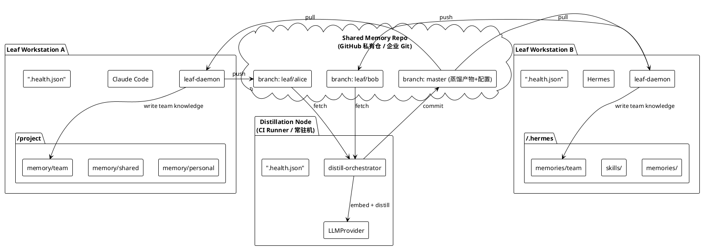
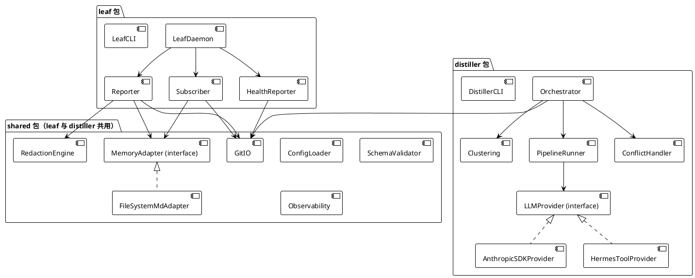
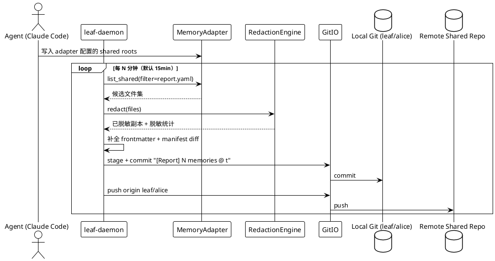
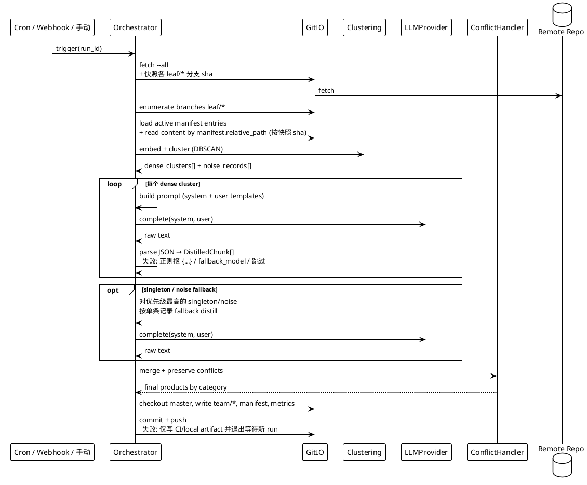
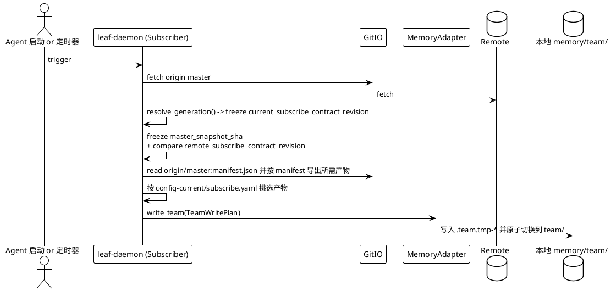
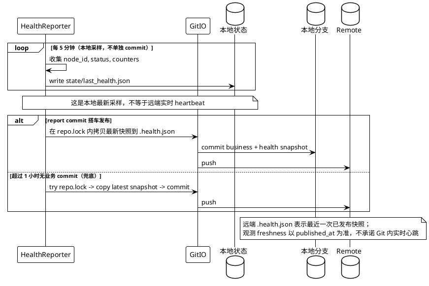

# Agent 原生组织记忆架构 (aomt) — MVP 技术方案

> 目标读者：codex 实现者
> 版本：MVP-0.1.0
> 编写时间：2026-04-20
> 对应愿景文档：`VISION.md`（组织记忆蒸馏部分）

---

## 0. TL;DR（给实现者的一页概览）

- **目标**：10 人量级单团队内跑通 "叶子节点上报记忆 → 蒸馏节点聚合产出 → 下发回叶子节点" 的完整 loop，并能支撑"蒸馏 prompt 调优"这一核心迭代动作。
- **骨架**：**两仓模型**。**当前代码仓（即本仓库 `aomt`）**承载 Python 包 / 安装脚本 / CI；**共享 memory 仓库**（默认 GitHub，可替换企业 Git）作为传输介质，叶子节点写 `leaf/<node-id>`，蒸馏产物写 `master`。
- **抽象**：`MemoryAdapter`（读写各 Agent 的 md 记忆）+ `LLMProvider`（蒸馏引擎可切，支持 SDK / Hermes / OpenAI 兼容三实现）。
- **默认覆盖的 Agent**：M1 只承诺 Claude Code + 项目内 `memory/shared/` 跑通；Hermes、OpenCode、Codex、Openclaw 在 M3 以官方路径验证 + fixture 形式加入。所有 Agent 仍优先复用同一个 `FileSystemMdAdapter`，差异只在 adapter YAML。
- **不做的事**：实时上报、自动冲突裁决、非 md 记忆的适配、跨团队递归蒸馏（全部留扩展点）。
- **运行前提**：`git` + `python 3.11+`；不依赖 `systemctl` / `sudo` / `docker`，sandbox 友好。
- **叶子节点集成成本**：一条 `curl | bash` 命令，daemon 自动起。

---

## 1. MVP 范围界定与判断依据

### 1.1 我们做什么

| 编号 | 能力 | 说明 |
|---|---|---|
| F1 | 叶子节点一条命令集成 | `install_leaf.sh` 自动建分支、拉配置、装 daemon |
| F2 | daemon 定时上报 | 扫描记忆目录 → 过滤 → 脱敏 → commit → push 到本分支 |
| F3 | daemon 定时下发 | `fetch origin/master` 后导出蒸馏产物到本地 `memory/team/` |
| F4 | CI/Cron 触发蒸馏 | fetch 所有叶子分支 → 聚类 → LLM 蒸馏 → commit master |
| F5 | 健康元数据 | 每分支根目录 `.health.json`，daemon 定时刷新，Git 即"监控总线" |
| F6 | 多 Agent 适配器 | M1 覆盖 Claude Code；M3 再通过 adapter YAML 覆盖 Openclaw / Hermes / OpenCode / Codex。每个新增 adapter 必须配官方路径依据与 fixture，不再只靠假设 |
| F7 | 规则全配置化 | 上报/脱敏/蒸馏/下发四份 YAML + adapter YAML，所有规则外挂 |
| F8 | 可观测性 | 结构化日志 + `--dry-run` + LLM 调用录制/重放 + 本地端到端测试 repo |

### 1.2 我们显式不做什么（为了 MVP 可落地）

| 不做 | 原因 | 扩展点 |
|---|---|---|
| 实时/事件驱动上报 | 无 MVP 价值，架构复杂度跳升 | § 12.4 |
| 原始对话日志上报 | token 噪声大、隐私风险高、需额外提炼层 | § 12.2 |
| 自动冲突裁决 | 裁决规则无数据支撑 | § 7.4 preserve_both + § 12.3 |
| 跨团队递归蒸馏 | 权限/拓扑复杂度高，MVP 无法验证收益 | § 12.1 |
| 非 md 记忆自动接入 | `MemoryAdapter` 接口留着，MVP 不实现具体类 | § 5.1 + § 12.2 |
| MCP Server 按需查询 | Agent 侧集成复杂 | § 12.4 |
| 细粒度 ACL/多租户 | Git 仓库权限足够 | — |

### 1.3 核心判断（为什么是这套方案）

1. **Git 对 md 文件是压倒性最佳介质**：天然 diff、分支隔离、审计日志、离线可用、运维零成本、与各 Agent 的现有工作区同构。MVP 规模（<30 叶子、分钟级 push）不会碰 git 规模天花板。
2. **MVP 不绑定任何单一 Agent 记忆方案**：首条可交付路径用 Claude Code + 项目内 `memory/shared/` 作为稳定输入面；Hermes / OpenCode / Codex / Openclaw 的官方记忆文件位置可能随版本变化，必须以 adapter YAML + fixture 锁定后再声明支持。`FileSystemMdAdapter` 是默认实现，但不是“无需验证即可全覆盖”的假设。
3. **蒸馏节点当 CI Runner 用**：无常驻进程，无额外基础设施；失败日志、artifact、秘密管理直接蹭 CI。MVP 推荐先用 CI Runner 直接跑 `distiller` 主程序，后续再接 Hermes-as-Distiller 作为可切换路径。
4. **Token 成本控制遵循 "上报零 LLM、蒸馏两级"**：上报纯规则；蒸馏先本地 embedding 聚类再对每簇调 LLM，单次预算可控可预测。
5. **双分区 + 冲突保留**：叶子本地 `personal/ + shared/ + team/`；蒸馏遇分歧时在**同一主题产物**内并列保留双方立场，显式标注"存在分歧"，不自动裁决。

---

## 2. 术语与角色

除 `VISION.md` 术语外，本方案新增/明确：

| 角色 | 说明 |
|---|---|
| **Leaf Node（叶子节点）** | 成员机器上的进程集合：Agent（Claude Code/Hermes/…）+ `leaf-daemon`。daemon 负责上报、下发、健康。 |
| **Distillation Node（蒸馏节点）** | CI Runner / 常驻机 / 某成员机器上的进程。定时拉所有叶子分支、聚合蒸馏、写回 master。 |
| **Shared Memory Repo** | 团队共享 Git 仓库。默认 GitHub 私有仓，可替换为任意 Git 平台。 |
| **MemoryAdapter** | 把各 Agent 长期记忆格式抽象为统一接口的适配层。 |
| **LLMProvider** | 把"调用 LLM 做蒸馏"抽象为接口（SDK 直连 / Hermes Agent as tool / OpenAI 兼容 三种实现）。蒸馏策略直接在 `pipeline.py` 内实现，不额外加 Engine 抽象。 |

---

## 3. 总体架构

### 3.1 网络拓扑



### 3.2 核心组件视图



### 3.3 关键数据流

#### 3.3.1 上报时序



#### 3.3.2 蒸馏时序



#### 3.3.3 下发时序



#### 3.3.4 健康上报时序



---

## 4. Git 仓库设计

### 4.1 仓库布局


> 本节只描述**共享 memory 仓库**。实现代码、`pyproject.toml`、`scripts/install_leaf.sh`、测试与 CI workflow 位于**当前代码仓（即本仓库 `aomt`）**；叶子安装时是"先从当前代码仓装程序，再克隆共享 memory 仓库传输数据"。**运行时单一真相源**是共享 memory 仓库 `master` 上的 `config/` 与 `prompts/`；当前代码仓里的同名目录只用作 bootstrap 模板、fixture、测试与 CI 校验，不参与运行时决策。本机专属参数（`node_id`、`install_id`、本地路径、interval）不进入 generation，而是独立保存在 `~/.memory-net/local.yaml`。`local.yaml` 只允许承载**本机白名单字段**，不得回写或覆盖 `config_revision`、`config_source_master_sha` 之类 generation 元数据。

两类分支：

- **`master`**：蒸馏产物 + 蒸馏节点 `.health.json` + **全局配置/Prompt（单一真相源）**。它是**双写者分支**：`distiller-bot` 只负责 `team/`、`manifest.json`、`distill_runs/`、`.health.json`；配置维护者只负责 `config/`、`prompts/`、`bootstrap_state.json`。**双写者竞态防护**（MVP 必做）：
  - distiller run 开始时冻结 `master_snapshot_sha = rev-parse origin/master`；
  - 同时从该快照导出 `config_revision = canonical_generation_hash(bootstrap_state.json + config/* + prompts/*)`；`config_revision` 用于 leaf generation 与运行时追踪，`master_snapshot_sha` 只用于本轮 provenance / fast-forward 校验；
  - push master 前必须重新 `git fetch origin` 并校验 `origin/master` **仍然严格等于** `master_snapshot_sha`；一旦不相等，就说明当前 run 基于过时快照生成了产物，必须走 superseded 分支；
  - 若远端已推进（配置维护者合入了 `config/*` PR，或上一轮 distill 已先行更新 master），push 失败路径见 § 7.2 "Master push 失败处理"：本 run 直接标记 `config_drift_superseded`，不 rebase 重推，由下一轮 run 基于新 `master_snapshot_sha` 重算；
  - 配置维护者 PR 必须触发一次 CI 校验，确保新 `config/*` 与当前 `products_active` schema 兼容（否则 PR 阻塞合入）。
  - **路径白名单校验是必做的实现约束**：distiller 直推 `master` 前，CI/本地校验必须断言 diff 只触及 `team/`、`manifest.json`、`distill_runs/`、`.health.json`；配置维护者路径则必须断言 diff 只触及 `config/`、`prompts/`、`bootstrap_state.json`。GitHub/GitLab/Gitea 的 branch protection 只能做分支级保护，**不能**替代这条路径级契约。
- **`leaf/<node-id>`**：每叶子节点一条长存分支，持有该节点上报 md + `.owner.json` + 自身 `.health.json`。**新建 leaf 分支必须从 orphan 空树初始化**；已有远端 leaf 分支只能跟踪 `origin/leaf/<node-id>`，不能从 `master` 派生。

#### `leaf/<node-id>` 分支目录

```text
/
├── .owner.json                     # 叶子分支所有权（install_id / host / claimed_at）
├── .health.json                    # 叶子健康
├── memories/
│   └── <category>/<slug>-<revision8>.md   # 已脱敏上报的 md（文件名随 revision_hash 变化）
├── manifest.json                   # 本分支 active entries + tombstones 索引
├── .gitignore
└── README.md                       # 叶子分支说明（自动生成）
```

#### `master` 分支目录

```text
/
├── .health.json                    # 蒸馏节点健康
├── bootstrap_state.json            # 共享仓 bootstrap 完成标记 + 协议兼容声明
├── team/
│   ├── common_knowledge/*.md
│   ├── best_practices/*.md
│   ├── shared_qa/*.md
│   ├── risk_signals/*.md
│   └── open_questions/*.md
├── manifest.json                   # 蒸馏产物全集索引
├── distill_runs/<run_id>/
│   ├── metrics.json
│   ├── cluster_report.json
│   ├── snapshot.json
│   ├── unclustered.json
│   └── llm/*.json                  # --record 模式时才有
├── config/                         # 运行时全局配置，单一真相源
│   ├── report.yaml
│   ├── redaction_patterns.yaml
│   ├── distill.yaml
│   ├── subscribe.yaml
│   ├── platform.yaml
│   ├── observability.yaml
│   └── adapters/*.yaml
└── prompts/                        # 运行时 prompt，单一真相源
```

**运行时解析规则**：
- leaf 侧只从 `origin/master` 快照同步 `config/` + `prompts/` + `bootstrap_state.json`，再落到本机 `~/.memory-net/config.generations/<config_revision>/`；
- leaf 侧运行时配置解析顺序固定为：`config-current/*`（远端只读 generation）+ `~/.memory-net/local.yaml`（本机 overlay）；`subscribe_task` 也必须走这条路径，不能临时直读远端 `subscribe.yaml`；
- `local.yaml` 只允许覆盖本机字段白名单（如 `node_id`、`install_id`、`agent`、`agent_root`、调度 interval、日志开关）；实现必须忽略其中任何 generation 元数据键，避免本地 overlay 污染当前激活版本；
- `config_revision` 不是 `master` commit SHA，而是**配置内容哈希**：基于同一个 `origin/master` 快照里的 `bootstrap_state.json`、`config/*`、`prompts/*` 计算出的 content hash。计算前必须先映射为 leaf 本地 generation 的 canonical layout：`bootstrap_state.json` 保持根路径，`config/<name>` 映射为 generation 根目录下的 `<name>` / `adapters/*`，`prompts/*` 保持 `prompts/*`。所有调用方按这个 canonical 相对路径排序并拼接 `{path}\0{bytes}\0` 后做 hash。蒸馏产物、`.health.json` 等无关写入若不改这三类内容，不得触发 generation 轮换；
- `subscribe_task` 允许从 `master_snapshot_sha` **只读**计算 `remote_subscribe_contract_revision` 作为漂移检测；它只覆盖 leaf 消费契约（`bootstrap_state.json` 中与 leaf 消费相关的门禁字段、`subscribe.yaml`、以及 adapter 中 `write_team` / `team_target` 所依赖的消费字段），**不**覆盖 `report.yaml`、`distill.yaml`、蒸馏 prompts 等与下发无关的配置。generation 的**创建、校验、激活**只允许由 `config_sync_task` 负责；`subscribe_task` 自身不得临时落盘或切换 generation；
- distiller 侧必须先冻结一个 `master_snapshot_sha`，本轮所有 `config/*` 与 `prompts/*` 都用 `git show <master_snapshot_sha>:...` 读取；**不允许** run 中途跟着 `master` 漂移；
- 当前代码仓中的 `config/` / `prompts/` 只能作为模板或测试样例，CI 负责检查其与共享仓 schema/version 不漂移。

**协议版本约束**：
- `bootstrap_state.json` 不只是“是否 bootstrap 完成”，还声明共享仓协议版本，例如 `schema_version`、`compatible_build_api_range`、`compatible_code_range`、各核心文件 schema 版本。
- leaf / distiller 启动时都必须先校验 `bootstrap_state.json` 与本地 build 身份兼容；不兼容则拒绝运行，而不是带病继续。
- 兼容规则：新增字段必须向后可忽略；删除字段或改变语义必须升 major，并通过 `bootstrap_state.json` 阻止混跑。
- distiller 读取 leaf `manifest.json` / `.health.json` 时，若 schema 不兼容，必须把该 leaf 标记为 `incompatible` 并写入 metrics/health；不能静默跳过。
- 还要显式区分两条消费面：`leaf -> distiller` 与 `master -> leaf`。后者要求 `subscribe_task` 每次消费前校验 `master/manifest.json` 和团队产物 frontmatter 的 schema/version；若不兼容，必须 **fail closed**，保留本地旧 `memory/team/`，禁止按 `replace` 语义清空。
- 安装阶段、每次 `config_revision` 切换、以及 `subscribe_task` 消费前，都必须重新跑这套门禁；不能只在首次安装时校验一次。

### 4.2 分支命名与权限


| 分支 | 可写者 | 规则 |
|---|---|---|
| `master` | `distiller-bot` + 配置维护者（GitHub branch protection + deploy key / PR + CODEOWNERS） | 禁 force-push；`distiller-bot` 只写产物区，配置维护者只经 PR 改配置区；CI 必须配置 single-flight / concurrency group，且两条写路径都要过**路径白名单校验** |
| `leaf/<node-id>` | 该叶子节点的**单一活跃 install_id** | 默认禁 force-push；daemon 运行期只做 fast-forward push；**MVP 不允许盲目 takeover，也不提供自动 stale reclaim**；重装/迁移只能复用原 `install_id` 恢复、改 `node_id` 重新安装，或按 runbook 人工回收后再装 |

`<node-id>` 命名：`<person>-<agent>-<instance>`，如 `alice-claudecode-01`。支持一人多 Agent、一 Agent 多实例。

**安全边界说明**：
- MVP 的 `leaf/<node-id>` 所有权是**应用层单 writer 协议**，不是 Git 平台默认提供的强隔离 ACL。
- 也就是说，`.owner.json` + `install_id` 的目标是**防误操作和防重复安装**，不是防恶意客户端或凭证泄漏；持续写入期的唯一硬门禁是 `install_id`，`owner_fingerprint` / `host` 只用于安装时的同机恢复判定与审计。
- `master` 必须依赖平台强保护；`leaf/*` 若需要强隔离，需额外部署”每节点独立凭证 + 分支级 ACL / pre-receive hook / 自建 Git 服务端校验”。
- 叶子客户端每次 push 前必须校验：目标分支名匹配本机 `node_id`，且远端 `.owner.json.install_id` 未变化；任一条件不满足都进入冲突恢复流程，而不是继续重试。
- `MEMORY_NET_HOME` 必须位于本机文件系统；NFS/SMB/CIFS 等共享盘不受支持。启动期需检测已知非本机文件系统并直接 abort，避免 `fcntl` 锁和 `install_id` owner gate 在跨 host 共享状态目录时失效。

**leaf 分支防投毒（发布契约与硬化边界）**：
- **威胁**：任何持仓库 write 权限的内部人员都可 `git push origin leaf/<任意 id>`，可创建 `leaf/ghost-*` 塞伪造记忆；经 distill 聚类后产物 `replace` 自动下发 = 全网污染广播。
- **MVP 基线契约**：本文件 § 7.2–§ 7.6 只描述**一种**发布路径：distiller 直接生成并 fast-forward push `master`。这条路径适用于**小规模、受信任集群**，目标是先把蒸馏规则、分发与调试链路跑通。
- **额外硬化选项**（会改变发布状态机，**不属于当前 MVP 基线路径**；若启用，需在实现时把 `release/*` / 审核态 / quarantine 态补成正式状态机）：
  1. **平台层 pre-receive hook（推荐）**：部署在共享 memory 仓库的 Git 服务端（自建 Gitea/GitLab/企业内部 Git 均支持）。hook 校验 `push_user` 的身份凭证指纹是否在 `leaf/<node-id>` 的允许列表中；GitHub SaaS 场景用 Ruleset + deploy key per-branch 近似实现（每节点独立 deploy key，只允许该 key push 对应 `leaf/<node-id>`）。
  2. **产物 PR review gate**：distiller 把产物写到 `release/<run_id>` 分支，由 CODEOWNERS 审核后再 PR 合并到 `master`；自动化场景用 bot + 自动化规则白名单（如”所有 contributors ≥ 2 且无 conflicts 的产物自动合”）。
  3. **新产物观察期 / quarantine**：新 `topic_id` 先进入隔离区，连续 N 次 run 无人工反对后再转入 `products_active`。
- 若团队对内部投毒风险敏感，应优先启用 #1；#2/#3 作为后续增强放入 § 13.3，而不是和当前 direct-to-master MVP 混写成同一默认状态机。

### 4.3 从 GitHub 替换到企业内部 Git

就**共享 memory 仓库**而言，系统对 Git 平台的耦合仅两处：

1. **`GitIO` 模块**：只调用 `git` CLI；凡支持 SSH/HTTPS push 的平台都兼容。
2. **蒸馏节点鉴权**：在 CI 层（GitHub Actions `GITHUB_TOKEN` / GitLab `CI_JOB_TOKEN` / Gitea deploy key / 常驻机 SSH key）。

替换步骤：

1. 目标平台建空仓，推送 master。
2. 改 `config/platform.yaml` 的 `remote_url`、`platform`、`ci_provider` 字段。
3. 蒸馏触发器：`.github/workflows/distill.yml` → 对应平台的 CI 描述文件（`.gitlab-ci.yml` / `Jenkinsfile` / 常驻机 crontab）。
4. 叶子 `install_leaf.sh --repo <url>`，URL 参数变更即可。

**鉴权具体路径（MVP 推荐）**：

| 平台 | 蒸馏节点 push master 方式 | master 保护配置要点 |
|---|---|---|
| GitHub | Deploy key（write）专用于 distiller-bot；Actions 用 `ssh -T git@github.com` | Branch protection: 允许指定 deploy key 绕过 PR 要求；关闭 force-push；启用"Require linear history" |
| GitLab | Project Access Token（maintainer 级），CI 变量 `CI_PUSH_TOKEN`，`git push https://oauth2:${CI_PUSH_TOKEN}@…` | Protected branches：master 允许 maintainer 角色 push |
| Gitea / 自建 | Deploy key（write），同 GitHub 思路 | 分支保护允许 deploy key bypass |
| 常驻机 | 系统账号 `distiller` 的 SSH key（`~/.ssh/id_ed25519`，权限 `0600`） | — |

**叶子节点鉴权**：默认 SSH key（`~/.ssh/id_ed25519`）；HTTPS 路径使用 `git credential-store --file ~/.memory-net/.git-credentials`（明文自管，权限 `0600`）。不使用 `git credential-cache`——其 Unix socket 在部分 sandbox 中被禁。

**可选增强模式（非 MVP 强制）**：若团队有自建 Git 能力，可在服务端增加 pre-receive hook，校验 `leaf/<node-id>` 只能被声明该 `node_id` 的 deploy key / token 推送，把应用层 owner 协议升级为平台层强约束。

---

## 5. 抽象层设计

### 5.1 `MemoryAdapter` 接口


```python
# memory_net/shared/adapters/base.py
from abc import ABC, abstractmethod
from dataclasses import dataclass
from pathlib import Path
from typing import Iterator

@dataclass(frozen=True)
class MemoryRecord:
    memory_id: str | None       # 稳定逻辑 ID；源文件若未显式声明，可在 Reporter 首次分配前为 None
    source_locator: str | None  # <root_alias>:<path_relative_to_base_dir>，跨多 root 稳定定位
    relative_path: Path         # 相对命中的 root_alias 的路径
    content: str                # 完整 md（含 frontmatter）
    frontmatter: dict           # 解析后的 frontmatter
    scope: str                  # personal / shared / team / skill

@dataclass(frozen=True)
class TeamProduct:
    relative_path: Path          # master manifest 中的 team/... 相对路径
    content: str                 # 完整 md（含 frontmatter）
    frontmatter: dict
    category: str
    distillation_id: str

@dataclass(frozen=True)
class TeamWritePlan:
    products: list[TeamProduct]
    config_revision: str
    merge_strategy: str          # replace / preserve_local
    include_index: bool = True   # 写稳定 INDEX.md，供 Agent hint 引用

class MemoryAdapter(ABC):
    @abstractmethod
    def list_shared(self) -> Iterator[MemoryRecord]: ...

    @abstractmethod
    def write_team(self, plan: TeamWritePlan) -> None: ...

    # --- 以下为 MVP 明确列出的扩展点，默认实现可由 FileSystemMdAdapter 提供 ---
    @abstractmethod
    def inject_team_hint(self, hint_spec: "TeamHintSpec") -> "HintInjectionResult": ...
    @abstractmethod
    def remove_team_hint(self, hint_spec: "TeamHintSpec") -> "HintRemovalResult": ...

    def iter_entries_with_hash(self) -> Iterator["MemoryEntry"]:
        """按 'adapter 原生条目粒度' 迭代并返回 (memory_id 候选, revision_hash, content)。

        默认实现走文件级（FileSystemMdAdapter）。当 adapter YAML 配置
        split_by (heading_h2 / marker / none) 时，本方法可按条目粒度切分，
        避免把长 MEMORY.md 当成单条输入喂给蒸馏。MVP 默认 split_by=none。"""
        raise NotImplementedError

    def read_by_memory_id(self, memory_id: str, revision_hash: str) -> str | None:
        """在 master 写入 citations 时用以反查原文。默认应基于 snapshot_ref + leaf manifest 定位。"""
        return None
```

**约束**：
- 多 root adapter 必须给每个 root 一个稳定 `alias` 与稳定 `base_dir`；`source_locator` 由 `alias:path_relative_to_base_dir` 组成，后续 `memory_id` 复用与 rename/move 判断都以它为准。修改 alias 或把 `base_dir` 指向另一棵逻辑目录，视为破坏兼容性的配置变更。
- adapter YAML 禁止把 glob pattern 直接当 root。必须写成 `base_dir + include[] + exclude[]`，所有命中的文件路径都先相对 `base_dir` 规范化，再生成 `source_locator`。这样 `**/*.md`、单文件和多目录扫描都共享同一套稳定定位规则。
- **`include[]` 与 `exclude[]` 的 `**` 必须是同一套语义**：都表示"零个或多个路径段"。
  这条不是风格约定，而是安全约束——两侧语义不一致时，一条看起来生效的 exclude 会在
  某些深度上静默失效，而失效方向是"多收"，即把本该留在 agent 私有侧的文件送进蒸馏输入。
  实现上 include 走 `Path.glob`（`**/` 本就匹配零段），exclude 走 `fnmatch`，而 `fnmatch`
  会把 `**/` 翻译成必须吃掉一个真实分隔符的形式，因此 `**/draft/**` 匹配 `a/draft/x.md`
  却**匹配不到受管根顶层的** `draft/x.md`。匹配器必须显式补齐这个零段情形，禁止靠在 YAML 里
  同时写 `draft/**` 和 `**/draft/**` 来绕过——双写只是把缺陷藏进配置，下一份 adapter YAML
  会原样再踩一次。零段补齐对 `**/` 出现的**任意位置**都成立（`foo/**/draft/**` 必须命中
  `foo/draft/x.md`），不能只特判开头——只修开头等于把同一个陷阱留给下一份配置。
  回归测试对每条目录型 exclude 都必须同时覆盖**顶层与嵌套**两个位置。
- exclude 是**纵深防御，不是第一道闸**。真正决定收集面的是 `include[]` 的 glob：没被它枚举出来的
  文件根本走不到后面任何一层。其后依次还有 `file_pattern`（默认 `*.md`）的文件名匹配与隐藏路径
  （任一路径段以 `.` 开头）跳过，最后才是 exclude。因此在 `include` 为 `**/*.md` 时，对非 `.md`
  后缀（如 `*.sqlite` / `*.lock`）或隐藏文件（如 `.env`）写 exclude 只有声明价值，运行期不会被执行到
  ——**文档与测试不得把这类条目说成"被 exclude 拒绝"**，否则会造出一条无人验证却被当作有效的防线；
  描述时必须点名当下真正生效的那一层。
- `inject_team_hint` / `remove_team_hint` 是 § 6.4 hint 状态机的唯一合法入口，实现必须幂等（重复调用同 `hint_spec` 返回相同结果），并保证"只动 anchor 块内，不碰 anchor 外的用户内容"。
- `iter_entries_with_hash` 的粒度默认为**整文件**（MVP 可用）；对 Hermes `MEMORY.md` / Claude Code 单文件多段记忆这类"append-only 笔记"场景，adapter YAML 可声明 `split_by: heading_h2` / `marker: "^---$"` 让 adapter 按二级标题或自定义分隔符切成多个 `MemoryEntry`，每个 entry 独立计算 `revision_hash`，避免一段局部改动翻新整文件。`split_by` 的具体语义与兼容性保证见 § 13.1。

### 5.2 默认实现：`FileSystemMdAdapter`（配置驱动）


MVP 不为每个 Agent 写独立类，而是用**一个配置驱动的通用实现** + 一份 adapter YAML。**新增 Agent ≡ 新增一份 YAML**。

```yaml
# config/adapters/claude-code.yaml
name: claude-code
roots:
  personal:
    # 官方 Claude Code 记忆面以 CLAUDE.md 为核心；MVP 默认不采集 personal。
    - alias: claude-user-memory
      base_dir: "~/.claude"
      include: ["CLAUDE.md"]
  shared:
    # M1 的稳定输入面：memory-net 自己管理的项目共享记忆目录。
    - alias: claude-project-shared
      base_dir: "${AGENT_ROOT}/memory/shared"
      include: ["**/*.md"]
      exclude: ["**/draft/**"]
team_target: "${AGENT_ROOT}/memory/team"
file_pattern: "*.md"
frontmatter_required: false
team_hint_injection:
  mode: install_once              # install_once / never / manual
  target: "${AGENT_ROOT}/CLAUDE.md"
  install_once_default: "${AGENT_ROOT}/CLAUDE.md"
  fallback_targets:               # 首个存在且可写即命中；都不命中则落到 install_once_default
    - "${AGENT_ROOT}/AGENTS.md"
    - "${AGENT_ROOT}/README.md"
  anchor_start: "<!-- memory-net-hint:start -->"
  anchor_end: "<!-- memory-net-hint:end -->"
  content_template: |
    Team knowledge is synced by memory-net.
    Use the stable index entry:
    @memory/team/INDEX.md
```

```yaml
# config/adapters/hermes.yaml —— 实际发布版（experimental）
# 设计校准（2026-06，依据本机真实布局只读核验，零额度）：
#   · hermes 真实记忆面：~/.hermes/memories/{MEMORY.md,USER.md} + ~/.hermes/SOUL.md，
#     且 *.md 旁会并存 *.lock（如 MEMORY.md.lock / USER.md.lock）。
#     codex 真实记忆面：~/.codex/memories/ 是一个 git 仓库（含 .git/ 与 memories_1.sqlite）。
#   · 隐私设计（不可回退）：上报只走 shared 面，且 shared root 固定为 memory-net 自管约定目录
#     ${AGENT_ROOT}/memory/shared，**不**指向 agent 原生全局库。`MemoryAdapter` 接口本身
#     没有 list_personal —— personal 在结构上永不被采集（硬保证，详见 §5.1）。
#   · 因此早期草案里"把 ~/.hermes/SOUL.md、USER.md 当 personal root 采集、把 ~/.hermes/skills
#     当 shared 采集"的写法已废弃；发布版仅保留 shared 约定根。
#   · support_status=experimental：codex/hermes 是否真的尊重 AGENTS.md 的 @import 语义尚未验证
#     （需一次自愿的、消耗额度的真实 agent 运行）。验证前不静默升格为 stable；加载时必须显式
#     opt-in：环境变量 MEMORY_NET_ALLOW_EXPERIMENTAL_ADAPTER=1，否则 from_yaml 直接拒绝。
name: hermes
support_status: experimental
roots:
  shared:
    - alias: hermes-shared
      base_dir: "${AGENT_ROOT}/memory/shared"
      include: ["**/*.md"]
      # .git/.cache 由 DEFAULT_EXCLUDES + 隐藏目录跳过兜底；*.lock 一条为声明式——
      # include 为 **/*.md 时它不会被执行到，放宽 include 后才承重
      exclude: [".git/**", "**/.git/**", ".cache/**", "**/.cache/**", "**/*.lock"]
team_target: "${AGENT_ROOT}/memory/team"
file_pattern: "*.md"
frontmatter_required: false
team_hint_injection:
  mode: install_once
  target: "${AGENT_ROOT}/AGENTS.md"
  install_once_default: "${AGENT_ROOT}/AGENTS.md"
  content_template: |
    @memory/team/INDEX.md
```

`config/adapters/codex.yaml` 与 hermes 同构：shared 约定根 + `support_status: experimental` +
同款 `exclude`（含声明式的 `**/*.lock`，见上），hint 目标同为 `${AGENT_ROOT}/AGENTS.md`。
`openclaw.yaml` / `opencode.yaml` 亦各一份。**每新增一个 Agent ≡ 新增一份 YAML**
（呼应 §2 约束：规则全外挂，代码不硬编码任何 agent 专属路径或蒸馏行为）。
上述真实布局与"约定 shared 根 / 无 list_personal"的隐私不变量，由
`tests/unit/test_adapter_calibration.py` 锁定（含 personal-scope 隐私回归测试）。

**`openclaw.yaml`：路径依据已取得（openclaw 2026.3.2 真实安装只读实测）**。载入配置的三条布局事实：

- agent 工作根是 `<openclaw home>/workspace/`，因此 `AGENT_ROOT` 指向该目录；
- 该根下的 `AGENTS.md` 是每会话被消费的指令文件（其正文自述读取顺序 `SOUL.md → USER.md → memory/YYYY-MM-DD.md → MEMORY.md`），故作为 hint 目标；
- 原生记忆库是 sqlite sidecar `<openclaw home>/memory/main.sqlite`，位于受管根 `${AGENT_ROOT}/memory/shared` 的**父目录层级**；原生日更笔记 `${AGENT_ROOT}/memory/YYYY-MM-DD.md` 则是受管根的**兄弟**。两者都不在受管根的相对 glob 射程内；`.env` / `credentials/` / `logs/` / `agents/` 同理。

关于「错放进受管根内的副本」这一层纵深防御，必须按实际生效的机制描述，不得笼统说成「由 `exclude` 二次拒绝」：
`credentials/` / `logs/` / `agents/` 下的 `.md` 确实由 `exclude` 拒绝（`**/` 前缀在顶层与嵌套两处都生效，见 § 5.1）；
而 `main.sqlite` 与 `.env` 走不到 `exclude` —— 真正生效的那道闸是 `include` 的 `**/*.md`：
`Path.glob` 根本不会枚举出这两个文件，因此其后的任何过滤器都没有发言权
（`file_pattern: "*.md"` 与隐藏路径跳过同样会拒绝它们，但今天是冗余层，只有放宽 `include` 后才承重）。
`exclude` 里保留这两条属**声明式**条目，作用是将来放宽 `include` 时不会悄悄开始收集原生库与密钥文件。

脱敏布局快照存放在 `tests/fixtures/adapters/openclaw/`（内容全部为中性样例；真实 `.env` 因仓库禁止跟踪该文件名而以 `_dotenv` 占位，测试物化临时目录时改回原名），
读路径回归由 `tests/unit/test_openclaw_adapter.py` 锁定。**该依据不含"hint 被真实消费"的证据**（未做真实 agent 运行），故 `support_status` 保持 `experimental`。

**`opencode.yaml`：路径依据未取得**——开发环境无 opencode 安装可供只读核验，取得依据需新装 CLI（属需人工批准的外部动作）。因此该 YAML 首行必须写明 `EXPERIMENTAL / UNVERIFIED: template only`，并注明受管根 `${AGENT_ROOT}/memory/shared` 是 memory-net 约定目录而非实测发现，以及威胁模型（越界读取会把 agent 私有状态/凭据暴露给蒸馏侧）。升级为已校准 adapter 需一次真实安装 + 一次被消费验证。

**元规则（防复发）**：任何 `support_status: experimental` 且既没有 `tests/fixtures/adapters/<name>/` 布局 fixture、也没有被校准测试登记的 adapter YAML，**首行必须带 UNVERIFIED banner**。仅靠 `support_status` 不够——它只表达"需显式 opt-in"，不表达"路径是实测还是假设"，集成者需要区分二者。该元规则由 `tests/unit/test_agent_adapters.py` 中的元测试强制，对将来新增的 adapter 同样生效。

`source_locator` 固定为 `<root_alias>:<path_relative_to_base_dir>`；`root_alias` 与 `base_dir` 一旦发布，不应在后续小版本里随意更名或改变语义。新增扫描范围时优先新增 root alias，不要复用旧 alias 指向另一棵目录。

**`team_hint_injection.mode` 语义必须落到实现状态机**：
- `install_once`：安装阶段若目标文件尚未带有受管 anchor，则允许注入一次；后续只有在 `hints_state.json` 标记当前块仍为“受管状态”且 adapter 配置签名变化时，才允许自动 re-inject。
- `manual`：安装脚本与 `config_sync_task` 都**不得**自动注入/重注入；只允许显式 `leaf-daemon hints inject|remove`。
- `never`：该 adapter 禁用一切新的 hint 注入；安装脚本与自动路径都直接 skip。若历史上已存在受管块，则允许 `config_sync_task` 或管理员显式 `hints remove --force` 做**一次性清理**，清理后把状态记为 `disabled_by_mode`。

### 5.3 `LLMProvider` 接口

```python
# memory_net/distiller/llm/base.py
from abc import ABC, abstractmethod
from dataclasses import dataclass

@dataclass
class LLMResponse:
    text: str
    input_tokens: int
    output_tokens: int
    cache_read_input_tokens: int = 0       # Anthropic prompt caching 命中量
    cache_creation_input_tokens: int = 0   # 本次写入 cache 的 token 量
    model: str = ""                        # 实际响应模型名，用于成本归因
    raw: dict = None

@dataclass
class PromptBlock:
    """用于 Anthropic prompt caching：把 system/user 拆成 cacheable 块。"""
    text: str
    cache: bool = False                    # True → 该块打上 cache_control=ephemeral

class LLMProvider(ABC):
    @abstractmethod
    def complete(
        self,
        system: str | list[PromptBlock],
        user: str | list[PromptBlock],
        *,
        response_format: str = "text",      # "text" / "json"：json 时 provider 负责强约束
        cache_hint: bool = True,            # 实现可整体 opt-out caching
        **kwargs,
    ) -> LLMResponse: ...

    @abstractmethod
    def embed(self, texts: list[str]) -> list[list[float]]: ...
```

- `system`/`user` 支持 `PromptBlock` 列表形态；`AnthropicSDKProvider` 把 `cache=True` 的块转为 `cache_control={"type":"ephemeral"}`；不支持 caching 的 provider 忽略该字段。
- `response_format="json"` 时 provider 必须以最强可用手段约束 JSON 输出（Anthropic 侧通过 system prompt 追加"only JSON"指令 + stop sequence；OpenAI-compat 侧用 `response_format={"type":"json_object"}`）。蒸馏 pipeline 仍保留 § 7.2 三级 fallback。
- `LLMResponse.cache_read_input_tokens / cache_creation_input_tokens` 属于后续
  prompt-cache fidelity 指标，当前 MVP-core 不要求 provider 暴露或写入该字段。

#### 5.3.1 计量溯源（provenance）字段契约

上面的 `complete()/embed()/PromptBlock` 是目标态；**当前实现的抽象方法是
`generate(LLMRequest) -> LLMResponse`**（`memory_net/distiller/llm/base.py`），
本节定义的 provenance 契约以该实现形态为准，两者的其余差异归 §5.3 目标态路线图。

`LLMResponse` 除 `text` / `model` / `usage` 外，带三个**独立的顶层 provenance 字段**：

| 字段 | 类型 | 默认 | 语义 |
|---|---|---|---|
| `usage_source` | `str` | `"unknown"` | 本次调用的 token 计数来源，取值域**固定为** `reported`（服务端返回的真实用量）/ `estimated`（本地估算）/ `unknown`（无法判定）。传入取值域外的值直接 `ValueError`。 |

**`reported` 由 `LLMResponse.__post_init__` 强制校验，不信任任何 provider 的自我申报**：
只有 `usage` 里 `input_tokens` 与 `output_tokens` **两个都是非负整数**（显式排除 `bool`，
它是 `int` 子类）时才保留 `reported`，否则**降级为 `unknown`**。
理由是它是**唯一与钱直接挂钩**的 provenance 值：结算会按这两个数计费并回补预扣差额
（§5.5.2），所以补 0 的"reported"会低估花费，**负数更糟——会把已经记上的花费再减回去**。
把它放在契约对象里而不是逐个 provider 里，是因为这样任何 provider（含将来新增的）
都**无法**伪造这个声明。
**降级而非报错**：计数本身仍有保留价值，且在这里硬抛会把后端一次草率的响应变成一次崩掉的 run，
包括回放旧 bundle 的时候。
| `provider_backend` | `str` | `"unknown"` | 实际执行该调用的后端标识（自由字符串，如 `mock` / `hermes_tool`），用于 run 级聚合。**必须是 `str`**：非字符串直接 `TypeError`，空串直接 `ValueError`。 |
| `raw_meta` | `dict[str, str]` | `{}` | 仅存**字符串标量**的附加元数据（如模型版本、`finish_reason`）。禁止放原始响应体——那会凭空多出一个未经扫描的落盘面。非 mapping、非字符串键值都直接 `TypeError`。 |

两条硬约束：

1. **`usage` 的值域是 `int`**。这些 provenance 值**不得**写进 `usage`：消费方
   （如 `HermesToolProvider`）对 usage 逐值执行 `int(v)`，字符串值必抛 `ValueError`。
2. 三个字段**全部有默认值**（`raw_meta` 用 `default_factory`，禁止可变默认值），
   既有构造点无需修改即可继续工作。
3. `provider_backend` 的校验是**类型校验而非真值校验**。仅判真值会放行 `1`、`["x"]`
   这类非字符串值；它们一旦被录制进 bundle，replay 侧读取 provenance 标量时必抛
   `TypeError`，record→replay 往返就此断裂。把类型校验钉在构造点是唯一能让往返闭合的位置。

**每个 provider 都必须申报自己的 provenance**——留用默认值 `unknown` 等于让生产调用
在 run 级聚合里显示成"来源不明"，整条溯源链在真实路径上就是空的：

| provider | `provider_backend` | `usage_source` | `raw_meta` |
|---|---|---|---|
| `MockLLMProvider` | `mock` | `estimated`（token 数是词数估算） | `{}` |
| `AnthropicSDKProvider` | `anthropic_sdk` | 服务端返回了 usage 对象 → `reported`；拿不到 → `unknown`（此时 token 计数是补 0 的占位，不能谎称 reported） | `stop_reason` 与服务端回报的 `model`，仅字符串标量 |
| `HermesToolProvider` | 桥接进程申报的非空字符串，否则 `hermes_tool` | 桥接进程申报的合法取值，否则 `unknown`——桥接层无法代下游断言"这是服务端报告的"，因此**不得**默认成 `reported` | 桥接进程申报的字符串标量映射，否则 `{}` |

桥接协议（`memory_net/distiller/llm/hermes_tool.py` 的 stdout 契约、参考实现
`scripts/hermes-memory-distill`）相应扩展三个**可选**键
`usage_source` / `provider_backend` / `raw_meta`；不带这三键的旧桥接按上表回落，不报错。

MVP 提供三种实现（codex 先落 1 份 + 1 份备用即可）：

| 实现 | 用途 | 必要性 |
|---|---|---|
| `AnthropicSDKProvider` | 直连 Claude API；最简路径 | **M1c 必须** |
| `HermesToolProvider` | 进程外 agent 后端的**实验性**集成入口 | **experimental** |
| `OpenAICompatProvider` | 直连 OpenAI 兼容端点（DeepSeek 等）；**生产蒸馏后端** | **M4 必须** |

#### 5.3.2 `HermesToolProvider` 的定位：experimental 集成入口

`HermesToolProvider` 与参考桥接 `scripts/hermes-memory-distill` **不是生产蒸馏后端**，
也**不作为产物等价性的生产基准**。它们存在的意义是证明 `LLMProvider` 抽象能容纳一个
**进程外**后端；生产蒸馏走 `--provider deepseek`（`OpenAICompatProvider`，见 §5.3.3）。

判据是通道能力而非成熟度：桥接把 `system_prompt` 与 `user_prompt` 交给一个只接受
单一文本提示的 CLI，**role 边界在通道上就不存在**，也没有服务端级别的结构化输出约束，
因此不能承担"把不可信的叶子记录喂给模型"的生产职责。据此：

- 该 provider **不得**进入任何生产 profile 的 `llm.provider`；
- 参考桥接的 `produce_response()` **保持确定性 mock 实现**，它验证的是协议而不是模型；
- 两处文件头必须写明该定位，避免后续被误接成生产路径。

即便是实验入口，跨进程边界仍有必须成立的最低生产化契约：

| 契约 | 行为 |
|---|---|
| 超时 | 单次调用有 wall-clock 上限（默认 300s），超时抛 `RuntimeError`，永不无限期阻塞蒸馏 |
| 进程组隔离 | 子进程以**新会话**启动；超时后按进程**组**发 `SIGTERM`，有界等待后无条件补发 `SIGKILL`。只杀桥接自身不够——桥接再拉起的孙进程会继续消耗额度并继续写状态 |
| stdout 非 JSON | 抛 `RuntimeError`，且错误信息必须**同时**带 stdout 前缀与 stderr 尾部（截断到有界长度）。裸 `JSONDecodeError` 既不是本契约的错误类型，也不带诊断所需的现场 |
| 响应非对象 | 顶层不是 JSON 对象同样抛 `RuntimeError`，不做"退回原始 stdout 当 text"的猜测 |

#### 5.3.3 `OpenAICompatProvider`：生产蒸馏后端（DeepSeek 直连）

生产蒸馏走 OpenAI 兼容端点直连（DeepSeek 即为其一，`DEEPSEEK_BASE_URL` 是该端点）。
选它做生产后端的理由是**通道能力**，这四项是 §5.3.2 的桥接通道一项都给不了的：

| 能力 | 实现 | 为什么是硬要求 |
|---|---|---|
| role 边界 | `messages=[{"role":"system",...},{"role":"user",...}]` 两条独立 message | 叶子记录是**不可信输入**。把它和系统指令拼成一段文本，等于让记录内容有机会改写指令 |
| 结构化输出约束 | `response_format={"type": "json_object"}` | 服务端级别的约束；prompt 里的"只输出 JSON"从此降级为冗余提示，不再是唯一防线 |
| 输出上界 | `max_tokens` 直传 | 预算按上界预扣，上界必须真的生效 |
| 真实计量 | `usage.prompt_tokens` / `usage.completion_tokens` → `usage_source: "reported"` | 只有服务端回报的 token 数才能支撑"生产计量真实"的判据；本地估算不能 |

行为契约：

- `provider_backend = "deepseek"`；服务端回了 usage → `usage_source = "reported"`；
  没回才回落 `len(text)//4` 估算并标 `estimated`。
- **"回了 usage"的判定是"两个计数都是真整数"**：`usage` 对象存在但
  `prompt_tokens` / `completion_tokens` 缺失或为 `null` 时，**一律按 `estimated` 处理**，
  不得把缺口补 0 后仍标 `reported`。补 0 的 `reported` 读起来是"服务端说这次没花钱"，
  既低估花费，也让 A1 的 `usage_source == "reported"` 判据变成重言式。
  （`bool` 显式排除：它是 `int` 子类，`True` 会被当成"1 个 token"。）
- `raw_meta` 记 `response_model` 与 `finish_reason`（仅字符串标量）。
- **`finish_reason == "length"` 必须抛错**：被截断的半个 JSON 不是成功返回，
  把它交给下游解析只会得到一个更难定位的解析失败。抛错前**先结算**——钱已经花了。
- **模型 id**：可用取值为 `deepseek-v4-flash` 与 `deepseek-v4-pro`。
  未在 profile（`llm.model`）或 `--model` 指定时**默认取 `deepseek-v4-flash`**——
  没配置的 run 不该悄悄挑更贵的那一档。
- **凭据只从进程环境读** `DEEPSEEK_API_KEY` / `DEEPSEEK_BASE_URL`。
  provider **不读任何 `.env` 文件**，读取与注入是 launcher 的职责；
  凭据绝不落盘进任何仓库、日志、fixture 或 artifact。

**超时与重试消费注入的 `RunBudget`**（§5.5.2）：

- 单次调用有 `timeout`（默认 120s）。每次尝试**之前** `reserve(...)`，
  provider 只提供 token 上界与本次超时，定价与换算全在 budget 内部；
  触顶即抛 `BudgetExhausted`，**请求根本不发出**。
- 仅对超时 / 连接中断 / 5xx / 429 重试（指数退避，默认 2 次）。
  **不对 JSON 解析失败重试**——解析发生在 pipeline，重试同一个 prompt 只是重复烧钱。

**响应定位规则（`parse_json_response` / `_raw_decode_object`）**：真实模型的响应不保证是纯 JSON，
可能带思考前言、代码块围栏或收尾寒暄。因此**扫描全部可解码的顶层对象，取带 `products` 键的那一个**，
而不是取第一个能解析成功的：推理型模型常先吐一个前言对象，取第一个要么对着一个根本不是答案的
载荷报 "must include products[]"，要么——更糟——**静默接受**一个恰好带 `products` 键的前置对象，
其产物照样通过校验并发布。

- 命中**多于一个** → `AmbiguousProductsPayload`。取其一是在猜模型的意图，猜错就发布错载荷派生的团队知识，
  而两条路径的产物都能通过校验，错误完全不可见。
- 命中**零个**且有候选 → 报错并列出**候选对象的键名**（`sorted` 去重），
  **绝不回显任何值**：该消息会进 `parse_error_details` → `metrics.json` → 公开 artifact。
- 一个可解码对象都没有 → 保持原有的 `JSONDecodeError`。
- 候选**只取同级对象**：解码成功后从该对象的结束位置继续扫，不再进它内部。
  否则一个合法载荷里嵌套出现的 `products` 键会把自己判成歧义。
- 扫描原地推进偏移量、不切片：逐个花括号复制一遍后缀在花括号密集的响应上是 O(n²)，
  而响应长度由模型决定。
- **解码尝试次数有上界**（`MAX_DECODE_ATTEMPTS`）。解码成功可以按长度跳过，解码失败不能：
  失败时无从知道该跳到哪，只能前进一个字符，于是 `{"x":{"x":{"x":…` 这类深嵌套截断输入
  仍然是每个左花括号扫一遍剩余全文。超出上界即按解析失败处理（fail-closed，
  错误消息只报次数不报内容），因为一份需要上百次尝试才能定位载荷的响应，本来也不该被采信。
- 与 `response_format={"type":"json_object"}`（§5.3.3）是双保险：服务端约束负责让响应本就是 JSON，
  这条规则负责服务端约束不生效时不猜错。
  **退避必须先于 sleep 预扣，且按 `退避 + timeout` 作为该次尝试的 wall-clock 上界**：
  一次重试的最坏耗时是"等多久 + 请求多久"，只预扣 `timeout` 会让 run 启动一个
  最坏情况恰好超出上限的调用（剩 120.5s、timeout 120s、退避 1s → 实际可跑到 121s）。
  sleep 本身也必须落在该 reservation 的终结范围内。
- **每次尝试恰好一个终态，异常路径也不例外**：
  - 捕获 `BaseException` 而非 `Exception`——`KeyboardInterrupt` 落在 reserve 与 settle
    之间会漏掉一个预扣，而未终结的预扣意味着一次尝试的成本悄悄没算进上限；
    非 `Exception` 的中断按**不重试 + 保守计费**处理（中断无法证明服务端没执行）。
  - 响应解码（读 `choices` / `usage`）发生在**已计费之后**，因此它自身抛错时
    也必须先终结预扣再抛出。`Reservation` 暴露 `is_settled`，
    使这层兜底不会把正常路径已终结的预扣重复终结。
- 每次尝试恰好调用一个终态，映射**按保守优先**写死：

| 结果 | 终态 | 理由 |
|---|---|---|
| 2xx **且 usage 完整回报** | `settle` | 有真实 usage 可结算 |
| 2xx **但 usage 未完整回报** | `settle_unknown` | `settle` 会按结算额回补预扣差额，而本地估算只看得见响应文本、对服务端计费的 input token 一无所知；拿估算去回补等于为已经发生的花费释放额度 |
| 超时 / 连接中断 / 传输异常 / **5xx** | `settle_unknown` | 5xx 不能证明服务端没执行——可能执行完在返回路径上失败 |
| **429** | `settle_unknown` | 响应体无法区分"入口就被限流"与"推理中被掐"，因此一律按可能已计费处理 |
| 其它 4xx（缺 key、参数非法等） | `release` | 请求在进入推理前被拒，可证明未计费 |
| `finish_reason == "length"` | 先 `settle` 再抛错 | 费用已发生 |

预算是 **run 级共享**的（由 CLI 把同一实例注入 primary 与 fallback 两条 lane），
因此 primary 吃掉的额度 fallback 拿不到。

**逃逸出 provider 的异常必须改写为 `ProviderCallError`**（**三处入口一个都不能漏**：
SDK 客户端构造、调用与重试循环、以及**响应解码**——解码读的是 SDK 自己的响应对象，
它抛出的 `AttributeError` / `TypeError` 同样可能把那个对象引用进消息里）：SDK 的异常文本是按它刚发出的
那次请求拼出来的，可能带上 endpoint URL 乃至已鉴权请求的片段；而 orchestrator 会把失败 run 的
`str(exc)` 写进 failure health 与 metrics 文件，这些是 CI 会发布的 artifact。
因此对外只暴露**异常类型 + HTTP 状态码 + 尝试次数**，原异常仅挂在 `__cause__` 上
（交互式 traceback 可见，但不落盘）。两个例外：
`BudgetExhausted` 原样上抛（pipeline 要按类型识别它），
非 `Exception` 的 `BaseException`（如 `KeyboardInterrupt`）也原样上抛——
把中断包成 `RuntimeError` 会让它看起来像一次 provider 故障而被 run 的错误处理吞掉。

依赖：`openai` 放进 `[project.optional-dependencies]` 的 **`llm` extra**，
不进硬依赖——生产后端是可选装的，不该让每个只跑 mock 路径的安装都被迫拉上它。

### 5.4 蒸馏 Pipeline（不引入额外 Engine 抽象）


MVP **不**新增 `DistillationEngine` 接口——它与 `LLMProvider` 职责重叠。`memory_net/distiller/pipeline.py` 直接：

1. 从**共享 memory 仓库快照**加载 `prompts/distill_system.md` + `prompts/distill_user.md`（路径由 `distill.yaml.prompts` 指定）；当前代码仓的同名文件只作模板/测试样例。
2. 渲染输入时**动态注入** `distill.yaml.categories`、`category_evidence_rules`、JSON schema 说明，禁止在 prompt 内硬编码分类常量。
3. 调 `LLMProvider.complete(system, user)`。
4. 解析输出 JSON 为 `DistilledChunk` 或 `DistilledChunk[]`，并做 citations / category / evidence rule / topic_key 校验（容错策略见 § 7.2）。

未来若要支持"非模板蒸馏策略"（map-reduce、图抽取等），在 `pipeline.py` 内以函数分支实现，或新增 `pipeline_<strategy>.py`；不强制引入抽象层。

### 5.5 运行上下文与 run 级预算（`memory_net/distiller/runctx.py`）

#### 5.5.1 `RunContext`：唯一的注入载体

一次蒸馏 run 需要把若干 run 级事实送到运行期（run_id 与时钟、成本预算、profile 溯源、
输出扫描器、录制句柄）。**这些一律通过一个 `RunContext` 值对象注入，不得各开一条通道**：
每开一条通道就要同时改消费方签名与 `cli.py`，消费方的构造参数会随特性数量线性膨胀。

```
RunContext (frozen):
  identity: RunIdentity | None      # run_id + 时钟
  budget:   RunBudget   | None      # 定价、上界与已消耗计数
  profile:  ProfileProvenance | None
  scanner:  OutputScanner | None
  recorder: BundleRecorder | None
```

- 五个字段**全部可为 `None`**，`None` 表示"该特性对本 run 不适用"，消费方回落到注入前的行为。
- 装配用 `RunContextBuilder`（可变，**只在 `cli.py` 内使用**）：逐个 `set_*`，
  全部就绪后 `freeze()` 产出唯一的不可变 `RunContext`，**然后才构造任何消费者**。
  `freeze()` 之后再调 `set_*` 直接抛错，`freeze()` 也不可重复调用——
  否则会出现"不同消费者持有不同版本 context"，而这类偏差在运行期几乎不可能被发现。
- `RunIdentity`（frozen）持 `run_id: str` 与 `now: Callable[[], str]`。
  run 级的时钟与 id **只有这一个来源**：任何模块自读时钟或自造 run_id，
  都会让"注入固定 identity 后两次 run 逐字节一致"这一可复现性判据失效。

#### 5.5.2 `RunBudget`：run 级共享的预扣/结算预算

预算是 **run 级**的，不是 provider 级的：primary 与 fallback 是两个不同的 provider 实例，
若各持一份上限，则一个配了 `max_usd=5` 的 run 实际最多可以花 10 美元。
因此 `cli.py` 构造**一个** `RunBudget` 实例并注入两条 lane，二者共用同一份余额。

`RunBudget` 持有定价与三个维度的上界：`input_per_mtok_usd` / `output_per_mtok_usd` /
`max_usd` / `max_attempts` / `max_wall_clock_s`（后三者为 `None` 表示该维度不设限）。
**定价与换算全在 budget 内部**，调用方只提供 token 上界——否则每个 provider 都要复制一份
定价知识，而它们迟早会漂移。

**预扣（reserve）而不是事后计费**：

```
reserve(*, input_tokens_upper, output_tokens_upper, timeout_s_upper) -> Reservation
```

调用**之前**按上界扣减；任一维度触顶抛 `BudgetExhausted`，**调用根本不会发出**。
这是"绝不超额"的实质保证——事后结算做不到，因为钱在结算时已经花掉了。
wall-clock 同样按上界预扣：剩余时间不足 `timeout_s_upper` 时直接触顶，
不允许"只剩 1 秒还去开一个 120 秒的请求"。

**`Reservation` 的三个终态，每次尝试必须恰好调用其一**：

| 终态 | 何时用 | 成本 | `attempts` |
|---|---|---|---|
| `settle(*, usage, wall_s)` | 成功返回 | 按真实 `usage` 结算，回补预扣差额 | +1 |
| `settle_unknown(*, wall_s)` | 超时 / 连接中断 / 结果未知 | **预扣一律不回补** | +1 |
| `release(*, wall_s)` | 能证明服务端未执行、未计费 | 预扣全额回补 | +1 |

- `settle_unknown` 是**默认的保守路径**：请求可能已在服务端产生费用，回补等于低估余额。
  "5xx 且响应体无 usage"**不能**证明服务端没执行（可能执行完在返回路径上失败）。
  `release` 只在"发出请求之前就失败"（缺 key、参数非法）或服务端明示未执行时使用。
- `attempts` 永远由 `Reservation` 自己 +1，**调用方不传累计值**——传累计值会把"本次"
  与"累计"混淆，第二次调用传 2 就变成 1+2=3。
- 一个 `Reservation` 只能终结一次，重复终结抛错：否则一次失败重试可以把额度退两遍。
- 真实成本**超过**预扣时不回滚已发生的调用（钱已经花了），只记账，并让下一次 `reserve` 触顶。
- `assert_all_settled()` 由 orchestrator 在 `finally` 里**显式调用**断言无残留预扣，
  但**只在没有其它异常正在传播时才检查**（`sys.exc_info()[0] is None`）。
  从 `finally` 里抛异常会**顶替掉**正在传播的那一个：run 已经因为真实原因失败时，
  这会把"预扣残留"报上去代替真正的成因，还会改变异常**类型**——
  而调用方是按类型分流的（`DistillGateError` 与 `RuntimeError` 处理方式完全不同）。
  已经在失败的 run 本来就够响；要抓的是"报成功、却有一次尝试的成本没落到上限上"这种**静默**情形。
  **不依赖 `__del__`**：析构时机不确定，不是可靠的检测点。
- `snapshot() -> dict` 供 metrics，键集合稳定。

**两道闸并存，各管一段，不是同一条规则的重复**（这条曾被写成"`context.budget` 存在时
pipeline 完全委托给它"，与实现不符，已按实现订正）：

| 闸 | 位置 | 时机 | 覆盖面 |
|---|---|---|---|
| `RunBudget.reserve()` | provider | **调用之前** | 会预扣的 lane；能拦住"这一次调用就超额"，也算得进重试与超时的成本 |
| `cost_budget_usd` 累加器 | `DistillationPipeline` | **调用之后** | 全部 lane；只对**已返回**的调用累加，因此永远慢一次 |

两者用同一份 profile 定价与同一个 `budget_usd`，各自独立记账，**不互相叠加计费**；
累加器恒生效（不因注入了 `RunBudget` 就关闭），它是"任何 lane 都至少有个兜底"的保证。

**会花钱但自己不预扣的 lane 必须由 `BudgetedProvider` 包起来**
（`memory_net/distiller/llm/budgeted.py`）：它在委托之前 `reserve()`、返回后结算，
从而把"调用前拦截"这条性质补给 `anthropic` 与 `hermes_tool`。没有它，这两条 lane
在触顶前总能先发出一次超额调用，而重试与超时的花费累加器根本看不见。
结算规则与生产后端一致：`usage_source == "reported"` 才 `settle`，否则 `settle_unknown`
（不回补），异常路径按 `BaseException` 兜底 `settle_unknown`。
**`mock` lane 不包**——它不花钱，把它计入 `budget_usd` 会让出厂默认 profile 饿死自己的确定性 run；
`deepseek` 也不包，它自己就预扣，再包一层等于双重预扣。
profile 没写 `budget_usd`（即 `RunBudget` 为 `None`）时不包，保持注入前的行为。

**三个上界都由 profile 显式声明才存在**，`cli.py` 从 `llm.*` 读、回落 `cost_budget.*`
（与 `budget_usd` / `pricing` 同一套两处查找）：

| profile 键 | `RunBudget` 字段 | 缺省 |
|---|---|---|
| `llm.budget_usd` | `max_usd` | 无 → `None`（该维度不设限） |
| `llm.max_attempts` | `max_attempts` | 无 → `None`（该维度不设限） |
| `llm.max_wall_clock_s` | `max_wall_clock_s` | 无 → `None`（该维度不设限） |

只有成本上界而没有另外两个，等于放任"无限重试"与"卡在慢端点上"两种失控；
这里**不给静默默认值**，否则会去封顶没人要求封顶的 run。

**三者只要配了任意一个就构造 `RunBudget`**，三个全缺才返回 `None`。
只按 `budget_usd` 判断会把 profile 确实配了的 attempt / wall-clock 上界**悄悄丢掉**，
让所有付费 lane 退回"完全没有调用前闸门"的状态——正是这两个上界要防的那件事。

#### 5.5.3 消费方的注入契约与"禁止自读时钟"

`DistillationPipeline` 与 `DistillOrchestrator` 各**只**接受一个新构造参数
`context: RunContext | None = None`。此后**所有** run 级特性都通过给 `RunContext`
填字段抵达运行期，**不再新增构造参数**——否则消费方签名会随特性数量线性膨胀，
而每加一个参数都要同步改 `cli.py`。

- `context=None` 时，两者的行为与注入能力存在之前**逐字段一致**：自造 run_id、
  自读时钟、沿用既有的 `cost_budget_usd` 闸。这是每个子任务都能独立合并的前提。
- `context.identity` 存在时，`run_id` 与所有时间戳（`generated_at` / `updated_at` /
  `snapshot.json` 的时间字段）**全部**取自它。`content_hash` 由含 `generated_at` 的正文派生，
  因此只要冻结 identity，两次 run 的产物与 manifest 就逐字节一致。
- `context.budget` 存在时，pipeline 捕获 `BudgetExhausted` 并把该 cluster 计入
  `skipped_clusters`（尊重 budget 的拒绝，不自己再判一次剩余额度）。
  但**既有的 `cost_budget_usd` 累加闸必须继续生效，不得因为注入了 budget 就关掉**：
  `RunBudget` 只约束**真的会调 `reserve()`** 的 provider（当前只有生产后端），
  而 mock / Anthropic / 桥接三条 lane 都不调。一旦"有 budget 就关旧闸"，
  这三条 lane 就彻底没有上限了——而**发布默认 profile 恰好就是
  `provider: mock` + 配了 `budget_usd`** 的组合。
  两者不是同一条规则的两份拷贝：budget 是**调用前**的上界（阻止请求发出），
  旧闸是**事后**基于已观测 usage 的累加器；二者取自同一份 profile 定价，结论一致。
- `context.identity` 存在时，它是 run_id 的**唯一**来源。调用方传入的 run_id
  若与之不符直接抛错：两个 id 会分别落进同一个 run 的不同产物（请求元数据 vs 产物 id），
  而这种不一致只会在很久之后以"对不上的 manifest"的形式暴露。
- `context.profile` 的落盘（`snapshot.json` / `metrics.json` 追加
  `profile_path` / `profile_blob_sha256` / `master_snapshot_sha`）与
  `ProfileProvenance` 类型本身同批交付：在生产者存在之前，消费侧只能对着一个
  尚未定义的类型做鸭子类型取值，那样写出来的既非契约也不可回归。

**禁止任何模块自读时钟或自造 run id**（`runctx.py` 这个唯一的默认工厂除外）。
由结构性负向测试用 AST 扫描 `memory_net/distiller/` 全部模块守住：
出现任一**环境时钟或环境 id 源**、或 `AOMT_FROZEN*` 环境变量读取即失败。
禁用清单必须覆盖**全部同类 API 而不只是最常见的那个**——只禁
`datetime.datetime.now` 会把 `datetime.date.today` / `datetime.datetime.today` /
`datetime.datetime.fromtimestamp` / `time.time` / `time.time_ns` /
`time.gmtime` / `time.localtime` / `time.ctime` / `uuid.uuid1` / `uuid.uuid6` /
`uuid.uuid7` / `os.urandom` 全部留成敞开的门，下一个伸手去拿的人就把这道闸绕过去了。
每一条禁用项都必须有一条会真的打红的负向自检。
**`time.monotonic` 明确不在禁用之列**：它量的是时长、没有纪元、无法命名一个 run，
也不进任何产物；禁掉它只会把调用方逼回这道闸本来要挡住的墙上时钟。
理由不是风格，而是可复现性：只要有一个模块自己读时钟，"注入固定 identity 后
两次 run 逐字节一致"就不再成立，而这种偏差在运行期几乎不可能被发现。
同理**禁止用环境变量做冻结开关**——冻结只通过注入实现，否则等于给防篡改设计开一个后门。

**白名单按"模块 + 具名函数"逐条给出，不豁免整个模块**——豁免一整个文件等于让
该文件里后来新增的任意函数都免费获得一个环境时钟。当前只有两条：
`runctx.utc_now` / `RunIdentity.system`（唯一的默认工厂），
以及 `orchestrator._write_team_products` 的 `uuid4`（与 `os.getpid()` 一起拼临时目录名，
该值不进入任何产物、manifest 或 metrics）。

扫描器必须**解析导入别名**：`from datetime import datetime as D; D.now()` 与
`import datetime as dt; dt.datetime.utcnow()` 都要能识别，只匹配字面写法的扫描器
挡不住任何一个真想绕过它的人。扫描逻辑本身以"接受根目录的函数"形式实现，
并对合成目录树做**端到端**的正反两向自检——只对匹配器断言的自检等于没有自检。

#### 5.5.4 `cli.py`：唯一的装配点

`memory_net/distiller/cli.py` 是**唯一**构造 `DistillationPipeline`、`DistillOrchestrator`
与 primary/fallback provider 的地方。因此凡是"由 CLI 注入"的东西，落点都在这里：

1. 从冻结的 profile 读出配置后，用 `RunContextBuilder` 收集 `identity` 与 `budget`，
   `freeze()` 产出唯一的 `RunContext`；
2. **然后才**构造 provider → pipeline → orchestrator，三者拿到的是同一个实例。

两条由此确立的事实：

- **`run_id` 在 CLI 生成**（`RunIdentity.system()`），不再由 orchestrator 自造。
  run_id 必须先于消费者存在，否则任何以 run_id 命名的运行期资源都无从构造。
- **primary 与 fallback 拿到同一个 `RunBudget` 实例**。这与 record 车道里两条 lane
  共享同一个 `BundleRecorder` 是同一个模式：run 级的东西只能有一份。

`RunBudget` 的定价与上界来自 profile 的 `llm.pricing.*` 与 `llm.budget_usd`。
**profile 没有配 `llm.budget_usd` 时不构造 budget**（`context.budget` 为 `None`），
pipeline 因此回落到既有的 `cost_budget_usd` 闸——即"没配预算就跟今天一样"。

`--provider` / `--fallback-provider` 的取值域新增 `deepseek` → `OpenAICompatProvider`。
`_base_provider()` 的签名扩为带 `budget` 关键字参数：预算是构造期注入的，
不是调用期参数，这样 provider 内部的重试无需把它一路传下去。

#### 5.5.5 profile 选择：`--config`（快照受保护）

一个 run 用哪份蒸馏配置，由**三级优先级**决定，且**默认值不变**：

| 优先级 | 来源 | 说明 |
|---|---|---|
| 1 | `--config <仓相对路径>` | 显式指定 |
| 2 | `AOMT_DISTILL_PROFILE` 环境变量 | 无 `--config` 时生效 |
| 3 | `config/distill.yaml` | 默认，行为与今天逐字节一致 |

**profile 与它引用的 prompt 一律走 `git show <snapshot_sha>:<path>` 从冻结快照读取**，
与既有的 `_distill_config()` / `_snapshot_prompts()` 同一条路径。
**禁止从仓外任意文件系统路径加载**——那等于给"prompt/配置随 run 一起被固定与哈希"
这个防篡改设计开一个后门：谁都能在 run 之外改一份 YAML 塞进来，而产物里记录的
`master_snapshot_sha` 仍然看起来干净。

路径校验（复用 `memory_net/shared/util/paths.safe_posix_relative_path`）：
必须是仓相对路径，绝对路径、`..` 段、空段一律拒绝，一律以 `SystemExit` 退出。

**显式 profile 与默认 profile 的缺失语义不同**，这是有意的不对称：

- **显式**（`--config` 或环境变量）指定的路径在快照中不存在 → **拒绝启动**。
  用户点名要某份配置却拿到默认值，是最糟的失败模式：run 会成功，
  但跑的根本不是他要的那套预算与模型。
- **默认** `config/distill.yaml` 缺失 → 回落到工作区文件、再回落到空配置，
  与今天完全一致（非 git 仓与全新仓都要能跑）。

#### 5.5.6 profile 校验与溯源（`memory_net/distiller/profile.py`）

**`profile_class` 是这份 profile 对自己的定级**，取值域 `production` / `development`；
缺省（不写该键）视为 development，**保持今天的行为**——出厂 `config/distill.yaml` 没有这个键。

`profile_class: production` 时，下列键**必须全部显式存在**，缺一即拒绝启动
（`SystemExit`，不是警告）：

| 必填键 | 为什么它不能有默认值 |
|---|---|
| `llm.provider` | 默认会悄悄回落 `mock`，跑出一份看起来正常、实际没接触过模型的产物 |
| `llm.model` | 默认会替生产环境挑一个模型档位，含价格档位 |
| `llm.pricing.input_per_mtok_usd` / `llm.pricing.output_per_mtok_usd` | 默认是 Anthropic 量纲；用它换算 DeepSeek 会把成本高估一到两个数量级，预算闸提前误停 |
| `llm.budget_usd` | 没有它就没有成本上界，这是生产环境唯一不能省的那个 |
| `clustering.embedding_backend` | 默认是 3 维廉价向量，与 DBSCAN 参数量纲不匹配，聚类结果无意义而指标看着正常 |
| `clustering.embedding_model` | 默认会替操作者挑一个模型，也就挑了一个 embedding 空间 |
| `output_scanner.schema_version` / `output_scanner.mode` | 没有它就没有输出侧泄漏闸 |

另有五条**取值**约束：

1. `llm.provider` 不得为 `mock` / `hermes_tool`——前者是假的，后者的通道丢 role 边界
   且无结构化输出约束（§3.0 / §5.3.2），都不能承担把不可信记录喂给模型的生产职责。
   这条按**生效值**判定而非 profile 字面值：`--provider` / `--fallback-provider` 会覆盖 profile，
   只查 profile 的话，一条 `--provider mock` 就能让 production profile 跑出一份假产物，
   而 `profile_class: production` 仍照常写进 metrics。**主备两条通道分别判**——
   备用通道同样会产出发布物。同理 **production 下 `--replay` 一律拒绝**：
   回放会把 provider 整个换成 `ReplayProvider`，绕过上面这条检查，
   而 bundle 里录的可能正是 mock 的响应，`provider_backend` 也照录不误。
2. 数值键必须是**有限且为正**的数（`llm.budget_usd` 与两个 `*_per_mtok_usd`）。
   只查"键存在"挡不住 `0` / `.nan` / `.inf`：预扣额度完全由这几个价格算出，
   价格为 0 则任何调用的预扣都是 0，`.nan` 的比较恒为假——两种写法都让上界形同虚设，
   而 run 看起来配了预算。
3. `output_scanner.mode` 在 production 下**唯一合法值是 `enforce`**；写 `observe` 直接拒绝启动，
   **不静默改回 `enforce`**——静默纠正会让人以为 `observe` 生效了。这一步只校验声明；
   真正的输出侧扫描器是独立的后续交付，在它落地之前，production profile 得到的是
   "声明被锁定"而不是"扫描已生效"。
4. `clustering.embedding_backend` 在 production 下**不得为 `test-cheap`**。
   这条按**语义**而非文件名判定——与 profile 叫什么名字无关，
   要挡的是"3 维词频向量 + 按语义距离调的 DBSCAN 参数"这个组合本身。
5. `output_scanner.mode` 的取值域是 `enforce` / `observe`，与叶子侧
   `leaf/scanner.py` 的 `audit` / `warn` / `block` **不共用取值域**。写叶子侧的词一律拒绝，
   哪怕在非 production profile 下：两套词汇混用早晚会让人把叶子侧的 `audit`
   误当成输出侧的 `observe`。

**溯源 `ProfileProvenance(profile_path, blob_sha256, master_snapshot_sha)`**
由 CLI 构造并填进 `RunContext.profile`，orchestrator 写
`distill_runs/<run_id>/snapshot.json` 与 `metrics.json` 时直接取用。
`blob_sha256` 是**profile 原始字节**的 sha256（不是解析后的 YAML），
因为要回答的问题是"这次 run 到底读了哪几个字节"，而解析会丢掉注释、键序与格式。
"原始字节"是字面意思：读取走 `git show` 的**二进制**通道、工作区回落走 `read_bytes()`，
解码只发生在喂给 YAML 解析器之前。文本模式会做行尾归一（CRLF→LF），
那样算出来的哈希对不上仓库里那个 blob，而溯源哈希的全部价值就在于能对得上。
`context.profile` 为 `None` 时 `snapshot.json` **不写这三个键**，与今天完全一致。

`metrics.json` 侧另加三个字段，缺省空串 / `False`。注意与 `snapshot.json` 的差别：
`DistillMetrics` 序列化全部字段，所以**没有 profile 的 run 也会多出这三个键**（值为空串 / `False`），
metrics 的字节不再与旧版逐字相同；`snapshot.json` 则仍然在无 profile 时一个键都不加。
两者不同是有意的：metrics 是调参回路读的地方，"这次没有 profile"必须是一个可读到的事实，
而不是一个缺失的键；`snapshot.json` 是产物身份的一部分，多一个键就是另一份快照。字段为：
`profile_path`、`profile_blob_sha256`，以及 `embedding_test_only`——
后者取自本次 run 实际用的 `EmbeddingPolicy.test_only`（§5.5.7），
回答的是"这一跑的向量是不是那 3 维替身"。它必须落在 metrics 里而不是只在日志里：
用替身向量跑出来的产物与真向量产物在结构上完全一致，事后无从分辨。
键值取自 profile 溯源与 policy 两个真实来源，不重新解析 profile。

#### 5.5.7 `EmbeddingPolicy`：embedding 后端的单一判定结果

**问题**：embedding 后端过去由**两处互不相干的环境变量自读**决定——
`clustering/embedder.py` 的 `FastEmbedder.embed()` 与 `clustering/dbscan.py` 的
`cluster_vectors()` 各读一次 `MEMORY_NET_USE_FASTEMBED`。两处判定意味着它们**可以不一致**
（例如向量是真的、聚类却走了单簇回落），而这种不一致在运行期没有任何症状：
指标照常产出，只是聚类结果没有意义。CLI 也没有任何通道能把 profile 的选择传下去，
所以"生产 profile 强制真实 embedding"根本无法落地。

**`EmbeddingPolicy`（frozen）是唯一的判定结果**，由 CLI 从 profile 算出一次，
同时注入 embedder 与 `cluster_vectors()`：

| 字段 | 含义 |
|---|---|
| `backend` | `fastembed`（真实本地模型）/ `test-cheap`（3 维廉价向量，仅测试与 CI） |
| `model_name` | 模型名，`fastembed` 下必需 |
| `test_only` | `backend == "test-cheap"` 时为真，进 metrics 让"这一跑不是真向量"可见 |
| `probe()` | 构造 embedder 并 embed 一条探针文本；失败即抛 |

两条行为收紧：

1. **`fastembed` 下不再"import 失败就静默回落廉价向量"**。静默降级会产出一份
   看起来正常、实际用 3 维向量聚出来的产物，而 DBSCAN 的 `eps` / `min_samples`
   是按真实语义向量的量纲调的——两者组合在真实数据上无意义。加载失败必须**抛错**。
2. `test-cheap` 保持既有的"确定性单簇回落"行为不变：CI 的 hermetic 性依赖它。

未传 policy 的兼容路径保留 `MEMORY_NET_USE_FASTEMBED` 作为**开发便利开关**并标注 deprecated，
但它现在**只在 `policy.py` 一个地方、且只在 embedder 构造时读一次**，
读完即固化成一个 policy 对象。原来的写法在每次 `embed()` 里重读：同一个 embedder
的两批向量可以来自两个不同后端，而中途改环境变量没有任何运行期症状。
`cluster_vectors()` 则**完全不读**这个变量——它读就是第二处判定，
正是本节要消除的东西；未传 policy 时它一律走确定性单簇回落。

**接线方式：`cluster_vectors()` 的 policy 取自"产出这批向量的那个 embedder"**
（`pipeline.py` 传 `policy=self.embedder.policy`），而不是再查一次 profile。
"注入两次"仍然可能两处不一致；"从生产者身上读回来"在结构上不可能不一致。

**两个前置检查的时机（这是本节最容易写错的地方）**：

`main()` 的既有顺序是 `_freeze_master_snapshot()`（内含 `fetch` + `rev-parse origin/master`）
→ 从冻结 sha 读 profile。也就是说 **profile 在 fetch 之后才可得**，
因此"探针必须先于任何 fetch"这个说法**在当前调用图下不可能成立**。真正成立的是两条：

| 检查 | 位置 | 覆盖什么 | 为什么只能在这 |
|---|---|---|---|
| `_preflight(args)` | `main()` 最开头，**fetch 之前** | 仅**不依赖 profile** 的失败：`--provider deepseek` 时 `DEEPSEEK_API_KEY` / `DEEPSEEK_BASE_URL` 非空、`openai` 可 import | 这些只看命令行就能判，所以可以真正前置 |
| `EmbeddingPolicy.probe()` | **解析出 profile 之后、任何叶子分支读取与任何 LLM 调用之前** | embedding 后端能否真的加载 | 后端名写在 profile 里，而 profile 来自冻结快照，快照要 fetch 之后才有 |

写死的判据：**LLM 调用与叶子读取一定在 probe 之后**；master fetch 一定在 preflight 之后。
判据说的是"读取"而不是"联网触达"：master 快照冻结走 `git fetch --all --prune`，
若 master 仓配了叶子 remote，这一步会连到它们——但它只更新引用，不读取任何叶子内容，
也不产生任何费用。真正要挡的是"用一个加载不了的 embedding 后端去跑完整条昂贵链路"。
`_preflight` 按 `--provider` 而非解析后的 provider 名判断，理由同上：解析要 profile。

#### 5.5.8 输出侧 scanner 判定器（`memory_net/distiller/output_scanner.py`）

**问题**：蒸馏输出（模型原始响应、渲染后的产物、录制 bundle 的附属 JSON）在写进
team 目录 / bundle / CI artifact 之前**没有任何扫描**。叶子侧的 `Redactor` 解决的是
另一个问题：它做的是**改写**（`redact()`），而输出侧要的是**判定**——
改写会让录进 bundle 的不再是模型的真实回答，回归价值直接归零。

因此输出侧新增一个**纯函数判定器**，与叶子侧共用同一份规则语料
（`config/redaction_patterns.yaml`，避免两套会漂移的真相源），但**只 `scan()`、不 `redact()`**：

| 概念 | 契约 |
|---|---|
| `RuleHit` | `rule` + `field_path` + `field_kind` + `line`，**绝不携带命中原文**（携带原文的 finding 自己就是泄漏面）；`repr()` 与 JSON 序列化同样不含原文 |
| `Ruleset.from_yaml(path, *, dynamic_values)` | 读 `patterns` + `blocklist_terms` + `output_scanner_thresholds` + `output_scanner_dynamic_rules` **四个子集**，`version` 的 hash **覆盖这四项的全部内容** |
| `scan(payload, *, field_kind, ruleset)` | `payload` 为字符串或任意嵌套的 JSON 树；纯函数、无 IO、无落盘副作用 |

**为什么另起一个 loader 而不复用 `Redactor.from_yaml()`**：后者只读 `patterns` 与
`blocklist_terms`，其 `version` 也只覆盖这两项。若阈值块由它加载，
"改了熵阈值但版本号不变"就是一个静默陷阱——同一个 `version` 会对应两种判定行为。
两个 loader 读同一个文件的不同子集，各自的 version 语义在 YAML 头部注释里写明。

**按字段类型分型扫描**（避免误伤是这条规则存在的唯一理由）：

- `structural`：citation 的 `revision_hash` / `content_hash` / `evidence_hash` / commit sha
  等天然长十六进制字段——**只对 `high_entropy_blob` 豁免**，其余规则照常。
- `prose`：标题 / 摘要 / 证据 / 模型原始响应文本——全部规则严格扫描。
- 遍历 JSON 树时，叶子的类型由**它自己的键名**决定：键名属于结构化白名单即 `structural`，
  否则取调用方传入的默认 `field_kind`。豁免绑定在字段语义上，不绑定在调用点上。

**新增三类规则**（`config/redaction_patterns.yaml` 的 `version` 因此 `2 → 3`）：

1. `abs_home_path`：绝对家目录路径（`/home/…`、`/Users/…`、`C:\Users\…`）——本机身份泄漏。
2. `hostname_form`：`.local` 与内网域名后缀；本机真实主机名走**动态规则**由运行环境注入，
   仓内只放中性占位（把真实主机名写进仓库本身就是泄漏）。
3. `high_entropy_blob`：**香农熵 + 长度**双阈值，阈值写在同一 YAML 的
   `output_scanner_thresholds` 块里并随 `version` 版本化。裸长度阈值挡不住
   "很长的英文句子 vs 40 字符的密钥"，而按 token（连续的非空白 base64/hex 字符段）
   算每字符熵可以——自然语言的长 token 极少，且英文正文的整体熵会被短词稀释。

   该规则有**两条按形状的豁免**，都不是"信任"，而是"这个度量在这一类上无法判别"：

   - **十六进制摘要**：小写 hex 每字符熵上界就是 4.0，实测 sha1/sha256/md5 摘要
     落在 3.94 以下，而随机字节的 base64 从 4.22 起步。阈值取 **4.1** 落在两个总体之间。
     这不是可选流量——系统自己就把 40 位 commit sha 写进**每一条 prompt 与每一条 citation**，
     阈值低于 4.0 等于拒绝每一次真实运行，而一个永远拒绝的闸门会被整个关掉。
   - **分隔符不进 token**：`-` / `_` / `/` 是**分隔符**而非 token 字符。
     标准 base64 不含 `-` 与 `_`，而本项目自己的名字全由它们拼成——产物文件名是
     `<title-slug>-<evidence_hash>.md`，一整段普通英文 slug 整体测得 4.1–4.4 bits/char，
     把 `-` 算进 token 就等于让规则对"模型给这条知识起了什么标题"开火。
     代价是 base64url（用 `-`/`_` 替代 `+`/`/`）会被切开，该形状由 `jwt` 规则按结构覆盖。
     `/` 另配一条**路径形状豁免**：整体匹配"由 `/` 连接、且不含 `+` 与 `=` 的段"，
     **且每一段都短于长度阈值**。只判形状会放走带 `/` 的 blob，只判长度会放走任何长路径。

   规则的**分词与豁免语义变化必须版本化**：`Ruleset.version` 是 `output_scanner_thresholds`
   等四个块的哈希，只改代码不改 YAML 会让"两种判定共用一个 version"——
   因此该块里有一个 `high_entropy_rule_revision`，语义一变就必须递增。

   **残余风险（显式登记，不隐藏）**：hex 编码的密钥、以及恰好被 `/` 切成两段短片段的
   base64 blob，这两类不会被本规则命中。两者都由上方 25 条厂商 pattern 按**前缀形状**覆盖；
   且本项目自身的凭据在结构上不会出现在产物里——它们按键名读进进程环境，从不落盘（§5.5.x 凭据规则）。
   两条残余各有一个**正面固定它们的测试**，避免它们退化为无人知晓的漏洞。

**动态规则的值不进 `version`**（有意为之）：注入值是本机事实（主机名），
把它折进版本号会让同一份规则在两台机器上产生两个 version，
录制期与回放期的 bundle 就永远对不上。可见性由 `Ruleset.dynamic_rule_names`
（只有规则名）承担。

**`version` 变更即 bundle 可疑**：`Ruleset.version` 写进 `record_metrics.json`；
replay 回归发现 bundle 的 version 与当前不一致时给出**明确警告**而非直接打红——
规则收紧不应让历史 bundle 失效，但必须可见。

#### 5.5.9 scanner 的 mode 与生产锁定（`enforce` / `observe`）

初版规则集必然有误报，而输出 scanner 是"命中即整 run 失败"的强闸门：
要标定阈值就得先拿到真实命中分布，要拿到分布就得先跑一遍。
解法是一个**受严格限制的标定模式**，不是放松闸门。

profile 里的配置形态（版本化）：

```yaml
output_scanner:
  schema_version: memory-net/output-scanner/v1   # 必填，改语义必须升版本
  mode: enforce                                   # enforce | observe，默认 enforce
  patterns_path: config/redaction_patterns.yaml   # 仓相对，走冻结快照读取
```

| mode | 行为 |
|---|---|
| `enforce`（默认，唯一的生产模式） | 命中 → `RedactionViolation` → 不落盘 → 整 run 失败 → 非零退出 |
| `observe`（仅标定用） | 命中 → 不阻断，只把**规则名 × 字段类型 × 计数**写进 metrics 的 `redaction_observations`（无原文） |

**没有 `warn`**：一个"打印警告但继续、且允许生产使用"的档位在实践中等价于关闸，
只会制造"我们有 scanner"的错觉。要么阻断，要么明确标记为无闸的标定跑。

四条硬约束（全部由负向测试守住）：

1. `profile_class: production` 的 profile 强制 `enforce`；profile 里写 `observe` →
   **拒绝启动**。不静默改回 `enforce`：静默纠正会让作者以为自己写的那个 mode 生效了。
2. production 下 **`--output-scanner-mode` 与 `AOMT_OUTPUT_SCANNER_MODE` 一律拒绝**，
   **无论其取值**——包括与 profile 一致的 `enforce`。理由是通道本身：
   一个"取值相同就放行"的覆盖通道会教会使用者它存在，而它存在就意味着生产的 mode
   不再只由被冻结、被哈希的 profile 决定。
3. 非生产 profile 可以选 `observe`，取值优先级 CLI > 环境变量 > profile。
4. **`observe` 下禁用一切录制**：`--record` / `--record-dir` 与 `observe` 同时出现即非零退出，
   且**独立于 `profile_class`**。理由：`observe` 下 scanner 不阻断，
   recorder 会把**含命中原文的完整 prompt/response** 照常写进 bundle。
   标定需要的是分布，而分布已经在 metrics 里（只有规则名与计数），不需要 bundle。

**mode 与命中分布进 metrics**（`metrics.json` 与 bundle 的 `record_metrics.json` 两处取值必须相等）：

| 键 | 何时写 | 内容 |
|---|---|---|
| `output_scanner_mode` | scanner 存在时 | `enforce` / `observe`——让读 metrics 的人一眼看到"这一跑有没有闸" |
| `output_scanner_ruleset_version` | scanner 存在时 | 判定用的规则版本，bundle 回归比对靠它 |
| `redaction_observations` | 仅 `observe` | **规则名 × 字段类型 × 计数**，绝不含命中原文 |

`context.scanner is None`（仓内没有规则、且 profile 未声明该块）时**这三个键完全不出现**，
metrics 的键集合与 scanner 存在之前逐字相同。

**计数直接取自 scanner 实例，而不是从 `DistillationOutput` 里转一手**：
scanner 本身就是那个 run 级计数器，三个消费方（recorder / pipeline / orchestrator）
共用同一个实例。绕经 `DistillationOutput` 会漏掉 recorder 侧的命中——
那些命中发生在出站前与落盘前，根本不经过 pipeline 的输出对象。

**patterns 文件走冻结快照**，与 profile 同一条读取路径：从工作树读会让 run 记录的
`master_snapshot_sha` 看起来干净，而实际生效的规则来自快照之外。
因此 `patterns_path` 必须是仓相对路径，绝对路径与 `..` 一律拒绝。
profile 里完全不声明 `output_scanner` 块时落到 `enforce` + 默认规则文件（fail-closed 默认）。

#### 5.5.10 recorder 侧的两阶段扫描（fail-closed，且早于出站）

`RecordingProvider.generate()` 过去是"先调用、立刻落盘"：
`response = provider.generate(...)` 之后**立即** `recorder.record(...)`。
在这个形状下，任何下游扫描都只能是"扫在落盘之后"，而且**完全挡不住**
含敏感 records 的 prompt 已经被发到外部服务。因此改成两阶段：

```
stage-1（出站前）：scan(system_prompt / user_prompt / request.metadata)
                  → 命中即抛，**不发出任何网络请求**
stage-2（落盘前）：response = provider.generate(request)
                  → scan(response.text / response.raw_meta)
                  → 通过才 recorder.record(...)
```

两阶段共用同一个 run 级计数器（就是 `context.scanner` 本身）。
`enforce` 下命中即抛 `RedactionViolation`：**不写 `calls.jsonl`、不写
`requests/<NNNN>-*.json`**，异常向上传播由发布闸转成整 run 失败。
`observe` 下只累加分布并照常写入——注意 CLI 在 `observe` 下已禁用一切录制（§5.5.9 第 4 条），
该路径只在直接构造 `RecordingProvider` 的单测里可达，用于证明 mode 语义本身正确。

`BundleRecorder.record()` 增加**必填**参数 `scanned: ScanVerdict`：
写盘点要求调用方出示"扫过了"的证据，而不是相信上游某处记得扫。
带命中的 `enforce` 判定书递到 `record()` 一律拒写。
`context` 为 `None` 时行为与接线前逐字相同（此时 recorder 收到的是显式的"未扫描"判定书）。

**不录制的通道同样有出站扫描**：stage-1 过去只存在于 `RecordingProvider` 里，
于是"prompt 出站前被扫"这件事实际上成了 `--record` 的附属品——而不录制只是不把 prompt
写下来，并不是不把它发出去，且 prompt 正是承载叶子记录的那个载体。
`--replay-mode allow-live-on-miss` 的两条 live-on-miss 通道同样包装：
一次 miss 就是一次带真实 prompt 的真实调用，闸门不能变成"bundle 里恰好有没有这条答案"的函数。
因此 `_wrap_record()` 对没有 recorder 的通道也包一层 `ScanningProvider`：
只做 stage-1（响应不在本通道落盘，解析后的产物由发布闸扫）。
两个包装器共用同一个 `scan_request()`，避免两套口径各自漂移。

**"无规则集 + 录制"在 CLI 侧一律拒绝启动**：`_output_scanner()` 只在
"profile 未声明 `output_scanner` 块**且**快照里没有默认规则文件"时返回 `None`，
而这恰好是唯一一条能让 `RecordingProvider` 带着未扫描判定书落盘的可达路径——
prompt 与响应正文会原样进 `calls.jsonl` / `requests/`。因此该分支在
`--record` / `--record-dir` 存在时改为报错退出，而不是打一行日志继续跑。
（不录制的 run 不受影响：它不落任何模型正文，"这个仓库没有规则可执行"仍是合法状态。）

#### 5.5.11 事务性 bundle：staging / commit / abort

bundle 的写入过去不是事务性的：`BundleRecorder.record()` 逐调用 append + fsync，
第一个 cluster 落盘之后第二个 cluster 才被判定命中——前者**已经在磁盘上**。
"命中即 bundle 为空"在那个调用图下没有实现路径。

因此 recorder 增加 staging 概念：

| 成员 | 契约 |
|---|---|
| 构造 | 传入**目标 bundle 路径**与 **run_id**；所有写入落到 `<target>.staging-<run_id>`，**与目标同父目录**（保证 `os.rename` 是同文件系统内的原子操作）；**目标在 `commit()` 之前根本不被创建** |
| `commit(*, precheck)` | 先在 staging 内跑 `precheck`（全量扫描，见 §5.5.12），通过后原子 rename 到目标并返回目标路径 |
| `abort()` | `rmtree(staging)`，**幂等**，且保证**不创建**目标 |

三条边界规则：

1. **残留 staging 拒绝复用**：构造时同名 staging 已存在即抛错。静默清理会删掉
   另一个仍在运行的 run 的工作目录。
2. **`precheck` 抛错时不 rename、也不自动删 staging**：清理是调用方的决定
   （`abort()`），保留现场才有机会诊断。
3. **平面 `--record <file.jsonl>` 也在事务边界内**：先写 `<file>.staging-<run_id>`，
   commit 时 `os.replace` 到最终路径。否则后续 cluster 失败时，前面的记录会留在最终文件里。
   注意这条把平面录制从"追加"改成了"替换"：一次 run 的录制是一个整体，
   半个 run 的记录混进上一次的文件里不是可用的回放素材。

不传 run_id 构造时保持今天的直写行为，`commit()` 退化为返回当前路径。

#### 5.5.12 事务接线：recorder 归 `RunContext`，orchestrator 负责 commit/abort

过去 recorder 在 run_id 之前就被造出来，而 orchestrator 只拿到一个目录路径、
根本不持有 recorder——无从 commit、也无从 abort。接线改为：

- **CLI**：recorder 在 `RunIdentity` 之后构造（staging 名需要 run_id），
  填进 `RunContext.recorder`；`_build_providers` 不再自己造 recorder，从 context 取。
- **orchestrator**：顺序由"先写 bundle 再判闸"改为

  ```
  pipeline 全部 cluster 完成
    → 质量闸 _distill_gate_error()
    → 在 staging 内写三个附属 JSON（cluster_assignment / snapshot / record_metrics）
    → recorder.commit(precheck=_scan_staging_bundle)
  任何异常路径 → try/finally 里的 recorder.abort()
  ```

**commit 前的全量扫描 `_scan_staging_bundle`** 做三件事：

1. 生成**完整清单**（相对路径 + 大小 + sha256）并扫描它——
   **路径字符串本身**也要扫，防止路径里带家目录或主机名。清单只在内存里存在：
   它是判定的输入，不是 bundle 的一部分（写进去还会产生"清单不包含自己"的悖论）。
2. **每一个附属 JSON 逐字段全树扫描**：`cluster_assignment.json`、`snapshot.json`、
   `record_metrics.json`——字符串叶子按 `prose` 扫，已知哈希/标识字段按 `structural` 扫。
3. `calls.jsonl` 与 `requests/*.json` 在出站/落盘时已逐调用扫过，此处**再全量复扫一遍**，
   防有人绕过 `RecordingProvider` 直接落文件。`enforce` 下逐调用扫过的内容复扫必然 0 命中，
   因此**复扫出现任何命中就等价于"逐调用与全量结果不一致"**，直接 abort。
4. **只承认能被扫的条目**：符号链接（`lstat` 判定，不跟随——跟随等于扫目标、发布链接，
   而链接指向的内容既不在 bundle 里、也随时会变）、非普通文件、超过
   `MAX_STAGED_FILE_BYTES`（64 MiB）的文件、以及**无法按严格 UTF-8 解码**的字节，
   一律 `BundleContentError` 拒绝提交。UTF-16 用 `errors="replace"` 解出来是夹着 NUL 的串，
   任何规则都匹配不上读者真正看到的那段文字——"扫过了"会变成一句只对好读的条目成立的话。
   空目录的**目录名**单独进清单（它没有子文件替它把名字带进去）。
5. **按扩展名分派会留下缺口**：只解析 `*.json` 与 `calls.jsonl` 的话，
   `requests/9999-note.txt` 这类文件只有路径、大小、哈希被看见，正文原样发布。
   因此扫描口径是"staging 内**每一个普通文件的正文**"：能解析成 JSON 的按结构树扫，
   其余按纯文本扫（无法按 UTF-8 解码的字节用替换字符解码后再扫，
   而不是跳过——跳过等于给"换个编码写进去"开了门）。

**master `manifest.json` 在写盘前也要过一次扫描**：它由产物条目、上一份 manifest
与运行标识拼成，是**发布物**而不是 bundle 的一部分，因此 `_scan_staged_bundle` 覆盖不到它；
其中的 `relative_path` / `contributors` / `snapshot_ref` 都是字符串字段，
上一份 manifest 里的条目更是从未经过本次 run 的任何扫描。
`_master_manifest()` 是 dry-run 与正式发布两条写路径的**唯一**共同构造点，
扫描放在它的返回之前，两条路径就都被覆盖，且不会有第二处口径。
**构造时机在 commit 与写 team 之前**：manifest 由 `_run_at_snapshot` 在过闸之后立刻构造，
再作为参数传给两个写出口（两者都不再自己构造）。否则"最后一次扫描"会落在
bundle 已发布、`team/` 已被替换之后，一次 manifest 命中就会留下
"产物换了、manifest 还是旧的"这种半成品状态。有了这一步，**全部扫描都早于 commit**。

**事务边界到 commit 为止，之后不回滚**（明确写下来，因为它是一处有意的取舍）：
commit 发生在质量闸与全量扫描**之后**、写产物与发布**之前**。
因此"写 team 产物 / 写 manifest / 发布"这几步失败时，bundle **仍然留在磁盘上**。
这不是遗漏：bundle 记录的是**已经付过费的真实模型调用**，
而它正是重跑时避免再付一次的唯一素材；因为一次本地文件写失败就把它删掉，
等于用烧掉的额度换一个更整齐的目录。安全侧的性质并不依赖这一步——
扫描闸在 commit 之前，commit 之后的失败都是 IO / 发布类失败，
不会让任何未扫描的内容进入 bundle。回归用例把这条边界钉住
（`_write_distill_outputs` 抛错后 bundle 存在、staging 已清理）。

两条 CLI 侧断言：`--record` 与 `--record-dir` 不得同时给；
**生产 profile 拒绝平面 `--record`**——平面文件不经过 commit 前的全量复扫，
生产的录制必须是走完整闸门的 bundle。

#### 5.5.13 发布闸：命中即整 run 失败

pipeline 在 `parse_json_response` 成功之后、`render_products` 之前
（"已成结构化对象、尚未落任何盘"的那一刻）扫描解析结果的**全部 prose 字段**。
`enforce` 下命中的语义是**整 run 失败**，不是"跳过这个 cluster"：

- 一个 cluster 的输出泄漏，说明**这批输入 + 这个 prompt** 会让模型带出敏感内容，
  其余 cluster 没有任何理由被认为是干净的；
- "跳过一个 cluster"会让 run 成功退出、产物照常发布，泄漏只留下一行计数——
  这正是"有 scanner 的错觉"。

**计数如何穿过异常边界**（这是最容易漏的一处）：`RedactionViolation` 携带 `hits`；
pipeline 捕获后**不吞异常**，而是把 `redaction_failures` 与 `redaction_rule_counts`
写进 `DistillationOutput`，再抛出**携带该 output** 的 `DistillationAborted`。
orchestrator 捕获它 → 取出 output → 走 failure 路径。
计数与阻断因此走同一条通路，不存在"异常吃掉了计数"的窗口。

**失败消息本身也要过扫描**：异常消息是唯一一类"由未经扫描的素材拼出来"的产物——
provider 会引用桥接的 stdout、解析器会引用载荷、提交拒绝会引用文件名——
而它们会落进 `.health.json` 与 `metrics.json`，CI 会当 artifact 发布。
`_write_failure_outputs()` 因此先把 `error` 过一遍 scanner：命中就**整条替换**成
"error message withheld: output scanner matched <规则名>"，而不是让失败路径再抛一次
（这条路径本来就是别的东西出错之后才走到的）。

**`parse_error_details` 同样要过扫描**：解析失败时写进 `metrics.json` 的这段描述里
带有解析器引用的**模型可控片段**（候选键名、失败位置），而它是唯一一段
"没被解析过就进产物"的模型输出——解析成功的载荷走 `_scan_parsed`，解析失败的只剩这条。
命中即与产物命中同样处理：整 run 失败，且该条 detail **不写入**。

orchestrator 侧 `_distill_gate_error()` 新增 `redaction_failures > 0` 分支，
语义强于 parse/citation 两者：**阻止全部发布**（不写 team、不写 manifest、不写产物）
+ 触发 `recorder.abort()`（不留任何 bundle）+ 写 failure 版 `.health.json` 与 `metrics.json`
（只记规则名与计数，不记内容）+ **进程非零退出**。不允许部分成功。

`context.scanner is None` 时全部行为与接线前逐字相同。

#### 5.5.14 项目级 attempt ledger（`memory_net/distiller/llm/ledger.py`）

`RunBudget` 是**进程内**对象，`cli.py` 每次运行都重新构造它：它看不见第二个 distiller
进程、看不见 agent 运行、也看不见昨天的消耗。一个"进程一起就归零"的上限，
不是项目层面的上限。

因此另设一个**跨进程**的账本：`<MEMORY_NET_HOME>/state/llm_attempts.jsonl`，
append-only，配 `O_CREAT|O_EXCL` 锁文件。

- **计量单位是 attempt**，不是"逻辑调用"：一次 `generate()` 在重试路径上最多发出
  `max_retries + 1` 次真实请求，按逻辑调用计数会系统性低估。
- **预留发生在请求发出之前**：事后写的记录能报告超支，但阻止不了超支。
  `OpenAICompatProvider` 的重试循环里**每一次** `_call` 之前各预留一次，
  拒绝即抛 `BudgetExhausted`（并把已取的 run 预算 hold 释放掉——那次请求根本没发出）。
- **计数靠重放文件恢复**：崩溃后活下来的行是"已经花了多少"的唯一真相；
  内存计数器在重启后归零，正是同一个上限被花两次的路径。
- **每行只记 `{ts, kind, run_id, provider, model, outcome}`**，
  绝不记 prompt 或响应正文——账本是个计数，计数不需要正文也能被审计。
- **上限是代码常量**：`ATTEMPT_CEILING_HARD = 50`。
  `AOMT_ATTEMPT_CEILING` **只在小于该常量时生效**，大于即忽略并告警。
  把闸门交给环境变量等于没有闸：那个上限属于设置该变量的人，而不属于项目。
  构造参数 `AttemptLedger(ceiling=…)` 走**同一条**收敛规则（`min(值, 常量)`，
  非整数或负数即拒绝）：注入点若能绕过常量，那"硬上限"就只是默认 CLI 路径上的软上限。
- **预留失败也必须归还 run 级预算 hold**：provider 在拿到 `RunBudget` 预扣之后才向账本预留，
  账本的锁超时 / IO 错误如果直接向上抛，那笔预扣就永远不会被结算——
  而 orchestrator 的 `assert_all_settled()` 在有异常在途时刻意跳过（§5.5.3），
  于是它连报都不会报。因此预留段落包在 `try/except BaseException` 里，
  失败即 `release(wall_s=0.0)` 后再抛：那次请求根本没发出，不该占用任何额度。
  **结算侧同理**：成功路径上 `settle()` 先于 `_to_response()`（后者才结算 run 预算），
  这里抛错同样会吊住 hold，因此也包 `try/except BaseException` → `_close(billable=True)` 后再抛
  （请求已经发出，按已计费结算）。
- **`settle()` 只认"存在且未结算过"的预留**：重复结算或结算一个从未预留过的 sequence 一律报错。
  计数两种写法都不会错，但一条尝试留下两个互相矛盾的结局，账本就没法读了。
- **`settle()` 拒绝 `reserved` / `refused` 两个取值**：结算说的是"这次尝试怎么结束的"，
  而 `spent()` 数的正是 `reserved` 行——允许它当结算写入，等于让一次结算把自己数成第二次尝试。

### 5.6 凭据 launcher（`memory_net/shared/env_allowlist.py` + `scripts/aomt-with-env`）

生产蒸馏需要 `DEEPSEEK_API_KEY` / `DEEPSEEK_BASE_URL` 两个变量，
而它们所在的凭据文件（默认 `~/.hermes/.env`）是一个**混装了大量无关服务凭据**的个人文件。
因此**不允许** `source` 该文件、也不允许把整份环境交给子进程——
取值必须按**键名 allowlist** 逐条筛，且在解析阶段就把 allowlist 之外的键丢掉
（不是解析完再过滤：无关服务的凭据根本不应该出现在本进程内存里）。

**解析器不是 shell**：只接受 `^[A-Za-z_][A-Za-z0-9_]*=` 形态，剥掉**成对**引号，
忽略空行与 `#` 开头；**不做**变量展开、命令替换、行继续，
`export KEY=` 与其它 shell 构造一律**拒绝**（不是静默接受——
接受一部分 shell 语法等于宣称支持全部，下一个构造就会被悄悄读错）。
`$(...)` 与 `${...}` 一律按字面量保留。

**取值优先级**：先看本进程环境（调用方为这次运行显式设置的），再回退凭据文件，
**两者都没有则报错**——带着空凭据继续，只会在几步之后换来一个说明不了原因的鉴权失败。

**交给子进程的方式**（这是本节的硬要求）：
`os.execve(path, argv, {**environ, **credentials})` —— 值**只走 `env` 参数**，
**绝不进 `argv`**：`/proc/<pid>/cmdline` 对同机任意进程可读。
`env -i KEY=VALUE` 与 bwrap 的 `--setenv KEY VALUE` 都会把值写进命令行，两者都不用；
bwrap 本来就把**自己的环境**传给沙箱内的子进程，所以 `exec_in_sandbox()` 走的是同一条路。

**三个模式，没有第四个**：`--check`（只打印 `<set>` / `<missing>`）、
`--print-keys`（只打印键名，供沙箱 launcher 知道要带哪些变量）、
`-- <cmd> [args…]`（exec）。**不提供任何可 `eval` 的输出、不提供 `env` 子命令**：
可 `eval` 的一行就是一个出现在终端、shell 历史和任何捕获日志里的凭据。
异常消息只带**键名与路径**，绝不回显值。

## 6. 叶子节点（Leaf Node）

### 6.1 目录布局与记忆分区

以 Claude Code 为例（Hermes 替换为 `~/.hermes/*`，其它 Agent 类推）：

```text
~/project/
├── memory/
│   ├── personal/                 # 绝对不上报，.gitignore 默认排除
│   ├── shared/                   # 候选上报
│   └── team/                     # 下发团队知识（只读，由 daemon 重写）
│       ├── common_knowledge/
│       ├── best_practices/
│       ├── shared_qa/
│       ├── risk_signals/
│       └── open_questions/
├── CLAUDE.md                     # 已注入 team hint（@memory/team/...）
└── .memory-net/
    ├── config.generations/       # 每次从 master 同步一个不可变 generation
    ├── config-current -> config.generations/<sha>
    ├── repo/                     # 共享仓库本地 clone，默认工作分支=leaf/<node-id>；origin/master 只读访问
    ├── state/
    │   ├── run.log
    │   ├── last_report.json
    │   ├── last_pull.json
    │   ├── last_health.json
    │   └── llm_calls/            # dry-run / 调试时记录
    └── daemon.pid
```

### 6.2 Daemon 进程设计


- 单 daemon 进程，Python 3.11+，调度用 `APScheduler`（纯库，sandbox 友好）；daemon 内部执行器采用**小型线程池**（如 `ThreadPoolExecutor(max_workers=4)`），允许不同 job 重叠调度，但所有共享状态都必须走显式锁协议。
- **启动方式（按优先级）**：
  1. **用户级 cron**（默认）：`@reboot $HOME/.memory-net/venv/bin/leaf-daemon start`
  2. **nohup 后台**（cron 不可用时）
  3. **tmux/screen session**（开发/调试）
  4. **systemd user unit**（有 `loginctl enable-linger` 权限时 opt-in）
- **明确不依赖**：`systemctl` root / docker / sudo。
- **任务**：
  - `report_task`（默认每 15 min）
  - `subscribe_task`（默认每 30 min + Agent 启动钩子）
  - `health_task`（默认每 5 min，本地采样；仅在兜底窗口超时后才发布 Git 快照）
  - `config_sync_task`（默认每 60 min，从 master 同步 `bootstrap_state.json` + `config/` + `prompts/`）
- **CLI**：
  - `leaf-daemon start|stop|status|restart`
  - `leaf-daemon report [--dry-run]`
  - `leaf-daemon subscribe [--dry-run]`
  - `leaf-daemon health [--once]`
  - `leaf-daemon trigger <task>` 手动触发任意任务
  - `leaf-daemon hints inject|remove` 团队知识引用注入/撤销

**双层互斥**：
- `leaf-daemon start` 先独占 `~/.memory-net/state/instance.lock`；拿不到说明已有 daemon 实例存活，直接退出。`daemon.pid` 只用于状态展示，不作为互斥原语。
- APScheduler 允许不同 job 在同一 daemon 内并发执行，但**每类 job 自身**仍要求 `max_instances=1`；CLI 手动触发路径也必须走同样的锁协议，避免"后台 job + 手工命令"并发改同一 worktree。
- **任务锁拆为两把**（MVP 必做，解决长 report 饿死 health 的问题）：
  - `~/.memory-net/state/repo.lock`：所有**写 worktree / 动 `.memory-net/repo`** 的任务独占持有（`report_task` / `subscribe_task` / `config_sync_task`）。
  - `health_task` **不争 `repo.lock`**，只独占轻量锁 `~/.memory-net/state/health.lock`。它每 5 min 只把最新健康快照写到 repo 外的 `~/.memory-net/state/last_health.json`（临时文件 + `rename`），**不直接改 `.memory-net/repo/.health.json`**；真正落到 Git worktree 的动作只允许在持有 `repo.lock` 的发布阶段执行（见 § 6.5）。
  - `hints inject/remove` CLI 也持有 `repo.lock`（它要改 agent 根目录 md 文件）。
- 若某任务同时需要读健康快照并提交 worktree，锁顺序固定为 `repo.lock -> health.lock`；`health_task` 采样时只持 `health.lock`，若要做兜底发布，必须先释放 `health.lock`，再按 `repo.lock -> health.lock` 顺序重新获取，避免 ABBA 死锁。
- `repo.lock` 被占用时：来者记一条 `skipped_due_to_lock` / `deferred_due_to_lock` 到日志与 `last_*.json` 后退出；MVP 不做队列重放。
- `report_task` 单次耗时若超过 `long_task_warn_minutes`（默认 10 min），在日志与 `.health.json.recent_errors` 中显式告警，便于事后分析是否需要把大扫描拆分。

**配置 generation 快照（运行中 task 不随 symlink 漂移）**：
- 每个 task **入口**一次性执行 `resolve_generation()`：读取 `~/.memory-net/config-current` 指向的 generation 目录绝对路径 + `config_revision`，并在**该 task 生命周期内**固定使用解析得到的绝对路径，不再二次走 symlink。
- APScheduler 周期任务统一配置 `max_instances=1`、`coalesce=True`、`misfire_grace_time=60s`，避免机器唤醒或 pause/resume 后补跑风暴。
- `config_sync_task` 若发现调度参数变化，不直接对“当前正在执行的那个 job”做 wait-on-self；而是写入 `pending_reschedule`，由 daemon 控制线程在该 job 本次 run 返回后执行 `pause → reschedule → resume`。若 30 秒内无法完成切换，`config_sync` 记一条 warn 并保留旧 trigger 到下轮。

**配置热重载与 generation 绑定**：
- `config_sync_task` 只读访问冻结的 `origin/master` 快照，**不切换 HEAD、不 merge `master`**；
- 它先取 `config_source_master_sha = rev-parse origin/master`，再基于该快照里的 `bootstrap_state.json`、`config/*`、`prompts/*` 按 § 4.1 的 canonical generation layout 计算 `config_revision`；**`config_revision` 是内容哈希，不是 `master` commit SHA**；
- 同步目标不是直接覆盖 `~/.memory-net/config/`，而是写入 `~/.memory-net/config.generations/<config_revision>/`，并在 generation 目录里额外记录 `config_source_master_sha` 作为 provenance；
  - 该 provenance 由 `materialize_generation(..., source_master_sha=...)` 写成 marker 文件
    `<generation>/config_source_master_sha`，与既有的 `config_revision` /
    `subscribe_contract_revision` 两个 marker 同一形态：**先算内容哈希，再写 marker**；
    未传 `source_master_sha` 时不写该文件（旧调用方行为不变）。
  - **marker 绝不进入 `collect_generation_files()` / `canonical_generation_hash()` 的输入。**
    否则同一份配置在两个不同 master sha 下会算出不同的 `config_revision`，
    content-addressed 语义（同内容必同目录、可复用、可复核）就被打穿了。
    三个 marker 文件名集中声明为 `GENERATION_MARKER_FILES`。带 `config/` 子目录的源布局
    是整树 `rglob`，会把根层 marker 一并吞进哈希，因此该分支按上述集合**显式跳过**；
    扁平布局只取根层 `*.yaml` 加子目录，marker（无扩展名）本就取不到。
    两种布局各有一条负向测试固定该不变量，另有"同一配置 + 两个不同 master sha
    ⇒ `config_revision` 相同"的端到端负向测试；
  - marker 写入使用**临时文件 + 原子替换**：复用既有 generation 时会刷新
    `config_source_master_sha`，并发物化下读侧不会看到截断内容；
- generation 目录是 **content-addressed 只读缓存**；若 `config.generations/<config_revision>/` 已存在且校验通过，直接复用；若不存在，先写 `.<sha>.tmp/`，校验通过后原子 rename；**已存在但内容不一致视为损坏**：`config_sync` 把该损坏 generation 目录移到 `config.generations/_corrupted/<sha>-<ts>/`（保留证据不立即删除），再按正常流程写新 generation，并在 `state/run.log` 与 `.health.json.recent_errors` 记 error；
- 本机专属参数固定写 `~/.memory-net/local.yaml`，**不得**写进 `config-current/` 指向的 generation 目录；
- generation 激活前必须重新校验同一快照里的 `bootstrap_state.json`：`compatible_build_api_range`、`compatible_code_range`、核心 schema 版本任一不满足，都拒绝切换到新 generation，保留旧 generation 不动；
- 远端校验失败（`bootstrap_state.json` 不兼容、schema 不合法、YAML 语法错）→ 本地保持旧 generation，写 warn 到 `state/run.log`，下次再试；
- task 启动时一次性绑定当前 `config_revision`（见上文”配置 generation 快照”）；整个 task 生命周期内只读这一个 frozen generation，避免混读新旧配置；
- generation 切换成功后，daemon 通过“先建临时 symlink，再调用跨 Linux/macOS 都成立的原子替换原语（如 Python `os.replace()`）”更新 `~/.memory-net/config-current` 指针，并对受影响的 APScheduler job 显式 `pause → reschedule → resume`；调度参数不会靠”文件变了自然生效”；
- 对 adapter YAML 的 `roots` / `team_target` 变更，daemon 在下次 report 前重建路径解析；**额外对 `adapter.team_hint_injection.mode`、`fallback_targets`、`content_template` 做差异校验**（与旧 generation 的对应字段 sha 比较），命中差异时才按 § 6.4 的 mode 状态机决定是否触发 `hints re-inject`；
- `config_revision` 与 `config_source_master_sha` 都写入 `last_report.json`、`last_pull.json`、`.health.json`，便于定位热更新问题。

### 6.3 上报 Pipeline


```text
list_shared()  ──► include/exclude filter (report.yaml)
               ──► size/frontmatter filter
               ──► redact (redaction_patterns.yaml)
               ──► frontmatter 补全（仅写脱敏副本，不污染原文件）
               ──► 计算 source_locator / revision_hash
               ──► 与 manifest.active_entries 比对
               ──► 删除 superseded 旧 revision 文件（不写 tombstone）
               ──► 拷贝到 .memory-net/repo/memories/<category>/
               ──► 更新 manifest.json（entries + tombstones）
               ──► git add + commit + push
```

**Frontmatter 自动补全**：缺失时 daemon 自动补 `schema_version`、`memory_id`、`revision_hash`、`author_node`、`author_adapter`、`created_at`、`updated_at`、`scope=shared`、`confidence=unknown`、`source_type=agent_memory`。补全只写到 `.memory-net/repo/` 下，**不回写** Agent 原目录。

**`memory_id` 稳定生成规则**（daemon 负责，跨多次采集稳定、跨节点唯一）：
- `memory_id` 是**逻辑记忆 ID**，格式：`leaf-<node_id>-mem-<ulid>`，例 `leaf-alice-claudecode-01-mem-01JS9R2K7M4N1C8P3V6TQ0WX9Y`。
- `revision_hash` 是**内容版本 ID**：去除 frontmatter 后正文做 `sha256`[:8]；内容变化只更新 `revision_hash` 与 `updated_at`，**不改 `memory_id`**。
- `source_locator` 固定为 `<root_alias>:<path_relative_to_base_dir>`，由 adapter 在 `list_shared()` 时给出；`root_alias` 和 `base_dir` 必须稳定，glob 只允许出现在 `include[]` 中。
- 分配优先级：
  1. 源文件 frontmatter 已有 `memory_id` 且**格式校验通过** → 保留；
  2. manifest.active_entries 中存在同一 `source_locator` → 复用旧 `memory_id`；
  3. 仅当“近期 tombstones”中存在**唯一**候选，且同时满足 `revision_hash` 相同 + 删除时间在 `rename_reuse_window` 内 + 路径相似度命中阈值，才视为 rename / move，复用旧 `memory_id`；
  4. 以上都不命中 → 首次分配新的 `memory_id`。
- daemon 首次发现既无 frontmatter `memory_id` 又无 manifest 登记的文件时，在**脱敏后**分配 `memory_id` 与 `revision_hash`，写入脱敏副本；原文件保持不动。
- rename / move 若命中多个候选（无法唯一判定）→ 分配新 `memory_id`，同时在 `last_report.json` 记 warning；MVP 不做自动多候选归并。
- 用户手写的 `memory_id` 只有在**格式、node_id 命名空间、manifest 唯一性**都校验通过时才保留；否则该条记录拒绝上报并写错误。
- `memory_id` 格式必须匹配 `leaf-<node_id>-mem-<ulid>`，其中 `<node_id>` 必须等于当前叶子节点；若同分支 manifest 中同一 `memory_id` 绑定到不同 `source_locator`，视为严重冲突。
- distiller 若发现跨 leaf 分支重复 `memory_id`，必须把该记录标记 `id_collision`，写入 metrics/health，并停止消费冲突项。
- MVP 把 `node_id` 视为**不可变身份标识**，不支持原地 rename；节点更名或 adapter 迁移属于后续扩展议题，不能在实现里默默改写现有 `memory_id` 命名空间。

**active set / tombstone 语义**：
- `manifest.json` 是 leaf 分支**唯一**的 active-set 真相源；distiller 只消费 `entries.status=active` 的记录，不直接扫描 branch 文件树。
- 同一 `memory_id` 产生新 `revision_hash` 时，Reporter 先删除旧 `relative_path`，再写入新副本，避免 leaf 分支长期堆积 zombie revision；**这属于同一逻辑记忆的版本推进，不写 tombstone**。
- 本次成功扫描中缺失、且未被 rename/move 规则复用的旧 active entry，立即转入 `tombstones`：记录 `deleted_at`、`last_revision_hash`、`last_relative_path`、`source_locator`，并删除叶子分支里的旧文件。Git 历史天然保留审计轨迹。
- `tombstones` 仅用于 rename/move 判定与审计，不再参与蒸馏输入。

**增量上报**：`manifest.json` 的 active entries 记录 `memory_id → revision_hash + source_locator + category_hint + redaction_pattern_version + adapter_config_revision + report_fingerprint + status`。`report_fingerprint = hash(revision_hash + normalized_source_locator + normalized_category_hint + redaction_pattern_version + adapter_config_revision + normalized_frontmatter_subset)`；只有同一 `memory_id` 的 `report_fingerprint` 未变才跳过。这样正文未变但分类 hint、脱敏规则、adapter 路径或上报元数据变化时，也会刷新脱敏副本与 manifest。

**路径 → 分类映射**：上报时按文件原始目录 / frontmatter tags 推断初始 `category`，仅作 hint；最终分类以蒸馏产物为准。

**Leaf push 失败恢复**：
- 叶子侧只允许 fast-forward push；`git push origin leaf/<node-id>` 被拒绝时，当前 task 必须标记 `owner_conflict_or_diverged`，停止继续写。
- 恢复顺序：`git fetch origin` → 校验远端 `.owner.json.install_id` 是否仍等于本机 `install_id` → 若不相等，直接标记 `owner_changed_abort` 并停止当前节点写入；**MVP 不做自动 reclaim**。若相等，则进入"reset 前强制留证"流程（见下）。
- **reset 前强制留证**（MVP 必做，解决"本地未推 commit + 脱敏副本被静默抹掉"的问题）：
  1. 把本地 `origin/leaf/<node-id>..HEAD` 未推的 commit 导出为 patch 到 `~/.memory-net/state/rejected_commits/<iso-ts>/commits.patch`（`git format-patch` 或 `git bundle create`），并在 `reset --hard` 前校验备份文件已成功生成且非空；
  2. 将本次 run 生成的脱敏副本整目录（`.memory-net/repo/memories/` 的 working tree 快照）复制到 `~/.memory-net/state/rejected_commits/<iso-ts>/redacted/`；
  3. 对当前 worktree 做一次完整留证：保存 `git status --porcelain=v1`、把 unstaged/staged diff 导出为 patch，并将 untracked 文件打包到 `worktree.tar.gz`；
  4. 另建 `git branch backup/rejected-<iso-ts>` 保存本地分支指针，便于事后人工 cherry-pick；
  5. 再执行 `git reset --hard origin/leaf/<node-id>`。
- reset 完成后，从 Agent 源目录重新全量扫描并重新计算 manifest diff；扫描时**先 replay `manifest.tombstones`**，避免被删文件在新扫描中以新 `memory_id` 复活；MVP 不允许在一个已分叉的本地 worktree 上做增量补丁式重试。
- `rejected_commits/` 目录默认保留 30 天，`health_task` 侧做滚动清理；`docs/runbook.md` 记录"如何从 rejected patch 恢复"（§ 9.8）。

### 6.4 下发与合并机制

1. `git fetch origin master`，只更新本地 `origin/master` 快照；**不 checkout、不 merge 到 leaf worktree**。
2. `subscribe_task` 入口先执行 `resolve_generation()`，冻结**当前已激活**的 `config_revision` 与 generation 目录；随后再冻结 `master_snapshot_sha = rev-parse origin/master`。本次 task 的 `subscribe.yaml` 始终来自当前 generation，`master/manifest.json` 与 `team/*` 始终来自这个 **同一** `master_snapshot_sha`。
3. `subscribe_task` 允许从同一 `master_snapshot_sha` **只读**计算 `remote_subscribe_contract_revision` 作为漂移检测，但**不得**自行生成或激活新 generation。它要与当前 generation 里按同一规则计算出的 `current_subscribe_contract_revision` 比较；若二者不等，本次 subscribe 直接记 `config_generation_stale_abort` 并 fail closed，等待 `config_sync_task` 先完成 generation 创建/校验/切换；只有两者一致时，才继续按当前 generation 的 `subscribe.yaml` 消费产物。**纯产物提交导致的 `master` 变化，或与下发无关的 report/distill/prompt 变更，不应触发 subscribe 失败。**
   - `subscribe_contract_revision` 的计算必须走同一个 helper：`compute_subscribe_contract_revision(<generation-or-master-snapshot>, <agent>)`。MVP 输入集合固定为：
     1. `bootstrap_state.json` 的完整内容；
     2. `subscribe.yaml` 的完整内容；
     3. `adapters/<agent>.yaml` 中 **Subscriber 实际消费的字段子集**。当前 MVP 固定为 `team_target`；若未来给 `write_team` 增加新消费字段，必须同时更新该 helper 的字段表与 schema 说明。
   - 规范化规则固定为：按相对路径排序、对 YAML 做规范化序列化后拼接，再做内容哈希；`config_sync_task`、`subscribe_task`、安装校验三处必须复用这一算法，不得各自实现。
4. 先读取 `origin/master:manifest.json`（按冻结的 `master_snapshot_sha`），校验 `products_active` schema、兼容范围、每个条目的 `relative_path` 与产物 frontmatter；**manifest 是唯一 active-set 真相源**，`team/` 只是渲染目录。
5. 仅按 `manifest.products_active` 指定的相对路径，用 `git archive <master_snapshot_sha> <paths...>`、`git show` 或等价方式精确导出需要下发的文件；任一路径缺失都视为 run 不一致，当前 subscribe 失败并保留本地旧 team 目录。
6. 调 `adapter.write_team(TeamWritePlan(...))` 时采用**两阶段发布**：
   - Subscriber 先把 `products_active` 渲染成 `TeamProduct[]`，并额外生成稳定入口 `INDEX.md`（按 category / priority / title 列出当前 active 产物）；
   - adapter 先把目标内容写到 `parent(team_target)/.team.tmp-<config_revision>/`；
   - 完整性校验通过后，再用目录级原子 rename / swap 替换 `team_target`；
   - 若当前平台不支持目录级原子替换，则退化为 `manifest + ready marker` 协议，消费者只读取带 ready 标记的版本。
   - **MVP 默认 `merge_strategy: replace`** 仍成立，但 replace 的可见效果必须是原子切换，不能出现“先删空目录再慢慢回填”的中间态。
   - 可选 `preserve_local`：保留本地注释（留给 § 12 高级策略）。
7. **Agent 可见方式**：通过 adapter YAML 的 `team_hint_injection` 注入一次性引用块，并由 `hints_state.json` 维护状态机（MVP 必做）。
   - **注入时机**：
     - `install_leaf.sh` 仅在 `mode=install_once` 且当前无受管块时首注；
     - `leaf-daemon hints inject|remove` 手动触发；
     - `config_sync_task` 检测到 adapter YAML 的 `team_hint_injection` 相关字段变更（§ 6.2）时，只有在 `mode=install_once` 且 `hints_state.json.managed_state=installed` 时，才自动触发一次 `hints re-inject`（旧命中位 remove + 新命中位 inject）；若检测到 `mode -> never` 且当前仍有受管块，则执行**一次性受管块清理**后转入 `disabled_by_mode`。
     - 除上述三处外，daemon 运行期**不**自动维护。
   - **幂等保证**：注入块由 `anchor_begin` / `anchor_end` 标记包裹；重复 `hints inject` 先移除旧块再写新块；`hints remove` 按 anchor 清除。
   - **mode 约束**：
     - `install_once`：允许首装注入；若用户执行 `hints remove`，状态转为 `removed_by_user`，后续自动 re-inject 不得把它偷偷加回去。
     - `manual`：所有自动路径都 skip，只允许 CLI 显式执行。
     - `never`：禁止新的自动/手动 inject，但**允许清理历史受管块**。若 mode 从 `install_once/manual` 切到 `never`，`config_sync_task` 必须在 compare-and-swap 保护下尝试移除旧块；成功后把 `managed_state` 置为 `disabled_by_mode`。管理员也可用 `hints remove --force` 做同等清理。
   - **避免 Agent / 用户并发修改被覆盖**：无论 `inject_team_hint` 还是 `remove_team_hint`，都不是“拿旧文件快照重建整文件后直接覆盖”，而是统一走**带 compare-and-swap 的 anchor patch 原语**。实现要求：
     1. 先读取目标文件当前内容并计算 `base_file_sha256`；
     2. 仅替换或移除 anchor 区间，生成候选新内容；
     3. 写临时文件前再次读取目标文件并校验其 sha 仍等于 `base_file_sha256`；若已变化，直接 abort，本轮记 `target_changed_abort` / `reinject_deferred`，绝不静默覆盖 anchor 外的新内容；
     4. 只有 compare-and-swap 成功时，才执行原子 `rename`。
   - **状态机与 `state/hints_state.json`**（MVP 必须落盘）：
     ```json
     {
       "schema_version": 1,
       "adapter": "claude-code",
       "config_revision": "cfg-9d61f2a3a4b1",
       "mode": "install_once",
       "managed_state": "installed",
       "installed_target": "~/project/CLAUDE.md",
       "anchor_sig": "sha256(anchor_begin + anchor_end + content_template)",
       "yaml_sig": "sha256(team_hint_injection 节展开后的规范化 yaml)",
       "base_file_sha256": "sha256(before_patch_bytes)",
       "installed_at": "2026-04-20T08:05:00Z",
       "last_verified_at": "2026-04-20T09:30:00Z"
     }
     ```
   - **config_sync 触发 re-inject 的规则**：只有 `mode=install_once` 且 `managed_state=installed` 时，若 `yaml_sig` 变化，或新旧 `fallback_targets` 的首个命中位不同，则：
     1. 先基于新 `fallback_targets` 选出目标，并预渲染新的 hint 块；若没有任何命中位，直接保留旧状态并写 warn；
     2. 若新旧目标是**同一文件**，则在内存中生成“旧块替换为新块”的完整文件内容，并按上面的 compare-and-swap 协议写回；不得先删旧块再赌新块能写回；
     3. 若新旧目标**不同文件**，先对新目标执行带 compare-and-swap 的 inject；只有新目标写成功后，才对旧目标执行同一套 compare-and-swap 保护下的 `remove_team_hint`；
     4. 全部成功后再刷新 `hints_state.json`，写入新 `installed_target / anchor_sig / yaml_sig / base_file_sha256`；若中途失败，保证旧 hint 仍可用，并记录 `cleanup_pending` / `reinject_failed`。
   - **各 Agent 对应注入点**：
     - Claude Code：`CLAUDE.md` 追加稳定索引引用 `@memory/team/INDEX.md`；**不得**写 `@memory/team/**` 这类 glob，也不要在安装期写动态产物文件名，因为文件名由 distill run 决定。
     - Hermes：`~/.hermes/memories/MEMORY.md` 顶部 `See: memories/team/`。
     - Openclaw / OpenCode / Codex：各自 root md（如 `AGENTS.md`）做对等注入；`fallback_targets` 首个存在即命中，都不命中 → skip + warn。

### 6.5 健康上报

**低频 commit 策略**（避免每 5 分钟一个 commit 污染历史 / 触发 push 风暴）：

- `health_task` 默认每 5 min 只刷新 repo 外的 `state/last_health.json`，不 commit、不 push；快照写入方式为“临时文件 + `rename`”，并且只持有 `health.lock`，不争 `repo.lock`（§ 6.2）。
- 下次 `report_task` commit 时，在持有 `repo.lock` 的临界区内再短暂获取 `health.lock`，把最新 `state/last_health.json` 原子拷入 `.memory-net/repo/.health.json`；随后 `.health.json` 作为改动之一被**带入常规 commit**（天然免费搭车）。`subscribe_task` 不写 leaf 分支，因此**不承担**健康搭车发布职责。
- **兜底 commit**：若距上次 commit（任意类型）已超过 `health.fallback_commit_minutes`（默认 60 分钟）仍无业务 commit，`health_task` 先在 `health.lock` 内刷新本地快照，再**释放 `health.lock`**；之后按固定顺序 `try_acquire(repo.lock, timeout=10s) -> acquire(health.lock)` 把最新快照发布到 `.memory-net/repo/.health.json`，再显式 commit 一次（message `[Health] periodic <iso-ts>`）+ push。为避免 health 饿死 report，超时即放弃本轮兜底并写一条 `health_fallback_deferred` 日志，60min 计时**不重置**，下次再试。
- **兜底 push 失败分支**：若 `health_task` 拿到锁并 commit 成功但 push 被拒（远端已分叉），走 § 6.3 的 Leaf push 失败恢复流程（留证 + reset），并在健康快照里追加 `health_fallback_push_rejected`；远端观察者只以最后一次成功发布到分支上的 `.health.json` 为准。
- `health.fallback_commit_minutes` 的起点是”最近一次 `git commit` 时间”（任意类型），不是”最近一次 health push 时间”——避免 report 频繁时兜底 commit 永不触发是**期望行为**；只有在业务 commit 停摆时兜底才启用。
- Schema 见 § 8.7。
- 观测方法：任意观察者 `git fetch --all && git show leaf/<node-id>:.health.json` 即可；或用 `scripts/cluster_status.py` 一次性解析所有分支，输出 TSV 便于 grep / Excel。**Git 可见的新鲜度判定一律以 `published_at` 为准**；`last_heartbeat_at` 只是“最近一次已发布快照里记录的本地采样时间”，不能被误当作远端实时心跳。若团队需要近实时心跳，应降低 `health.fallback_commit_minutes` 或接外部监控，而不是假设 Git 内心跳实时。**MVP 中 stale 只用于观测与人工排障，不作为自动 owner reclaim 条件。**
- `@reboot cron` 只提供”开机拉起”，不等于进程监护；MVP 的最低自愈手段就是配一条低频 `leaf-daemon start` cron，靠 `instance.lock` 保证幂等。

### 6.6 一条命令集成脚本


用户视角：

```bash
curl -sSL https://raw.githubusercontent.com/ljxalpha/agent-native-org-memory/<commit-sha-or-signed-tag>/scripts/install_leaf.sh | \
  bash -s -- \
    --repo git@github.com:<org>/<team>-memory.git \
    --agent claude-code \
    --node-id alice-claudecode-01 \
    --agent-root ~/project \
    --package-ref git+https://github.com/ljxalpha/agent-native-org-memory.git@<40-char-commit-sha>
```

MVP-core 当前脚本合同：
1. 校验 `node_id` 字符集与 Git ref 合法性；拒绝 `git+*` 浮动分支引用；拒绝 `--repo` / `--package-ref` URL 内嵌用户名或密码。
2. 创建 `~/.memory-net/`、venv 与 `state/install_id`，安装 `--package-ref` 指向的包。
3. 克隆共享 memory repo；若本地 repo 已存在，要求 `origin` URL 与本次 `--repo` 完全一致。
4. fetch `origin/master`，要求 `bootstrap_state.json`、`manifest.json` 与当前 agent adapter YAML 存在；experimental adapter 需要显式环境变量 opt-in。
5. 远端 `leaf/<node-id>` 已存在时，要求 `.owner.json` 的 `install_id`、`owner_fingerprint`、`host` 与本机匹配；否则 fail closed。远端不存在时，从 orphan 分支初始化 `.owner.json`、`.health.json`、`manifest.json`、`README.md`、`.gitignore` 后 push。
6. 从 `origin/master` 导出 `bootstrap_state.json + config/ + prompts/`，计算 content-addressed `config_revision`，激活 `config-current`，写 `local.yaml` 与 `install_state.json`。
7. 运行 install-time hint injection，并把结果写入 `state/hints_state.json`。
8. 注册 `@reboot` cron（若可用），同时用 `nohup` 拉起一次 leaf daemon。

#### 6.6.1 安装副作用的逃生阀与 hermetic 回归

第 8 步的两个动作会越出 `$MEMORY_NET_HOME`，写到**运行安装的这台机器本身**：
`crontab` 改的是用户真实的 crontab，`nohup` 起的是一个常驻进程。
只要它们无条件执行，安装脚本就无法被自动化回归——跑一次测试就污染一次开发机或 CI runner。
因此提供两个逃生阀：

| 开关 | 环境变量 | 作用 |
|---|---|---|
| `--no-cron` | `MEMORY_NET_INSTALL_NO_CRON=1` | 跳过 crontab 注册 |
| `--no-daemon` | `MEMORY_NET_INSTALL_NO_DAEMON=1` | 跳过 daemon 拉起 |

**默认行为不变**：不带开关的生产安装照旧装 cron 并起 daemon。开关只做减法，
命令行参数优先级高于环境变量。

`tests/integration/install_leaf_local.sh` 是该脚本的 hermetic 回归：
`mktemp -d` 隔离 + 本地 bare remote（`scripts/bootstrap_repo.sh` 造，
与 `local_repo.sh` 同一手法）+ `--package-ref` 指向仓库**本地路径**（离线 pip install，
不出网）+ `MEMORY_NET_HOME` 指向临时目录 + 中性 git 身份。
它断言 `state/install_id`、`local.yaml`、`config-current` 符号链接、`.owner.json`
三元组与 `leaf/<node_id>` 分支全部就位，并**显式断言用户 crontab 未被改动**——
后者不是锦上添花：它是这条回归允许在真实机器上跑的前提。
CI 以阻塞步骤运行该 harness。

#### 6.6.2 安装期探针（`memory_net.leaf.install_probe`）

安装脚本此前只检查远端文件**是否存在**（`git show … >/dev/null`），
而"存在"不等于"兼容"也不等于"可解析"。同时脚本里最贵、最难撤销的几步
（clone、orphan 分支 push、cron、daemon）都排在任何环境检查之前，
于是"python 太老 / state 装在网络盘 / 远端 schema 坏了"这类问题都要等到
半装完之后才暴露，且暴露点离成因很远。探针把结论前移，**fail-closed**。

两个阶段，各自有阶段名，失败即非零退出并把 `[<STAGE>] <原因>` 打到 stderr：

| 阶段 | 检查 | 位置 |
|---|---|---|
| `PREFLIGHT` | python ≥ `requires-python` 下界、git 版本下界、`$MEMORY_NET_HOME` 为本机 FS、可写、剩余空间下界 | pip install 之后、`git clone` 之前 |
| `SCHEMA_PROBE` | 远端 `bootstrap_state.json` 走 `validate_bootstrap_state()`（含 `compatible_code_range` / `compatible_build_api_range`）、`manifest.json` 走 `validate_master_manifest()`（含 `compatible_leaf_range`）、`team/` 下**一条代表性产物**的 frontmatter 走 `validate_team_product_frontmatter()` | fetch 之后、建/切叶子分支之前 |

两处放置都是有意的：

- `PREFLIGHT` 不放在脚本最顶端，因为探针随包发布，且真正要考核的解释器是
  **venv 里那个**——它才是将来跑 daemon 的那个。建 venv 是廉价且本地的，
  clone / push / cron / daemon 才是贵且难撤销的，探针挡在后者之前。
- 产物只抽**一条**：schema 层面的破损是全局性的，一条即可发现；
  全量校验会让安装耗时随团队记忆规模增长。

本机 FS 判定与运行期共用 `memory_net/shared/util/filesystem.py` 的同一份实现——
安装期放行、运行期拒绝，比不检查更糟。

`preflight_probe()` 的 python / git 版本与剩余空间**全部可注入**，
因此每条失败分支都由真实运行的负向用例覆盖，而不是只写在注释里。

#### 6.6.3 build 兼容白名单与 `build_info.json`

`validate_bootstrap_state(..., build_id=)` 的 `approved_build_ids` 校验、
以及 `validate_master_manifest(..., build_version=)` 的 `compatible_leaf_range` 校验，
两项能力早已存在，但安装侧从未调用。`SCHEMA_PROBE` 现在两项都喂。

- **build_id 只由 pin 住 commit 的 ref 产生**：`package_ref` 不是
  `…@<40 位 sha>` 形态时（本地路径 ref、开发安装），探针传 `None` 而不是传
  `code_version` 回落值——`approved_build_ids` 是 **commit 白名单**，
  塞一个版本号进去要么永远不匹配，要么靠巧合匹配，两种都比不传更坏。
- **`bootstrap_state.json` 刻意不预置 `approved_build_ids` 键**：该键的语义是
  "一旦存在，build_id 必须在名单内"。直接加会把**所有现存安装**当场 fail-closed。
  是否启用、何时启用是运营方的决定，流程写在 `docs/runbook.md`。
  "远端未声明该键 ⇒ 放行"由一条回归固定。

`<MEMORY_NET_HOME>/state/build_info.json` 记录本次安装的既成事实：

```json
{"package_ref": …, "build_id": …, "build_id_source": "package_ref|code_version",
 "code_version": …, "installed_at": …, "master_sha": …}
```

`build_id` 与 `build_id_source` 由 `identity.build_id_from_package_ref()` 推导——
**与运行期 health 采集用的是同一个函数**。两处各推一遍会让审计线索自相矛盾。

#### 6.6.4 安装状态机与 dirty recovery（`memory_net.leaf.install_state`）

`install_state.json` 原先只有两个写入点：靠前的 `VENV_READY` 与最末的 `DAEMON_STARTED`。
`set -euo pipefail` 下两者之间任何一步失败都**什么都不写**，留在盘上的要么是上一次运行的
陈旧值、要么是空——恰恰是最需要知道"这次走到哪"的时刻。

阶段枚举（有序，位置本身有语义）：

`PREFLIGHT → VENV_READY → REPO_READY → BRANCH_READY → GENERATION_READY →
HINTS_INSTALLED → DAEMON_STARTED`，失败记为 `FAILED:<STAGE>`。

- 脚本装 `trap … ERR`，任何一步失败即**原子**写入 `FAILED:<STAGE>`。
- **失败记录只含阶段名与退出码，别无其他。** 安装命令经手远端 URL、绝对家目录路径、
  乃至凭据片段，而这个文件会被贴进 issue。阶段名足以定位失败，命令输出不值这份泄露。
  该约束由一条正则负向断言固定（禁 `https?://` / `git@` / `ssh://` / `/home/` /
  `/Users/` / `Traceback`），单测与 harness 各一条。
- 未知阶段名一律 `InstallStageError`：脚本里写错一个阶段名，不能变成一条谁也解释不了的状态。

**dirty recovery**：安装开始时读上次状态，若为 `FAILED:*`、或盘上物件与状态自相矛盾
（状态说 venv/repo 就位但不在、`config-current` 是悬空符号链接等），先把
`local.yaml` / `config-current` / `state/*` 的**清单**留证到
`<state>/dirty_recovery/<ts>/inventory.json`：只记路径、大小、内容 sha256，
**绝不复制内容**（清单小到可以永久保留，拷贝则会把 state 里的密钥与本机路径再复制一份），
然后**继续安装**——在这里拒绝会让这台机器再也修不好。
**全过程不删不移任何文件。**

（`install_state.json` 不再冗余记录 `node_id` / `agent` / `generation`：
这三者的真相源分别是 `local.yaml` 与 `config-current/config_revision`，
在状态文件里存副本只会制造第二个可能过期的答案。）

#### 6.6.5 generation 物化归口与安装后验证

**物化归口。** 脚本原先内联手搓 `mktemp → git checkout → 算 hash → mv → ln -sfn`，
是通往同一结果的**第二条、无保护的路径**：它跳过了 `materialize_generation()`
已经实现的移动后哈希复核与损坏代次 quarantine（`_corrupted/`），
而且它计算 revision 时喂进去的目录形状与守护 `config_sync` 的不同——
同一份配置，装机与同步可能算出不同的 `config_revision`。
现在两侧都调 `materialize_generation(source_root, generations_root,
adapter_name=…, source_master_sha=…)`，并用「临时符号链接 + 原子替换」激活
`config-current`，读者不会看到该链接短暂缺失。**删代码即得能力。**

**安装后验证。** 原先 `nohup` 返回的瞬间就写 `DAEMON_STARTED`：
守护进程在第一个 tick 就崩掉，安装看起来依然干净。现在在**有界等待**内验证两件事，
通过才写 `DAEMON_STARTED`：

1. 守护确实产出了健康快照（轮询 `state/last_health.json`，退避 1→2→4→8 秒后封顶，
   默认总上限 30 秒，可用 `MEMORY_NET_INSTALL_POST_VERIFY_SECONDS` 调整；
   期间若进程已退出立即失败，不等满超时）；
2. `memory-net-leaf status` 的**严格档**在一份新写出的 health 上通过——
   严格档要求七个运维身份字段齐全，因此这一步实际验证的是"安装布局能解析出完整身份"。

任一失败 → `FAILED:POST_VERIFY` + 非零退出，**并且由 `EXIT` trap 杀掉这次刚起的守护**：
运维已被告知"安装失败"，机器上却留着一个进程，两者自相矛盾。
成功标志在写完 `DAEMON_STARTED` **之后**才置位——状态写失败同样算安装失败。
`--no-daemon` 时整段跳过。

补充三条同源约束：

- **单机单装**：脚本开工前对 `<state>/install.lock` 取排他 `flock`。两个并发安装会互相
  改写 `local.yaml`、共用同一个 worktree、互相覆盖 `daemon.pid`，而失败的那个看起来
  和成功一样。**已在跑的守护进程不在协调范围内**，重装前需先停守护（见 runbook）。
- **中断即失败**：除 `ERR` 外另装 `INT` / `TERM` trap，记 `FAILED:<STAGE>`（130 / 143）。
  否则一次 Ctrl-C 会把上一个**成功**阶段留在盘上，描述一次根本没跑完的安装。
- **hint 注入结果如实记录**：注入保持非致命（能上报、能订阅的叶子仍然有用），
  但状态写的是 `HINTS_INSTALLED` + `hints_injected: true|false`，
  而不是无条件的成功——非致命不等于可以让状态说谎。

> 该验证针对新写出的 health 文件，而不是装机时种进叶子分支的那份
> `.health.json`——后者在建分支时写入，那时 `config-current` 尚不存在，
> 因此不含运维身份；它由第一次 report / 健康发布刷新。

生产级 one-command hardening 仍作为后续任务跟踪：平台/依赖探针、
`build_info` / approved build ID 校验、安装失败阶段状态、远端 manifest
兼容校验、代表性 schema probe、同机 dirty recovery 留证、generation quarantine、
以及安装后 `status` 验证，统一见 `INSTALL-001`。

### 6.7 代码组织

```text
memory_net/leaf/
├── __init__.py
├── daemon.py         # APScheduler 装配 + 生命周期
├── reporter.py       # § 6.3
├── subscriber.py     # § 6.4
├── health.py         # § 6.5
├── hints.py          # team hint 注入/撤销
└── cli.py            # argparse 入口
```

---

## 7. 蒸馏节点（Distillation Node）

### 7.1 部署形态选项

| 形态 | 实现 | 优点 | 缺点 |
|---|---|---|---|
| **A. CI Runner（推荐）** | GitHub Actions / GitLab CI 定时触发 `distiller run` | 零运维、秘密管理免费、失败日志免费 | 冷启动 1–2 min |
| **B. 常驻机** | 独立机器或某成员机 + 用户 cron | 随叫随到、手动调试方便 | 有人要维护机器 |
| **C. Hermes-as-Distiller** | CI/常驻机内起一个 Hermes Agent，蒸馏逻辑做成 Hermes skill | 复用 Hermes 的上下文管理与工具调用；开发成本最低 | 被 Hermes 版本绑定；失败恢复自管 |

**路径选择**：
- **M1c–M3 默认 A**：CI Runner 直接跑 `python -m memory_net.distiller.cli run`，内部用 `AnthropicSDKProvider`。最简、最可控、最便于 Prompt 调优（直接配合 `--record` / `--replay`）。
- **M4 引入 C**：在 A 之上加 `HermesToolProvider` + 蒸馏 Hermes skill，**不替换**而是**共存**，`distill.yaml.llm.provider` 切一下即跑 C。
  - **契约桥接参考实现已就位（DN-P3）**：`scripts/hermes-memory-distill` 实现 `HermesToolProvider` 的 stdin/stdout JSON 契约（`{system_prompt,user_prompt,model,max_tokens,metadata}` → `{text,model,usage}`）。当前 backend 复用 `MockLLMProvider`：零额度，但走真实子进程 + JSON 边界，已证明 `distiller run --provider hermes_tool` 端到端可跑（`tests/unit/test_hermes_bridge.py`：经桥接子进程产出的产物与 in-process mock 路径逐字段等价）。M4 只需把脚本里 `produce_response()` 换成真实 `hermes` 调用，契约不变。

> 决策逻辑：C 把 "上下文管理、工具调用框架" 外包给 Hermes 降开发成本；但 MVP 早期就依赖它会被 Hermes 版本/稳定性风险绑定，且调优时多一层调用栈。**故 M1c 只做 A**，M4 再证明 C 路径下产物等价后作为长期可选方案并存。两种路径共用同一个 Orchestrator，只切 `LLMProvider` 实例。

**CI checkout 与并发硬性约束**（MVP 必须落地，E5 / E6）：
- `actions/checkout` 必须 `fetch-depth: 0`（或显式 `git fetch --unshallow`），否则 `git show <master_snapshot_sha>:prompts/*` 在 shallow 历史下会 fatal。
- workflow 必须 `concurrency: { group: memory-distill-master, cancel-in-progress: false }`——**不允许取消正在进行的 run**，新 run 排队等待，避免 `if: always()` step 来不及上传 artifact / 半写 `distill_runs/` 目录。
- `run_id` 嵌时间戳（`<UTC-yyyymmdd-HHMMSS>-<short-sha>`）保证同一秒触发的两个 run 不会写同一目录。

### 7.2 蒸馏 Pipeline


```text
acquire_distill_lease ──► fetch_all_branches ──► snapshot leaf/* refs
                      ──► snapshot master_snapshot_sha
                      ──► load manifest.active_entries per branch
                      ──► read content by manifest.relative_path (按快照 sha)
                      ──► read-artifact dedup + schema validate
                      ──► embed all records (FastEmbed, 本地 CPU)
                      ──► cluster (DBSCAN, normalized cosine, min_size=2, eps=0.25)
                      ──► split dense_clusters + noise_records
                      ──► for each dense cluster:
                             build prompt (categories + evidence rules + JSON schema)
                             LLM distill
                             parse structured output (topic_key, category, content, citations, conflicts)
                      ──► select prioritized fallback candidates
                      ──► for each selected singleton/noise record:
                             single-record fallback distill
                      ──► bucket by stable topic_id，再生成 category-specific products
                      ──► citation validate + evidence-rule validate + conflict merge
                      ──► render team/<category>/*.md
                      ──► update manifest.json + distill_runs/<run_id>/metrics.json
                      ──► commit + push master / or emit CI artifact superseded
                      ──► health_report
```

**Token 控制 + 续跑**（当前 MVP-core 合同）：
- 当前 pipeline 按 DBSCAN cluster 顺序执行主 LLM 调用，并支持 `cost_budget.budget_usd`
  的 run 级硬上限；预算耗尽后跳过剩余 cluster，写入 `skipped_clusters`
  与 `estimated_cost_usd`。
- 当前实现记录 `cluster_assignments`、`clusters.jsonl`、tokens、cost、
  parse/citation failures、fallback attempts、config revision、master snapshot、
  incompatible leaves、id collisions、quarantined records 与 scanner audit summary。
- 上报阶段零 LLM；embedding 阶段默认本地模型零 token；LLM 花费只在蒸馏主调用。
- 以下能力不属于当前 MVP-core 必填合同，统一进入 `DISTILL-001`：
  `max_records_per_prompt` 二次切分、singleton/noise fallback lane、soft/per-cluster
  预算、省电模式、embedding cache、`unclustered.json`、`--resume`、按预估成本调度、
  以及 prompt-cache 命中量 metrics。

**LLM JSON 输出容错**（当前 MVP-core 合同）：
- 主 provider 输出先尝试完整 `json.loads`，失败时会从文本中 raw-decode 首个 JSON object。
- 若配置了 fallback provider，primary parse 失败后以同一 prompt 询问 fallback provider。
- 两次解析均失败时跳过该 cluster，记录 `parse_failures` 与 primary/fallback
  error detail。
- render 前强制执行 category 白名单、citation 可解析、citation 数量、unique
  contributor 数量与同 run duplicate-topic 校验；不通过则记 `citation_failures`
  并跳过该 cluster。

**快照一致性与 single-flight**：
- Orchestrator 启动时先拿 distill lease。**MVP 只允许一种激活的 distiller 部署形态作为 `master` writer，默认就是 CI Runner。** 常驻机/手工 CLI 只能作为调试路径，若要变成 writer，必须显式停用 CI 并切换到统一远端 lease 协议。
- CI writer 路径使用 workflow `concurrency group`；本地 `.distill.lock` 只保护单机调试，不足以和 CI 互斥，**不得**与 CI writer 同时启用。
- 拿到 lease 后，对所有 `leaf/*` 分支做 `git rev-parse` 抓当前 sha；后续 `git show <sha>:path` 按快照读。
- 同时抓 `master_snapshot_sha = rev-parse origin/master`；本轮 `config/*`、`prompts/*`、`master/manifest.json` 模板与 render 规则都绑定这个 sha，并写入 `snapshot.json` / `metrics.json`。
- distiller 只按各 leaf branch 的 `manifest.active_entries` 读取输入，**不直接扫描 branch 文件树**。
- `run_id` 与每分支 sha 一起记入 `distill_runs/<run_id>/snapshot.json`，便于回放；citations 也必须指向这份快照中的具体 revision。
- `dedup` 只用于去除**同一快照读取过程中的重复工件**，键为 `(source_branch_sha, memory_id, revision_hash, relative_path)`；禁止跨 leaf / 跨作者把正文相同的记录折叠成一条输入。
- `contributors` 统计基于独立来源集合（至少 `author_node` 去重），而不是去重后的文本条数。

**Record / Replay 落点与保真度**（当前 MVP-core 合同）：
- `--record <path>` 写调用方指定的 append-only JSONL 文件；每行包含
  `prompt_hash`、完整 request、response 与 usage，写入时持 `fcntl` 排他锁并
  flush/fsync。
- `--replay <path>` 读取同一 JSONL 文件；默认 strict 顺序回放并比对
  system/user prompt、model 与 max tokens。
- `--replay-mode prompt-only` 按 prompt hash 匹配；`allow-live-on-miss` 仅在显式
  配置时回落 live provider，并在 response usage 中标记 replay miss。

**Record / Replay run-scoped bundle（`RECORD-001` 已落地）**：
- `--record-dir <dir>` 把本次 run 的录制收敛成一个**外部工作区目录**（与
  `--record <file>` 一样是调用方指定路径，**永不落在 master 白名单内、不提交
  master**，是 CI artifact 的出口）：
  - `<dir>/calls.jsonl`：与 `--record <file>` 逐行同格式的**合并录制**——同一 run
    的 primary 与 fallback provider 调用按发生顺序写入**同一个** `calls.jsonl`
    （每簇先 primary、解析失败再 fallback），replay 可直接消费。即使本 run 零调用
    （空输入或预算耗尽），bundle finalizer 也保证写出一个**空** `calls.jsonl`，使
    bundle 始终自洽、可按“零调用”回放。
  - `<dir>/requests/<NNNN>-<prompt_hash>.json`：每次 LLM 调用一份独立 JSON，
    `NNNN` 为**跨 primary+fallback 共享的**零填充递增序号，便于人工逐条审阅
    prompt/response。共享序号是必需的：同一簇的 primary 与 fallback 用同一组
    prompt、`prompt_hash` 相同，独立计数会让两份文件名碰撞。
  - `<dir>/cluster_assignment.json`：`{run_id, master_snapshot_sha,
    clusters:[{cluster_id, memory_ids, size}]}`，由 orchestrator 从本轮
    `cluster_assignments` 写出（与 `distill_runs/<run_id>/clusters.jsonl`
    同源）。
  - `<dir>/snapshot.json`：本轮 `distill_runs/<run_id>/snapshot.json`
    （`leaf_refs + master_snapshot_sha + run_id`）的副本，使 bundle 自洽可回放。
  - `<dir>/record_metrics.json`：`{run_id, calls, replay_mode, replay_hits,
    replay_misses, replay_live_calls}` 的 replay source 摘要。
- `--replay <path>` 既可指文件，也可指 bundle 目录（目录时读取
  `<dir>/calls.jsonl`）。replay 时 **primary 与 fallback 共享同一个有序游标**
  （内部 `_ReplaySource`：strict 按 offset、prompt-only 按 `prompt_hash` 候选队列），
  从而精确复现录制时 primary→fallback 的调用顺序；**仅当本 run 配置了 fallback
  provider 时**才接入 fallback lane，避免无 fallback 的 run 把下一簇 primary 记录
  误当作本簇 fallback 消费。于是触发了 fallback 的 run 也能零 live 调用确定性回放。
- primary 与 fallback 是**各自独立的 ReplayProvider 实例、共享同一游标**，但**各持
  lane-specific 的 live-on-miss provider**：`allow-live-on-miss` 下 primary miss 落到
  primary provider、fallback miss 落到**配置的 fallback** provider，不会用错模型/凭证。
  strict / prompt-only 不走 live，miss 直接报错，不受影响。
- **replay source metrics**：`replay_mode`（`live` / `strict` / `prompt-only` /
  `allow-live-on-miss`）、`replay_hits`（命中录制的调用数）、`replay_misses`
  （未命中数）、`replay_live_calls`（实际打到 live provider 的调用数 = 总调用数
  − `replay_hits`）一并写入 `distill_runs/<run_id>/metrics.json`。普通 live/record
  run 下 `replay_hits == 0`、`replay_live_calls == 总调用数`。
- **CI artifact**：CI 约定把 record bundle 写到工作区 `record_runs/<run_id>/`，
  `distiller-ci` 的 upload-artifact 步骤以 `**/record_runs/**` glob 收集（尽力而
  为，缺省 `if-no-files-found: ignore`）。

**Citations 与 category 校验**：
- LLM 输出的 citation **最小契约** 仅要求 `{memory_id, revision_hash}`，可选带 `author_node`；`source_branch_sha` 与 `relative_path` 由 orchestrator 根据 `snapshot.json + leaf manifest` 回填，禁止让模型猜测它拿不到的字段。
- orchestrator 回填后的 citation 才扩展成 `{memory_id, revision_hash, author_node, source_branch_sha, relative_path}`，并在 `snapshot.json + leaf manifest` 中逐条验真。
- `category_evidence_rules` 在 render 前再次执行；不满足门槛的 candidate 当前
  记为 `citation_failures` 并跳过，不写入 `team/`。后续若需要人工抽检输入，
  再由 `DISTILL-001` 引入 `unclustered.json`。
- `topic_key` 只是展示/slug 候选，不承担存储层主键职责。orchestrator 必须先把 `topic_key / title` 归一化为稳定的 `canonical_topic_key`，并显式写入 `topic_normalization_version`；随后生成**与 category 无关**的逻辑主题 ID：`topic_id = topic-v<topic_normalization_version>-<canonical_topic_key>`。
- `citation_set_hash` 不参与 `topic_id` 生成，而是单独落为 `evidence_hash` / `distillation_id` 的版本信息；同一主题证据增减、或同一主题从 `best_practices` 重判为 `risk_signals`，都不应触发 `topic_id` 漂移。
- `topic_normalization_version` 是协议字段，不是实现细节。任何会改变 `canonical_topic_key` 归一化结果的算法升级，都必须显式 bump 版本，并通过迁移/alias 规则处理；**禁止**在同一版本号下静默重算所有历史 `topic_id`。
- `master/manifest.json` 必须持久化 `topic_migrations`，用于记录“旧 `topic_id` / 旧 `canonical_topic_key` / 旧版本号 → 新 `topic_id`”的迁移链；这张表是 normalization 升级时的唯一真相源，不能让实现者靠字符串重算去猜。
- cluster 调用允许在 `products[]` 返回多个产物（一簇多主题）；当前实现不启用
  singleton fallback lane。所有 candidate 统一用 `(category, topic_id)` 做同 run
  active 唯一性校验，避免同一分类主题产出多个 active 文档。
- **同一 `(category, topic_id)` 在单次 run 内最终最多只允许一个 active 产物**。若该桶内出现互相矛盾的 position，`preserve_both` 的含义是把多方立场折叠进同一产物的 `conflicts[]` 与正文 marker 块，而不是生成两个并存 active 文档。

**Master active-set / tombstone 语义**：
- `master/manifest.json` 是团队知识的唯一 active-set 真相源；`team/` 目录只是其渲染结果。
- 新 run 成功时，先构造本轮 `products_active`；上一轮 active 里未再出现的产物转入 `products_tombstones`，其文件从 `team/` 删除，`citation_backrefs` 同步收缩。
- 同一 `(category, topic_id)` 在新 run 中被重生成时，生成新的 `distillation_id`，旧版本进入 tombstone；若同一主题存在多方冲突立场，它们必须体现在**同一个** active 文档的 `conflicts[]` 中。若 category 发生改变，旧 category 下的产物 tombstone 与新产物仍共享同一个 `topic_id`，只是不再共享 `distillation_id`。MVP 不做原位覆盖复用旧 `distillation_id`。
- `subject_index` 必须在每次成功 run 结束时从 `products_active` / `products_tombstones` **全量重算**，而不是做增量搬移；这样才能避免同一 `memory_id@revision_hash` 被多个 active 产物同时引用时出现错误扣减。
- `subscribe replace` 只消费 `products_active` 对应的当前文件集合，因此不会把已退役产物继续下发。

**Master push 前校验 + 失败处理**：
- push 前必须 `git fetch origin master` 并校验 `origin/master == master_snapshot_sha`；若不等，本 run 已经依据**过时快照**生成了产物，直接标记 `config_drift_superseded`，不重 rebase、不重 push。
- `git push origin master` 非 fast-forward → **不做 `pull --rebase` 重推**。
- 当前 run 直接标记 `superseded`（或 `config_drift_superseded`），但**不承诺把该状态写回 `master`**；诊断信息只写 CI artifact / 本地 workspace artifact / job summary。
- 观察者应基于最新快照触发新 run；MVP 不为 superseded 引入第二条 Git 写通道。
- 因非 fast-forward 失败而未成功 push 的 `.health.json` / `metrics.json` 不能视为已发布状态；对外可见状态仍以后一个成功写入 `master` 的 run 为准。
- **重试上限 ≤ 2**：仅在"网络抖动 / 平台 5xx"等可重试错误码下退避重试（指数退避，base 5s），且每次重试都重新执行 push 前校验；非 fast-forward 不算可重试错误。

**产物审核门（M1 本地/强信任可关，真实共享试点默认开）**：
- `distill.yaml.review_gate.enabled=true` 时，distiller **不直接 push master**，改为 push 到 `release/<run_id>` 分支并打开 PR → master。
- PR 由 `.github/CODEOWNERS` 指定的人工 reviewer 审核；review 通过后由 CODEOWNERS 合并，CI 合并事件上再跑一次 schema / citation / evidence-rule 校验作为 merge gate。
- 作用：拦截"被 prompt injection 投毒的 leaf 记忆经 LLM 汇总后被直接写入团队产物"的场景。结合 §4.2 leaf 分支防投毒（pre-receive hook / quarantine 发布路径）形成纵深防御。
- M0.5 / M1 本地 PoC 可用 `review_gate.enabled=false` 保留 CI 直推 master 的快路径；一旦进入多人共享仓试点，默认应设为 `true`，除非已启用平台层 pre-receive hook / 每节点独立凭证。review gate 开启时，`distill_runs/<run_id>/metrics.json` 多记一个 `review_gate=pending|approved|rejected` 字段。

### 7.3 分类与分级产物


与 `VISION.md`（蒸馏部分）对齐，**可配置增删**（`distill.yaml.categories`）；MVP 默认再加一层**证据门槛**，避免“成簇了就能进 team”或“singleton 恰好走 fallback 就能进 team”的语义漂移：

| 分类 | 含义 | 默认下发 | MVP 证据门槛 | 示例 |
|---|---|---|---|---|
| `common_knowledge` | 多节点共同持有的事实 | 是 | `min_contributors >= 2` | “订单状态机的 6 个合法状态是…” |
| `best_practices` | 被证实的做法 | 是 | `min_contributors >= 1`；若 singleton，则 `confidence=high` | “A 场景用 X 而非 Y” |
| `shared_qa` | 常见问答对 | 是 | `min_contributors >= 2` | “Q: 接口超时怎么查？A: …” |
| `risk_signals` | 值得团队注意的风险信号，可为重复出现，也可为高置信单点预警 | 是 | `min_contributors >= 1`；singleton 需显式 risk hint，或 `confidence >= high` | “依赖 X 并发 >50 偶发 500” |
| `open_questions` | 值得团队共享的未决问题，可为反复出现，也可为高价值单点疑问 | 是（低优先级） | `min_contributors >= 1` | “XX 接口契约未定” |

产物文件自带 frontmatter（§ 8.6），`citations` 使用**结构化版本引用**；`citation_backrefs` 以 `memory_id@revision_hash` 建索引，用于从原始记忆反查“哪些当前 active 的团队产物引用了它”。若要进一步回放到具体原文快照，需结合 `products_active[].snapshot_ref` 与产物 frontmatter 中的结构化 citation 完成，不承诺只靠 `citation_backrefs` 单独完成。

### 7.4 冲突保留策略


同一主题的候选产物先按 `topic_id` 归桶，再在桶内按 `(category, topic_id)` 做二次归并与冲突检测；**不局限于同 cluster**。

- **MVP 做法：`preserve_both`**。同一 `topic_id` 下若出现相反/不一致陈述，则把双方 position 一并保留在**同一条** active 产物里，由 `conflicts[]` 和正文 marker 块呈现。
- 生成的 md 内用 `> ⚠️ 存在分歧` 块引用双方原文，`conflicts` frontmatter 字段记录双方的结构化 citation refs 与 contributors。
- `topic_key` 由 LLM 输出；若为空或不合法，parser 退回 `slugify(title)`。但真正参与去重与冲突归并的是 orchestrator 生成的稳定 `topic_id`（不含 `citation_set_hash`、不含 category，且受 `topic_normalization_version` 约束），而不是裸 `topic_key`。
- 不自动裁决。扩展：`conflict.strategy` 可切 `newest_wins` / `highest_confidence` / `llm_judge`（§ 12.3）。

### 7.5 健康上报

- **成功结束**：Orchestrator 在 commit master 产物的**同一次 commit** 中包含 `.health.json` 更新，不额外起 commit。
- **失败 / superseded**：若本次 run 未成功 push `master`，则失败状态只写 CI artifact / job summary，不强行回写 `master`；`master` 上的 `.health.json` 只代表最近一次**成功发布**的 distill run。
- **超时/进程崩溃兜底**：run 一开始就把最小 `snapshot.json` / `health_snapshot.json` 落到本地工作目录；CI workflow 侧再追加 `if: always()` step，把这些文件作为 artifact 保存。artifact / job summary 是**尽力而为**的诊断出口，不是强一致状态通道；若 run 在上传前被平台取消或强杀，外部只能以 CI run state 为准。MVP 不在 `always()` 步骤里再次尝试 push `master`。
- `distill_runs/<run_id>/metrics.json` 当前至少记录：input/products、
  tokens、skipped clusters、estimated cost、`pre_publish_duration_seconds`、
  clusters、fallback attempts、parse/citation failures、`config_revision`、
  `master_snapshot_sha`、`incompatible_leaves`、`id_collisions`、
  `quarantined_records`、scanner audit summary、review-gate branch fields 与 status。
- `distill_runs/<run_id>/snapshot.json` 记录本次快照的 `leaf/* → sha` 映射，以及 `master_snapshot_sha`（§ 7.2）。

### 7.6 触发机制与扩展点


```yaml
# config/distill.yaml 的 trigger 节（摘抄）
trigger:
  cron: "0 */6 * * *"          # 每 6 小时
  manual_cli: true             # `distiller run --manual` 可手动
  extension_hooks:
    - type: webhook            # MVP 不实现，仅声明路径
      enabled: false
      path: /trigger
    - type: post_commit        # 叶子 push 后 `on: push` 增量蒸馏
      enabled: false
```

**single-flight 要求**：
- CI workflow 必须配置 `concurrency group: memory-distill-master`（或等价机制），保证同一共享仓 `master` 只有一个活跃 distill run。
- 同一共享 memory 仓库在任一时刻只能有**一个激活的 writer 部署形态**。MVP 默认只有 CI；若切到常驻机或手工 writer，必须先停掉 CI writer。
- 若未来启用 `webhook` / `post_commit`，也必须复用同一组 single-flight 约束；不能让“定时 run”和“事件 run”并发写 `master`。

### 7.7 代码组织

```text
memory_net/distiller/
├── __init__.py
├── orchestrator.py
├── clustering/
│   ├── embedder.py
│   └── dbscan.py
├── llm/
│   ├── base.py              # LLMProvider
│   ├── anthropic_sdk.py
│   ├── hermes_tool.py
│   └── openai_compat.py
├── pipeline.py              # prompt 装配 + 解析
├── conflict.py
├── metrics.py
└── cli.py
```

---

## 8. 配置与 Schema（集中定义，全部配置化）

**所有配置放 master 的 `config/` 目录**，叶子 daemon 启动 + 每 60 min 同步一次。改规则 = 提交 PR，即时生效。

### 8.1 `report.yaml`（上报规则）

```yaml
version: 1
include:
  # path_glob 匹配的是 adapter root 的 path_relative_to_base_dir，不是绝对路径。
  - root_alias: claude-project-shared
    path_glob: "**/*.md"
    applies_to_adapters: [claude-code]
  - root_alias: hermes-memory
    path_glob: "MEMORY.md"
    applies_to_adapters: [hermes]
  - root_alias: hermes-skills
    path_glob: "**/*.md"
    applies_to_adapters: [hermes]
exclude:
  - path_glob: "**/draft/**"
  - frontmatter_match:
      scope: personal
      confidence: low
limits:
  max_file_size_kb: 50
  max_files_per_run: 200
frontmatter_autofill:
  enabled: true
  defaults:
    scope: shared
    confidence: medium
    source_type: agent_memory
category_hint:
  from_path_prefix:
    "incidents/": risk_signals
    "recipes/": best_practices
    "faq/": shared_qa
  from_frontmatter_tag_map:
    bug: risk_signals
    pattern: best_practices
```

### 8.2 `redaction_patterns.yaml`（脱敏规则）

```yaml
version: 1
patterns:
  - name: email
    regex: '\b[\w._%+-]+@[\w.-]+\.[A-Za-z]{2,}\b'
    replacement: '<EMAIL>'
  - name: phone_cn
    regex: '\b1[3-9]\d{9}\b'
    replacement: '<PHONE>'
  - name: id_card_cn
    regex: '\b\d{17}[\dXx]\b'
    replacement: '<IDCARD>'
  - name: api_key_generic
    regex: '\b(sk|pk|rk)_[A-Za-z0-9]{20,}\b'
    replacement: '<APIKEY>'
  - name: aws_key
    regex: '\b(AKIA|ASIA)[0-9A-Z]{16}\b'
    replacement: '<AWSKEY>'
  - name: jwt
    regex: 'eyJ[A-Za-z0-9_-]{10,}\.[A-Za-z0-9_-]{10,}\.[A-Za-z0-9_-]{10,}'
    replacement: '<JWT>'
  - name: pem_private_key
    regex: '-----BEGIN (RSA |EC |OPENSSH |DSA |ENCRYPTED )?PRIVATE KEY-----[\s\S]*?-----END (RSA |EC |OPENSSH |DSA |ENCRYPTED )?PRIVATE KEY-----'
    replacement: '<PRIVATE_KEY>'
  - name: bearer_token
    regex: '\b[Bb]earer\s+[A-Za-z0-9\-._~+/]{16,}=*\b'
    replacement: 'Bearer <TOKEN>'
  - name: slack_webhook
    regex: 'https://hooks\.slack\.com/services/[A-Z0-9/]{20,}'
    replacement: '<SLACK_WEBHOOK>'
  - name: discord_webhook
    regex: 'https://(?:ptb\.|canary\.)?discord(?:app)?\.com/api/webhooks/\d+/[A-Za-z0-9_-]+'
    replacement: '<DISCORD_WEBHOOK>'
  - name: db_url_with_password
    regex: '\b(postgres|postgresql|mysql|mongodb(?:\+srv)?|redis|amqp)://[^\s:@/]+:[^\s:@/]+@[^\s/]+'
    replacement: '\1://<REDACTED>@<HOST>'
  - name: credit_card
    regex: '\b(?:4\d{3}|5[1-5]\d{2}|3[47]\d{2}|6(?:011|5\d{2}))[ -]?\d{4}[ -]?\d{4}[ -]?\d{4}\b'
    replacement: '<CARD>'
  - name: github_token
    regex: '\b(gh[pousr]_[A-Za-z0-9]{36,})\b'
    replacement: '<GITHUB_TOKEN>'
  - name: gcp_service_account_key
    regex: '"private_key"\s*:\s*"-----BEGIN [A-Z ]*PRIVATE KEY-----[\s\S]*?-----END [A-Z ]*PRIVATE KEY-----"'
    replacement: '"private_key":"<PRIVATE_KEY>"'
  - name: anthropic_api_key
    regex: '\bsk-ant-(?:api03|admin01)-[A-Za-z0-9_\-]{80,}\b'
    replacement: '<ANTHROPIC_KEY>'
  - name: openai_api_key
    regex: '\bsk-(?:proj-)?[A-Za-z0-9_\-]{20,}T3BlbkFJ[A-Za-z0-9_\-]{20,}\b'
    replacement: '<OPENAI_KEY>'
  - name: ipv4_private
    regex: '\b(?:10|127|192\.168|172\.(?:1[6-9]|2\d|3[01]))\.\d{1,3}(?:\.\d{1,3}){1,2}\b'
    replacement: '<INTERNAL_IP>'
  - name: ssh_url_with_user
    regex: '\b[a-zA-Z0-9._-]+@[a-zA-Z0-9.-]+:[a-zA-Z0-9._/~-]+\.git\b'
    replacement: '<SSH_GIT_URL>'
blocklist_terms: []             # 团队自定义精确匹配敏感词
external_scanners:              # 旁路兜底扫描器（S1/S2）
  gitleaks:
    enabled: true               # MVP M2 起默认开；leaf 报告前额外跑一次
    mode: block                 # block | warn | audit
    config_path: ".gitleaks.toml"   # 为空则用工具内置规则
    # block 模式下命中即失败本次 report；warn 模式下仅记入 metrics 并替换为 <EXTERNAL_LEAK>
  detect_secrets:
    enabled: false              # 可选第二引擎；与 gitleaks 并联，任何一家命中即视为命中
    mode: warn
    baseline_path: ".secrets.baseline"
llm_review:
  enabled: false                # MVP 默认关；留接口
  provider: same_as_distill
  model: claude-haiku-4-5-20251001
  prompt_path: "prompts/redact_review.md"
```

**脱敏执行纪律（S1/S2 必须落地）**：
- **正则引擎命中优先**，旁路 `external_scanners` 作为第二道防线；任意一方 `block` 模式命中即阻断本次 report，并在 `.health.json.redaction_incidents` 计数。
- `external_scanners` 的命中先落到 leaf 本地 `~/.memory-net/state/scanner_audit/<date>.jsonl`（脱敏位置 + 规则名 + 不落原文）；report commit 中只带聚合计数与错误码，不带原文片段。distiller 可在成功 run 的 `metrics.json.scanner_audit_summary` 中聚合各 leaf 的计数，但 leaf 不得直接写 master 的 `distill_runs/`。
- `redaction_patterns.yaml` 版本升级必须 bump `version`；叶子加载时若 `version` 与 `.health.json.redaction_pattern_version` 不一致，首次启动前**必须全量重跑脱敏**一次（避免旧规则通过的脏数据沉淀）。
- 脱敏失败或 scanner 命中时，错误码和规则名要写 `.health.json`；**绝不**将原文作为错误 payload 打进日志。

### 8.3 `distill.yaml`（蒸馏规则）

**仓内有两个 profile，用途不同，谁也不能替谁**：

| 文件 | `profile_class` | 用途 | 关键取值 |
|---|---|---|---|
| `config/distill.yaml` | 不声明（= development） | 默认 / CI / 本地开发，零额度 | `llm.provider: mock`、`clustering.embedding_backend: test-cheap`（**显式标注 test-only**） |
| `config/distill.deepseek.yaml` | `production` | 生产蒸馏 | `llm.provider: deepseek`、真实 model id、DeepSeek 量纲 pricing、`fastembed` + 真实模型名、`output_scanner.mode: enforce` |

三条硬规则（由 `tests/unit/test_profile_files.py` 守住）：

1. **生产 profile 里不允许出现 `<…>` 占位值**（`*_template` 键除外——
   `release/<run_id>` 是运行期替换点，不是没填的空）。带占位值的 profile 会让 run
   "像配置好了一样"跑起来，而这正是 profile 校验存在的理由。
2. **pricing 必须是 DeepSeek 量纲**。默认 profile 的 `3.0 / 15.0`（Anthropic 量纲）
   用在这个端点上会把成本高估一到两个数量级，`budget_exhausted` 因此提前误停；
   两个价格只用于计算预扣**上界**，所以取值**向上取整**——
   高估让 run 提前停，低估让 run 在自以为守着上限的情况下超支。
3. **默认 profile 必须显式写出 `embedding_backend: test-cheap`**。
   它过去是"什么都不写就落到 test-cheap"，读文件的人无从判断那一跑用的是不是真向量。

生产 profile 的 `llm.model` 取值与 `OpenAICompatProvider` 的默认 model 常量保持一致
（仓内只有一个生产 model id）；首次 live 运行前需 operator 用端点的 model 列表
（一次纯 `GET`，不产生 token 计费）确认该 id 仍然有效。


```yaml
version: 1
trigger:
  cron: "0 */6 * * *"
  manual_cli: true
  extension_hooks: []
llm:
  provider: anthropic_sdk        # anthropic_sdk / hermes_tool / openai_compat
  model: claude-sonnet-4-6
  fallback_model: claude-haiku-4-5-20251001
  max_tokens: 8000
  response_format: json          # 主调用强制 JSON；失败走 §7.2 fallback 链
  prompt_cache:                  # 后续 DISTILL-001
    enabled: true
    ttl: ephemeral               # ephemeral（5min）；MVP 不用 1h
    cached_blocks:               # 后续命中入 metrics.cache_read_input_tokens
      - system_template
      - category_evidence_rules_block
      - output_schema_block
    fallback_model_separate_cache: true
  pricing:                       # C7：用于 metrics.estimated_cost_usd 计算
    input_per_mtok_usd: 3.00
    output_per_mtok_usd: 15.00
    cache_write_per_mtok_usd: 3.75
    cache_read_per_mtok_usd: 0.30
    fallback_input_per_mtok_usd: 0.80
    fallback_output_per_mtok_usd: 4.00
embedding:
  provider: fastembed            # 本地 CPU
  model: bge-small-zh-v1.5
  normalize: true
  cache:                         # C3 跨 run 复用
    enabled: true
    dir: "distill_runs/_cache/embeddings"
clustering:
  method: dbscan
  library: scikit-learn
  metric: cosine
  min_cluster_size: 2
  eps: 0.25
  max_records_per_cluster: 20
  noise_handling: clustered_only  # fallback_single_record 见 DISTILL-001
  fallback_single_record_only: true
  max_fallback_records_per_run: 20
  singleton_min_confidence: high
  singleton_force_category_hints: [risk_signals, open_questions]
  per_author_fallback_cap: 3
  per_topic_bucket_cap: 2
categories:
  - common_knowledge
  - best_practices
  - shared_qa
  - risk_signals
  - open_questions
category_evidence_rules:
  common_knowledge:
    min_contributors: 2
    allow_singleton: false
  best_practices:
    min_contributors: 1
    allow_singleton: true
    min_confidence: high
  shared_qa:
    min_contributors: 2
    allow_singleton: false
  risk_signals:
    min_contributors: 1
    allow_singleton: true
    require_hint_if_singleton: true
    allow_singleton_if_confidence_at_least: high
  open_questions:
    min_contributors: 1
    allow_singleton: true
conflict:
  strategy: preserve_both        # preserve_both / newest_wins / highest_confidence / llm_judge
  marker: "⚠️ 存在分歧"
cost_budget:
  max_llm_calls_per_run: 200
  max_tokens_per_run: 300000
  soft_budget_ratio: 0.8         # DISTILL-001：累计到 80% 触发"省电模式"
  max_tokens_per_cluster: 8000   # DISTILL-001：单 cluster 硬上限
  on_budget_exhausted: skip_remaining_clusters   # 或 fail_run
resume:                          # DISTILL-001 续跑
  enabled: true
  state_dir: "distill_runs/<run_id>/"
  # CLI: distiller run --resume <run_id>
review_gate:                     # S3：可选产物审核门
  enabled: false                 # 仅 M0.5/M1 本地或强信任小组可关；多人共享试点默认改 true
  branch_template: "release/<run_id>"
  pr_target_branch: master
  codeowners_path: ".github/CODEOWNERS"
  merge_gate_jobs: [schema, citations, evidence_rules]
render:
  slug_source: topic_key
prompts:
  system_template_path: "prompts/distill_system.md"
  user_template_path: "prompts/distill_user.md"
```

### 8.4 `subscribe.yaml`（下发规则）

```yaml
version: 1
pull_interval_minutes: 30
pull_on_agent_start: true
target_dir: "memory/team"        # 相对 agent_root
categories_include: [common_knowledge, best_practices, shared_qa, risk_signals, open_questions]
categories_exclude: []
limits:
  max_total_files: 100
  max_per_category: 30
priority:
  - confidence_desc
  - recency_desc
merge_strategy: replace          # MVP：原子替换当前 active 集；可选 preserve_local
```

### 8.5 Frontmatter Schema（上报 md）

```yaml
---
schema_version: 1
memory_id: leaf-alice-claudecode-01-mem-01JS9R2K7M4N1C8P3V6TQ0WX9Y   # 见 § 6.3 稳定生成规则
revision_hash: e5f6a7b8
author_node: alice-claudecode-01
author_adapter: claude-code
created_at: 2026-04-20T08:30:00Z
updated_at: 2026-04-20T09:15:00Z
scope: shared                   # personal / shared
tags: [auth, oauth]
confidence: high                # high / medium / low / unknown
source_type: agent_memory       # agent_memory / skill / conversation
redaction_applied: [email, api_key]
upstream_task: "Fix OAuth flow bug"   # 可选
---
```

### 8.6 蒸馏产物 Schema


```yaml
---
schema_version: 1
distillation_id: dist-20260420-0600-b7e1
run_id: 20260420-0600
generated_at: 2026-04-20T06:00:00Z
generator: distiller-v1 (hermes_tool / anthropic_sdk)
category: best_practices
topic_id: topic-v1-oauth-token-refresh
topic_normalization_version: 1
canonical_topic_key: oauth-token-refresh
topic_key: oauth-token-refresh
evidence_hash: cset91ab
confidence: high
contributors: [alice-claudecode-01, bob-hermes-01]
citations:
  - memory_id: leaf-alice-claudecode-01-mem-01JS9R2K7M4N1C8P3V6TQ0WX9Y
    revision_hash: e5f6a7b8
    author_node: alice-claudecode-01
    source_branch_sha: 8f31c2d
    relative_path: memories/best_practices/oauth-retry-e5f6a7b8.md
  - memory_id: leaf-bob-hermes-01-mem-01JS9R6YJ4W6R9QK8N2C5T7V1P
    revision_hash: 4a91d22c
    author_node: bob-hermes-01
    source_branch_sha: 17abcc9
    relative_path: memories/best_practices/oauth-retry-4a91d22c.md
conflicts:
  - description: "retry 次数存在分歧"
    positions:
      - position_id: pos-alice-01
        claim: "最多重试 3 次"
        contributors: [alice-claudecode-01]
        citation_refs:
          - memory_id: leaf-alice-claudecode-01-mem-01JS9R2K7M4N1C8P3V6TQ0WX9Y
            revision_hash: e5f6a7b8
            author_node: alice-claudecode-01
      - position_id: pos-bob-01
        claim: "最多重试 5 次"
        contributors: [bob-hermes-01]
        citation_refs:
          - memory_id: leaf-bob-hermes-01-mem-01JS9R6YJ4W6R9QK8N2C5T7V1P
            revision_hash: 4a91d22c
            author_node: bob-hermes-01
tags: [oauth]
---

# Best Practice: OAuth token refresh retry

...正文...
```

### 8.7 健康元数据 Schema（`.health.json`）


```json
{
  "schema_version": "memory-net/health/v1",
  "node_id": "alice-claudecode-01",
  "role": "leaf",
  "config_revision": "cfg-9d61f2a3a4b1",
  "last_heartbeat_at": "2026-04-20T09:45:00Z",
  "published_at": "2026-04-20T09:46:02Z",
  "last_report_at": "2026-04-20T09:30:00Z",
  "last_pull_at": "2026-04-20T09:35:00Z",
  "memory_count": 42,
  "redaction_pattern_version": 1,
  "redaction_incidents": {
    "blocked_reports": 0,
    "scanner_hits": {"gitleaks": 0, "detect_secrets": 0}
  },
  "status": "healthy",
  "recent_errors": []
}
```

MVP 强校验字段为 `schema_version`、`node_id`、`role`、`status`、
`last_heartbeat_at`、`published_at`、`recent_errors`、
`redaction_incidents.blocked_reports` 与 `redaction_incidents.scanner_hits`。
`config_revision`、`last_report_at`、`last_pull_at`、`memory_count`、
`redaction_pattern_version` 是有真实来源时写入的可选诊断字段。

#### 8.7.1 运维身份字段

`adapter`、`install_id`、`code_version`、`host`、`build_id`、
`config_source_master_sha`、`started_at` 为运维身份字段。它们由 `build_health()` 的
七个同名 keyword-only 可选参数写入：**未传入的字段不会出现在输出中**，因此不传任何运维
身份参数时 `.health.json` 的内容与扩展前逐字节一致（向后兼容既有安装）。传入时必须是
非空字符串——空串抛 `ValueError`、非 `str` 抛 `TypeError`。

`build_health()` 是纯函数：它**不读取主机名、环境变量或任何文件**。运维身份的采集是独立
职责（见 § 8.7.2），这样健康快照的构造在测试与回放中完全可确定。

| 字段 | 语义 |
|---|---|
| `adapter` | 该叶子所用 adapter 配置的 `name` |
| `install_id` | 安装时生成并持久化的安装实例标识 |
| `code_version` | 运行中的 `memory_net` 包版本 |
| `host` | 运行主机名 |
| `build_id` | 安装所用代码的 commit sha（不可得时回落 `code_version`） |
| `config_source_master_sha` | 物化该配置代次时的 master 快照 sha |
| `started_at` | 进程/守护启动时刻（由调用方注入） |

`HEALTH_SCHEMA_VERSION` 保持 `memory-net/health/v1` 不变：这些字段只增不必填，
既有安装的 `bootstrap_state.json` 协议版本校验不受影响。

校验分两档，由 `validate_health(value, *, require_ops_identity=False)` 的开关选择：

- **宽松档（默认）**：运维身份字段可以缺席；一旦出现，必须是非空字符串，否则 `SchemaError`。
  既有安装写出的 `.health.json` 在该档下仍然合法（向后兼容）。
- **严格档（`require_ops_identity=True`）**：七个字段缺一即 `SchemaError`，错误信息列出全部
  缺失字段名。该档供安装后自检与稳定性巡检等运维路径显式开启。

#### 8.7.2 运维身份采集（`memory_net.leaf.identity`）

采集与构造分离：`collect_ops_identity()` 是唯一从环境读取运维身份的地方，
`build_health()` 只接收已采集好的值。

```python
collect_ops_identity(
    *, state_dir, adapter_path, local_yaml_path, generation_dir, started_at
) -> dict[str, str]
```

| 输出键 | 来源 | 缺失时 |
|---|---|---|
| `install_id` | `<state_dir>/install_id` | 抛 `OpsIdentityError` |
| `code_version` | `memory_net.__version__` | — |
| `build_id` | `local.yaml` 的 `package_ref` 尾部 40 位 commit sha | 回落 `code_version` |
| `build_id_source` | `package_ref` 或 `code_version` | — |
| `host` | `platform.node()` | 抛 `OpsIdentityError` |
| `adapter` | adapter YAML 的 `name` 键 | 抛 `OpsIdentityError` |
| `config_source_master_sha` | `<generation_dir>/config_source_master_sha` | **不写该键** |
| `started_at` | 调用方注入 | 抛 `OpsIdentityError` |

两条设计约束：

- **`build_id` 的降级必须可审计**：`package_ref` 不是 `git+…@<40 位 sha>` 形态时（开发路径），
  `build_id` 回落为 `code_version`，同时输出 `build_id_source` 标明实际来源——降级留痕，
  不静默。
- **`platform.node()` 在 `memory_net/` 下只允许出现在本模块**（由 AST 测试守住）。
  主机名是本机身份材料，收敛到单一读取点才能审计它流向了哪里。
- `started_at` 由调用方注入，采集器不自读时钟，保证健康快照可回放。

`config_source_master_sha` 缺失时不写该键，因此扩展前物化的旧配置代次继续可用（向后兼容）。

该键的存活取决于**每一条**物化代次的路径都记录 provenance。`config_sync_task` 会把
`config-current` 重新指向新代次，因此它必须把冻结快照的 sha 透传给
`materialize_generation(source_master_sha=…)`；否则装机时写下的 marker 会在第一次
配置同步后消失，严格档 `status` 从此恒为失败。该链路由一条驱动**真实**
`materialize_generation()` 的守护侧回归固定，而不是靠桩断言参数。

反过来，`config_sync_task` 还有一条**不从 master 快照物化**的回落分支（repo 不是 git 仓的
开发/夹具路径，此时取不到 `origin/master`）：它从工作区物化，**刻意不写该 marker**。
把上一次的 master sha 抄进这份代次会给一份并非来自该 commit 的配置贴上伪造的 provenance，
而这个字段的全部价值恰恰是"这份配置来自哪个 master commit"。宁可缺，不可假。

#### 8.7.3 上报 / 守护侧接线

`report()` 与 `daemon.run_foreground()` 都接受可选的 `ops_identity: dict[str, str] | None`
并透传到各自的 `build_health()` 调用点（含 scanner block 与 daemon 的 degraded 两条降级路径
——**降级时的健康快照同样要能定位到是哪台机器、哪个安装**）。

`split_ops_identity()` 负责把采集结果拆成两部分：§ 8.7.1 的七个 schema 字段作为
`build_health()` 的具名参数，`build_id_source` 这类审计注记走 `extra`（它是诊断信息，
不进 health schema 的校验面）。

`ops_identity` 为 `None` 时不写任何相关键，`.health.json` 与扩展前逐字节一致。

这两个参数**必须由 CLI 侧实际喂入**，否则整条能力等于死代码：叶子仓 `.health.json`
是被 commit 并推到团队远端、也是安装后自检要校验的那一份，`report` 子命令与守护的
`report_task`、`run_foreground()` 三处调用点都要传 `_ops_identity(args)`。
该接线由**命令级**回归固定（构造安装布局后跑 `report` 子命令，再断言仓内
`.health.json` 的七字段与 `build_id_source`），仅断言 `report()` 这个函数接口的用例
无法证明接线存在。

#### 8.7.4 CLI 接线与 `memory-net-leaf status`

`memory-net-leaf` 写 health 时按安装布局采集运维身份：`<MEMORY_NET_HOME>/state`、
`<MEMORY_NET_HOME>/local.yaml`、`<MEMORY_NET_HOME>/config-current`，adapter YAML 取
`--adapter`（若该子命令有该参数），否则按 `local.yaml` 的 `agent` 落到
`config-current/adapters/<agent>.yaml`。`started_at` 取**进程启动时刻**（进程内只取一次），
因此同一个 daemon 进程写出的所有 health 快照 `started_at` 相同。

采集是**尽力而为**：安装布局不完整（例如未经 `install_leaf.sh` 的开发运行）时记一条
warning 并照旧写出不含运维身份的 health，而不是让 `report` / `daemon` 失败。
真正的把关点在 `status`。"尽力而为"覆盖的失败面不止 `OpsIdentityError`——
布局文件存在但不可读（权限、坏编码、是个目录）同样必须降级为 warning，
否则一条本应软失败的路径会以 traceback 崩掉 `report`。

`local.yaml` 的 `agent` 决定去读哪一份 adapter YAML，而 `local.yaml` 是磁盘上的文件、
不是可信常量：`agent` 必须是**单个路径段**（非空、无分隔符、非 `.`/`..`），
否则绝对值会整段丢弃 `config-current/adapters/` 前缀、`..` 会走出该目录，
而 adapter 名随后就作为这个叶子的身份被写进 health 并发布出去。
不满足即按 `OpsIdentityError` 降级。

守护进程比它自己的配置代次活得久：`config_sync` 会在进程运行期间重新指向
`config-current`。因此 `run_foreground(ops_identity=…)` 除接受字典外**还接受一个
可调用对象**，在每次写健康快照时重新解析——一份指名已被取代的代次的健康快照，
比一份不指名任何代次的更糟。

`status` 不再是 `cat`：它执行「读 → `validate_health(require_ops_identity=True)` → 打印」。

- 校验失败 → 退出码 `1`，stderr 打印缺失/非法的具体字段名；
- health 文件不存在或 JSON 损坏 → 退出码 `1` 加一行明确错误，而不是 traceback；
- `--lenient` 显式降级为宽松档，供尚未重装的既有安装过渡使用；**默认严格**。

这样"安装完成后 `status` 为零"才真正等价于"这个叶子可被运维定位"。

### 8.8 `platform.yaml`（平台元信息，兼容替换）

```yaml
version: 1
remote_url: git@github.com:org/team-memory.git
platform: github                 # github / gitlab / gitea / bare
ci_provider: github_actions      # github_actions / gitlab_ci / jenkins / cron
branch_protection:
  master_writers_only: [distiller-bot]
```

### 8.9 `observability.yaml`

```yaml
version: 1
log:
  level: INFO                    # DEBUG / INFO / WARNING / ERROR
  sinks:
    - type: file
      path: "~/.memory-net/state/run.log"
      rotate_mb: 20
    - type: stderr
      enabled_when_tty: true
env_overrides:
  LEAF_DEBUG: 1                  # 置 1 覆盖为 DEBUG，记录每次 git 子命令
  DISTILLER_DEBUG: 1
llm_recording:
  enabled_on: [--record, --dry-run]
  path: "~/.memory-net/state/llm_calls"
secrets_filter:                  # S6 必须落地：避免 DEBUG 日志把 token / 原文 leak 出去
  enabled: true
  mode: deny_by_default          # deny_by_default | allow_by_default
  # deny_by_default：日志 payload 字段除非显式 allow_keys，否则一律 hash 化
  allow_keys:                    # 这些键的 value 允许明文写日志
    - run_id
    - cluster_id
    - memory_id
    - revision_hash
    - relative_path
    - topic_id
    - canonical_topic_key
    - schema_version
    - duration_ms
    - status
    - error_code
  redact_keys:                   # 即便 allow_by_default 模式，这些键也强制脱敏
    - prompt
    - messages
    - response
    - api_key
    - authorization
    - token
    - password
    - private_key
    - email
    - phone
  hash_algo: sha256              # 被脱敏的 value 替换为 sha256 前 12 字符 + "<HASH>"
  apply_to_sinks: [file, stderr, artifact] # 任何 sink 都过滤；CI artifact 也必须经过同一层过滤
  reuse_redaction_patterns: true # 复用 §8.2 正则做兜底（防误把 token 直接当字面量打）
```

### 8.10 `manifest.json` Schema


**叶子分支 `manifest.json`**（单分支内 memory active set + tombstones）：

```json
{
  "schema_version": 1,
  "node_id": "alice-claudecode-01",
  "install_id": "inst-01JS9R0FZQ6E6Y8H4J2K9M7P3T",
  "adapter": "claude-code",
  "updated_at": "2026-04-20T09:30:00Z",
  "entries": {
    "leaf-alice-claudecode-01-mem-01JS9R2K7M4N1C8P3V6TQ0WX9Y": {
      "status": "active",
      "relative_path": "memories/best_practices/oauth-retry-e5f6a7b8.md",
      "source_locator": "claude-project-shared:auth/oauth-retry.md",
      "revision_hash": "e5f6a7b8",
      "category_hint": "best_practices",
      "redaction_pattern_version": 1,
      "adapter_config_revision": "cfg-9d61f2a3a4b1",
      "report_fingerprint": "rpt-f8c91a2d44e0",
      "first_seen_at": "2026-04-20T08:30:00Z",
      "last_seen_at": "2026-04-20T09:30:00Z",
      "reported_at": "2026-04-20T09:30:00Z"
    }
  },
  "tombstones": {
    "leaf-alice-claudecode-01-mem-01JS9QZZZZZZZZZZZZZZZZZZ": {
      "deleted_at": "2026-04-20T09:10:00Z",
      "last_revision_hash": "7c19aa02",
      "last_relative_path": "memories/common_knowledge/legacy-note-7c19aa02.md",
      "source_locator": "claude-project-shared:legacy/legacy-note.md"
    }
  }
}
```

**叶子分支 `.owner.json`**（单 writer 所有权；`owner_fingerprint` 是主机绑定、路径无关的连续性标识）：

```json
{
  "schema_version": 1,
  "node_id": "alice-claudecode-01",
  "install_id": "inst-01JS9R0FZQ6E6Y8H4J2K9M7P3T",
  "host": "alice-workstation",
  "owner_fingerprint": "ofp-2f19a4c1b7d0",
  "claimed_at": "2026-04-20T08:00:00Z"
}
```

**master 分支 `manifest.json`**（蒸馏产物全集索引，支持按 versioned citation 反查）：

```json
{
  "schema_version": 1,
  "last_run_id": "20260420-0600",
  "compatible_leaf_range": ">=0.1.0,<0.2.0",
  "topic_normalization_version": 1,
  "updated_at": "2026-04-20T06:05:00Z",
  "products_active": {
    "dist-20260420-0600-b7e1": {
      "relative_path": "team/best_practices/oauth-retry-b7e1.md",
      "category": "best_practices",
      "topic_id": "topic-v1-oauth-token-refresh",
      "canonical_topic_key": "oauth-token-refresh",
      "topic_key": "oauth-token-refresh",
      "evidence_hash": "cset91ab",
      "run_id": "20260420-0600",
      "snapshot_ref": "distill_runs/20260420-0600/snapshot.json",
      "citations": [
        "leaf-alice-claudecode-01-mem-01JS9R2K7M4N1C8P3V6TQ0WX9Y@e5f6a7b8",
        "leaf-bob-hermes-01-mem-01JS9R6YJ4W6R9QK8N2C5T7V1P@4a91d22c"
      ],
      "contributors": ["alice-claudecode-01", "bob-hermes-01"],
      "confidence": "high",
      "conflicts_count": 0
    }
  },
  "products_tombstones": {
    "dist-20260419-1800-a11c": {
      "deleted_at": "2026-04-20T06:05:00Z",
      "last_relative_path": "team/best_practices/oauth-retry-a11c.md",
      "last_topic_id": "topic-v1-oauth-token-refresh",
      "last_category": "best_practices",
      "last_topic_key": "oauth-token-refresh",
      "snapshot_ref": "distill_runs/20260419-1800/snapshot.json",
      "contributors": ["alice-claudecode-01"],
      "cited_memories": ["leaf-alice-claudecode-01-mem-01JS9OLD@7c19aa02"],
      "replaced_by": "dist-20260420-0600-b7e1"
    }
  },
  "topic_migrations": {
    "topic-v0-oauth-refresh": {
      "migrated_to": "topic-v1-oauth-token-refresh",
      "old_canonical_topic_key": "oauth-refresh",
      "new_canonical_topic_key": "oauth-token-refresh",
      "migrated_in_run": "20260420-0600",
      "reason": "topic_normalization_upgrade"
    }
  },
  "citation_backrefs": {
    "leaf-alice-claudecode-01-mem-01JS9R2K7M4N1C8P3V6TQ0WX9Y@e5f6a7b8": ["dist-20260420-0600-b7e1"],
    "leaf-bob-hermes-01-mem-01JS9R6YJ4W6R9QK8N2C5T7V1P@4a91d22c": ["dist-20260420-0600-b7e1"]
  },
  "subject_index": {
    "alice-claudecode-01": {
      "active_products": ["dist-20260420-0600-b7e1"],
      "tombstoned_products": [],
      "active_memory_refs": {
        "leaf-alice-claudecode-01-mem-01JS9R2K7M4N1C8P3V6TQ0WX9Y@e5f6a7b8": ["dist-20260420-0600-b7e1"]
      },
      "tombstoned_memory_refs": {},
      "last_contribution_at": "2026-04-20T06:05:00Z"
    }
  }
}
```

`subject_index`（S7 必须落地）：按 `author_node` 正向索引该主体目前被哪些 active 产物引用、历史被 tombstone 过哪些。用途：
- **数据主体追溯与擦除准备**：某成员离职或提出删除请求时，能 O(1) 定位所有受影响产物 → 进入 §9.8 / §13 的数据擦除 runbook。注意：Git 历史不可天然“遗忘”，MVP 的 `subject_index` 只解决定位和下线 active 产物；是否 rewrite history / rotate repo / 保留审计备份必须由人工 runbook 决策，不能把它描述成完整“被遗忘权”实现。
- **数据溯源**：某成员反查"我的哪些记忆影响了团队产物"，不必全表扫 `citation_backrefs`。
- `subject_index` 由 orchestrator 在写 manifest 时从 `products_active` / `products_tombstones` 全量重算，不是运行时增量维护字段；`active_memory_refs` / `tombstoned_memory_refs` 以“memory ref → product ids[]”保存边关系，避免同一记忆被多个 active 产物引用时丢失计数。

**`distill_runs/<run_id>/clusters.jsonl`**（当前 MVP-core cluster assignment 明细）：

```json
{
  "cluster_id": "c-0007",
  "cluster_size": 6,
  "records": [
    {"memory_id": "leaf-alice-claudecode-01-mem-01JS9R2K7M4N1C8P3V6TQ0WX9Y", "revision_hash": "e5f6a7b8"}
  ],
  "size": 6
}
```

字段约束：
- 当前每行记录 `cluster_id`、`memory_ids` 与 `size`，用于核对 run 级
  `metrics.clusters` 与 snapshot 输入范围。
- per-cluster 成本、cache hit、fallback path、budget exhausted、prompt hash、
  products emitted 与 replay source 明细进入 `DISTILL-001` / `RECORD-001`。

**消费约束**：distiller 只读取 leaf `manifest.entries.status=active`；`tombstones` 不参与蒸馏，只用于 rename/move 复用与审计。叶子 `subscribe` 只消费 master `products_active` 当前 active 集合；`products_tombstones` 不下发。进入 `replace` 之前，leaf 必须先校验 `compatible_leaf_range`、`products_active` schema、产物 frontmatter `schema_version` 与 `.health.json` / `.owner.json` schema 兼容；`topic_id` / `topic_normalization_version` 对 leaf 来说是**不透明审计字段**，不单独作为下发门禁。任一强校验不满足都只能 fail closed，保留本地旧版本。

### 8.11 `bootstrap_state.json` Schema

```json
{
  "schema_version": 1,
  "bootstrapped_at": "2026-04-20T05:50:00Z",
  "compatible_build_api_range": ">=1,<2",
  "compatible_code_range": ">=0.1.0,<0.2.0",
  "approved_build_ids": ["git:4f2c9d1"],
  "manifest_schema_version": 1,
  "record_frontmatter_schema_version": 1,
  "product_frontmatter_schema_version": 1,
  "health_schema_version": 1,
  "owner_schema_version": 1
}
```

**协议根规则**：
- `bootstrap_state.json` 是共享仓的**协议根**。leaf / distiller 安装与启动前都必须先校验它，再决定是否继续跑。
- 校验顺序固定为：`bootstrap_state.json` → `manifest.json` → frontmatter / `.health.json` / `.owner.json`。上层不兼容时，不再继续猜测下层字段。
- 对当前 MVP 而言，凡 `schema_version` 或 `*_schema_version` 不匹配，或 `compatible_build_api_range` / `compatible_code_range` 不包含本地 build 身份，都必须直接 fail closed。若声明了 `approved_build_ids`（或同类 allowlist 字段），则 `build_info.build_id` 也必须命中，不能只看 semver。

## 9. 可观测性、测试、调试

### 9.1 日志

- 统一 `logging` + `observability.yaml`。环境变量 `LEAF_DEBUG=1` / `DISTILLER_DEBUG=1` 一键切 DEBUG。
- DEBUG 级别会记录每次 git 子命令的完整 argv（脱敏 token 后）。

### 9.2 LLM 调用录制与重放

- `distiller run --record <jsonl>`：每次 LLM 请求/响应写调用方指定的 append-only JSONL 文件；记录 `prompt_hash`、完整 request、response 与 usage，写入时持 `fcntl` 排他锁并 flush/fsync。run-scoped 目录与 `--record-to-repo` 属于 `RECORD-001`。
- `distiller run --replay <jsonl> --replay-mode strict|prompt-only|allow-live-on-miss`：
  - `strict`（默认）：按 JSONL 顺序回放并比对完整 request 关键字段。
  - `prompt-only`：按 prompt hash 匹配。
  - `allow-live-on-miss`：miss 时回落 live provider，并在 response usage 中标记 miss。
- run-scoped replay CLI、source run id 与 replay miss metrics 进入 `RECORD-001`。

**provenance 贯穿 record / replay**：

- 每条 `calls.jsonl` 记录的 `response` 对象除 `text` / `model` / `usage` 外，
  **必须**带 §5.3.1 的 `usage_source` / `provider_backend` / `raw_meta` 三个键，
  逐调用**原样**保留，不做任何聚合——这是 run 级聚合唯一的真相源。
- `ReplayProvider` 重建 `LLMResponse` 时**原样回放**录制期的这三项，
  **不得**改写为 `"replay"`。否则一个录自真实后端的 bundle 在 strict replay 下会丢失
  "这次计量来自服务端"这一事实，依赖它的回归断言在离线车道就复现不出来。
  "本次是重放"这件事由既有的 `replay_mode` / `replay_hits` / `replay_misses` /
  `replay_live_calls` 表达，**两组字段正交**。
- **向后兼容**：缺这三个键的历史记录在读取时回落为
  `usage_source="unknown"` / `provider_backend="unknown"` / `raw_meta={}`，不报错。
- `prompt_hash` 口径不变（仍只覆盖 `system_prompt + user_prompt`），
  provenance 字段**不进** hash，既有 bundle 的请求文件名与匹配行为不受影响。

#### 9.2.1 产物规范化与比较器（`memory_net/distiller/normalize.py`）

"两次 run 的产物是否等价"这个问题，用"剥离若干易变字段"是**答不了**的：
`products_active` 的 **map key 本身**就是含 run_id 的 `distillation_id`，
而 `citation_backrefs` / `subject_index` / 每一个 `snapshot_ref` 都由这些 key 派生。
没有字段可剥——标识符只能**重映射**，且必须在它出现的**所有**地方一起改。

因此本模块定义的是**算法**：

```
normalize(assets):
  1. 收集全部 distillation_id（products_active 的 key、products_tombstones 的 key、
     每个产物 frontmatter 的 distillation_id）与全部 run_id
     （run_id / last_run_id / last_contribution_at 三个字段）。
  2. 建立稳定重映射：distillation_id 按 (category, canonical_topic_key, relative_path)
     三元组排序后依次改名为 "distill-<NNN>"；排序键不含任何时钟/run_id 派生量。
     两个 id 的排序键完全相同时**抛错**——此时没有稳定顺序可言，
     随便选一个会让比较结果在两次运行之间抖动。
  3. 全树替换：遍历整棵 JSON 树（含嵌套 list/dict 与**键名**），
     按"长串优先"替换（distillation_id 包含 run_id，先替换短的会把长的打碎）。
  4. 时钟归零：generated_at / updated_at / deleted_at / published_at → 固定占位；
     master_snapshot_sha / config_revision → 固定占位。
     ※ `last_contribution_at` 看起来像时间戳，**实际存的是 run_id**
     （`_subject_index` 如此写入），按时钟归零会抹掉一个真实引用，故归入 run_id 一类。
  5. content_hash 按**归一化后的文档**重算（不是置空——置空会让"正文变了但哈希字段被剥离"
     这类回归漏过去）。
  6. 稳定序列化：dict 按 key 排序，**list 保持原序**（顺序本身是被测语义），
     `sort_keys=True, indent=2, ensure_ascii=False`。
```

两处与初版计划的偏离，理由都来自代码事实：

- **`evidence_hash` 不重算**。它由 citations + summary + evidence 派生
  （`pipeline.render_products`），三者都不含时钟与 run_id，**本身就跨 run 稳定**；
  而产物文件名里嵌的正是这个哈希（生产口径），重算成另一套公式只会让文件名与字段对不上。
  正文改动依然会经由生产公式改变它，负向测试仍然成立。
- **产物的"发射顺序"不构成差异**。第 2 步的排序键刻意不含发射序，
  因此两次 run 以不同顺序产出同一组产物时，规范化后相等——这是该排序键存在的目的。
  被当作语义的是**资产内部的 list 顺序**（citations / contributors / 索引列表），
  负向测试对的是这一类。

**资产从哪里读**（`RunAssets.collect`）：`manifest.json` / `snapshot.json` /
`metrics.json` 全部取 `distill_runs/<run_id>/`——manifest 也在其中：
仓库根那份会被之后每一次 run 覆盖，用它比较两次 run，两边读到的是同一份。
`_write_distill_outputs` 因此在写根 manifest 的同时，把**这次 run 的那份**
另存进 `distill_runs/<run_id>/manifest.json`；
产物取 **`distill_runs/<run_id>/team/`——即该 run 自己的产物快照**，
而不是仓库根的 `team/`。后者只保留**最后一次** run 的发布结果：
拿它比较"上一次 run 与这一次 run"，两边读到的会是同一批文件，
比较必然相等，而这正是比较器要发现的那类问题。
key 仍保持仓库相对形态 `team/<...>`，与 manifest 里的 `relative_path` 对齐
（第 5 步的 content_hash 回填就是按这个 key 匹配的）。

第 1 步的 run_id 收集是**全树递归**的（dict 与 list 都要下钻）：
只看顶层 mapping 的话，嵌在 `subject_index` 之类结构里的历史 run_id
不会进入重映射表，于是它原样穿过规范化，最后以"两次 run 不相等"的形式报出来，
而原因与产物无关。

比较器 `assert_normalized_equal()` 输出**结构化 diff**（路径 + 两侧值），
而不是一个布尔断言：几百个字段的两棵树"不相等"这句话，读的人无法据此定位。

### 9.3 dry-run

- `leaf-daemon report --dry-run`：输出将上报的文件列表、脱敏 diff、预计 commit 消息，**不 commit、不 push**。
- `leaf-daemon subscribe --dry-run`：输出将写入 team/ 的目录结构，**不改文件**。
- `distiller run --dry-run`：完成全流程但不 push；产物输出到 `./_dryrun/`。

### 9.4 本地端到端测试


`tests/integration/local_repo.sh`：
- 在 `/tmp/` 建 bare repo、2 个 leaf 工作目录（各带 mock Agent memory）、1 个 distiller 工作目录。
- 跑上报 → 蒸馏 → 下发全流程。
- 断言：team/ 下存在预期文件、manifest 正确、`.health.json` schema 通过、metrics 计数合理、citations 可反查到快照中的具体 revision。
- CI 中必跑，作为回归基线。

**三叶子稳定性 soak**（`tests/integration/local_repo_three_leaves.sh` +
`scripts/stability_soak.py`）。`local_repo.sh` 是一条直线：跑一遍就退出，
证明的是"一次全流程能通"，不能回答"连续跑很多轮之后还成不成立"。soak 补的就是后者。

- **harness**（`local_repo_three_leaves.sh`）在 `local_repo.sh` 的两叶子结构上加第三个叶子
  `carol-claude-01`，并把直线脚本改造成**可重复调用的一轮**：
  `--workspace <dir> --cycle <n>`。三个叶子**各自独立**：独立 `AGENT_ROOT`、
  独立 leaf 工作副本、独立 `MEMORY_NET_HOME`（各自的 `state/install_id`、`local.yaml`、
  `config-current` 配置代际），因此各自写各自的 `.health.json`，不是同一份状态被复制三次。
  每轮：给每个叶子新增一条记忆 → `report` → `distill --provider mock` → 把 release
  分支快进到 master → 按新的 master sha 重新物化每个叶子的配置代际 → `subscribe`。
  第一次调用负责建工作区，其后各轮复用同一工作区，**因此跨轮状态是累积的**——
  这是 `last_report_at` 单调性与"健康文件确实被重新生成"能被断言的前提。
  **每轮成本必须恒定**：新记忆写入的同时退休窗口外的旧记忆（窗口 3 轮），
  master 只保留最近 2 个 `distill_runs/<run_id>/`，release 分支在快进 master 之后删除。
  否则 24h 档跑数千轮时语料、已发布树与分支数三者无界增长，每轮蒸馏都比上一轮慢，
  最后是 soak 自身的成本、而不是被测系统，决定它何时垮掉。
  这一条只保证**语料、run 目录与分支数**有界；仍然线性增长的有两项：
  `manifest.json`（每轮蒸馏都重新铸造产物 id，于是上一轮的产物被墓碑化，
  墓碑只增不减——本 harness 实测约 3 KB/轮，且整份文件每轮重写并提交；
  这是蒸馏器自身的行为，soak 只是把它在长尺度上暴露出来）与 git 历史本身。
  两者的磁盘预算写在 `docs/runbook.md`。
  harness 另带一个故障注入钩子 `MEMORY_NET_SOAK_STALL_LEAF=<node_id>`：该叶子在第一轮之后
  停止上报，其余两个照常。它只服务于 soak 自身的回归——下面第 6 条断言必须能在**真实管线**上
  被触发，否则它只是一条在假执行器上成立的断言。
- **driver**（`stability_soak.py`）：`--leaves N`、`--cycles N` 与 `--duration-seconds N`
  两种终止条件（二选一）、`--report <path>`、`--workspace <dir>`。
  每轮结束后读取**每个叶子**的 `.health.json` 并断言：
  1. `validate_health(..., require_ops_identity=True)` 通过（§8.7.1 的七个运维身份字段齐全）；
  2. `status == "healthy"`；
  3. `recent_errors == []`；
  4. `last_report_at` 相对上一轮**不回退**；
  5. `redaction_incidents.blocked_reports` 相对上一轮**不增长**（本档上它恒为 0：
     被 scanner 阻断的上报会让该轮直接失败，健康文件根本不会进入比较，
     所以这条只在"叶子变 degraded 但没让轮次失败"时才承重，其失败分支由单测覆盖）；
  6. 健康载荷相对上一轮**必须发生变化**。第 6 条不是冗余：前五条对一个**根本没被重写**的
     旧文件全部恒真，没有它，"叶子还活着"会被"文件还在那儿"冒充。
- **诊断口径**：失败记录只写轮次、叶子 `node_id`、字段名与失败类别，
  **不写记忆正文**。`recent_errors` 只记条数不记内容（它的字符串由上游拼装，
  不能假定其中没有记忆片段）；harness 的 stdout/stderr 落在工作区的日志文件里，
  **不进报告 JSON**，报告只记返回码与日志的相对路径。
- **加速档与 24h 档是同一条代码路径**：`--cycles 5`（CI，分钟级、零额度、阻塞性）
  与 `--duration-seconds 86400`（operator 档，见 `docs/runbook.md`）只是终止条件不同，
  轮内动作与断言集完全一致。
- soak 的三个叶子是**同机 tmp 仓 + tmp `AGENT_ROOT` 的合成叶子**，它证明的是循环逻辑与
  health 契约；真实 agent 的记忆消费、daemon 常驻与崩溃重启、cron 触发、
  真实 embedding / 真实 LLM 调用、真实 24 小时墙钟下的资源与时钟漂移行为**均不在其覆盖内**。
- `scripts/stability_smoke.py` 保持不变：它重复跑 `local_repo.sh` 并统计返回码，
  与 soak 的跨轮状态断言语义不同，两者并存。

**平台兼容性硬约束（E7 必须落地）**：
- 整个 MVP 的运行时支持平台为 **Linux / WSL2 / macOS**；**不支持 Windows native**。
- daemon / install / distiller CLI 启动时若检测到 `platform.system() not in {"Linux", "Darwin"}`，**立即 fail closed** 并打印 `--help-platforms` 引导（指向 WSL 安装文档）。
- CI 矩阵 MVP 期不增加 `windows-latest`，仅 `ubuntu-latest` + `macos-latest`。Windows 用户走 WSL2，与原生 Linux 同代码路径。
- 该决定在 §10 沙箱与权限兼容里也有相同声明，二者必须保持一致；任何一处放宽都需同步另一处。

**M0.5 时间盒（E9 工程）**：
- M0.5 离线 PoC 必须在**单人 ≤3 工作日**内闭环，否则切回 M1a 主路径并把"端到端联通"目标降级为"分模块单测覆盖"。
- 验收脚本 `tests/integration/local_repo.sh` 不得依赖外网（含 LLM API、embedding 模型下载），必要时引入 `fastembed` 离线缓存或退化为固定向量 mock。
- M0.5 不交付 review_gate / pre-receive hook / metrics_aggregate 等 M2+ 功能；**只验证端到端骨架 + mock LLM JSON 解析路径**。

**单元测试必覆盖**：adapter 路径解析、`root_alias`/`source_locator` 稳定性、redaction 正则、frontmatter 补全、`memory_id` 在 edit / rename / delete 下的稳定性、manifest active/tombstone 切换、owner 冲突与同机恢复 / 手工回收判定、dirty worktree 恢复保护、daemon `instance.lock` / `repo.lock` / `health.lock` 锁顺序、config generation 内容哈希切换与 `pending_reschedule`、`bootstrap_state` build-compat gate、`team_hint_injection.mode` 三态、hint compare-and-swap 失败分支、category evidence rules、`topic_id`/`topic_normalization_version` 稳定性、versioned citation 校验、LLM JSONL 重放（strict / prompt-only / allow-live-on-miss 三档）、平台拦截 fail closed、external_scanners 命中阻断。singleton fallback 选路与 run-scoped replay 属于 `DISTILL-001` / `RECORD-001`。

### 9.5 Metrics

- `distill_runs/<run_id>/metrics.json`（当前 run 级聚合）：input/products、
  input/output tokens、skipped clusters、estimated cost、`pre_publish_duration_seconds`、
  clusters、fallback attempts、parse/citation failures、`config_revision`、
  `master_snapshot_sha`、replay mode、`incompatible_leaves`、`id_collisions`,
  `quarantined_records`、scanner audit summary、`review_gate_status` /
  `publish_branch` / `target_branch` 与 run status。
- C7 cache/cost by model、C6 resume/fallback 进度、C12 replay source/miss/live-call
  metrics 与 per-cluster 成本一致性属于 `DISTILL-001` / `RECORD-001`。

**run 级 provenance 聚合语义**（`memory_net/distiller/provenance.py`，纯函数无 IO）。
一次 run 会混合 primary 与 fallback 两条 lane，因此聚合规则必须先定死，
否则"这次 run 的计量是否可信"在混合场景下无定义：

- `provider_backends`：全部调用的 `provider_backend` **去重后按字典序排序的列表**；
  零调用为 `[]`。**不提供标量版本**——标量在混合场景下只能编码成 `"mixed"`，
  信息有损且诱导误判，判据因此写成 `provider_backends == [<期望后端>]`。
- `usage_source`（标量，取值域固定 5 值）：
  零调用 → `"none"`；全部为 `reported` → `"reported"`；
  全部为同一个非 `reported` 值 → 该值；出现两种及以上 → `"mixed"`。
- `usage_source_counts`：`{reported: N, estimated: M, unknown: K}`，
  **始终写全三个键**（缺席的计 0），让 `"mixed"` 可被拆开审计。
- **落点**：三个字段同时写入 `distill_runs/<run_id>/metrics.json` **与** bundle 的
  `record_metrics.json`，**两处取值必须逐字段相等**（由测试直接对比两个文件）。
  失败 run 的 metrics 同样写这三个字段：**只要本轮已经产出过 `DistillationOutput`**
  （即 bundle 已落盘），失败 metrics 就必须写该 output 的聚合值，而不是零调用视图——
  否则同一轮 run 的两个 sink 会自相矛盾，等于凭空抹掉已经真实发生过的调用。
  仅当本轮压根没有 output（pipeline 之前或之中失败）时才为 `none` / `[]` / 全 0。
- 聚合的输入是**逐调用**的响应（primary 与 fallback 都计入），
  由 pipeline 在既有的响应聚合路径上收集进 `DistillationOutput`。
- `leaf` 侧每次 report 写 `state/last_report.json`：files_scanned、files_included、files_redacted、files_tombstoned、commit_sha、`config_revision`、`config_source_master_sha`、`redaction_pattern_version`、`external_scanner_hits{rule→count}`。
- 对 DBSCAN 调参，至少落 `metric`、`normalize=true/false`、`eps`、近邻距离摘要、noise ratio，保证 run 间可比。
- 无 Prometheus 依赖；可视化从 git 历史解析即可（预留 `scripts/metrics_aggregate.py`，按 `run_id` 聚合 tokens / cost / 耗时）。

### 9.6 日志开关总览

| 开关 | 作用 |
|---|---|
| `observability.yaml: log.level` | 全局日志级别 |
| `LEAF_DEBUG=1` | 叶子节点 DEBUG |
| `DISTILLER_DEBUG=1` | 蒸馏节点 DEBUG |
| `--dry-run` | 不触达远端 |
| `--record` | 录制 LLM I/O |
| `--no-push` | 允许 commit 但不 push（调试 hook 时用） |

### 9.7 蒸馏质量评估（MVP 最小形态）


MVP 不追求完整评测体系，但必须有**可调参、可卡闸**的最小闭环：

- **Golden sample**：在 `tests/fixtures/golden_clusters/` 预置 3–5 组人工标注样本（输入 md + 期望分类 + 关键事实 + 期望 citations 数量），每次 `distiller run --eval` 额外跑一次 golden 对比。
- **产物 diff 审阅**：`scripts/product_diff.py <run_id_a> <run_id_b>` 输出两次 run 间产物的基础文本差异。当前已落地的 MVP 基础层是：读取本地 run snapshot / release ref，输出 `difflib` 行级 diff，供人工快速审阅。
- **结构化 diff 后续层**：新增 / 修改 / 删除产物按 `topic_id` 对齐、frontmatter 字段级 diff、citations 子集变化、token/Jaccard 相似度等维度不再计入当前 M3/M5 基础工具完成口径，统一归入结构化对比后续扩展。
- **semantic_assertions**（C9 必须落地）：`tests/fixtures/golden_clusters/<name>/assertions.yaml` 声明"该 golden 输出必须命中的关键事实"（如"必须提到 OAuth token refresh"），用关键词或正则做最小语义校验；assertion miss 在 `--eval` 输出 fail，作为 prompt 调优反馈信号（不阻塞 push，仅作为 review 提示）。
- **Prompt A/B 基础层**：`scripts/prompt_ab.py <variant_a_run> <variant_b_run>` 包装产物文本 diff 为 JSON 报告，`scripts/prompt_ab_view.py` 渲染为 Markdown，适合人工审阅 prompt 变更带来的产物文本变化。
- **Prompt A/B 结构化后续层**：同一 cluster 集上的 `(parse_failure_rate, citation_resolution_rate, evidence_rule_rejections, total_cost_usd, cache_hit_rate)` 比较、30+ cluster 显著性建议、cluster_assignment 等价性校验统一归入结构化对比后续扩展。
- **MVP-core 强制门槛**：`parse_failures == 0` 且 `citation_failures == 0` 才允许发布；失败时写 failed metrics 和 degraded health，不 push master/release。
- **MVP-core metrics 字段**：当前落盘 `input_records`、`products`、`input_tokens`、`output_tokens`、`skipped_clusters`、`estimated_cost_usd`、`pre_publish_duration_seconds`、`clusters`、`fallback_attempts`、`parse_failures`、`parse_error_details`、`citation_failures`、`config_revision`、`master_snapshot_sha`、`id_collisions`、`incompatible_leaves`、`quarantined_records`、`scanner_audit_summary`、`review_gate_status`、`publish_branch`、`target_branch`、`status` 与 `recent_errors`。
- **tuning metrics 调参字段（`METRICS-001` 已落地）**：在同一次蒸馏 pass 内顺带统计，**不额外发起任何 LLM 调用**，与上面字段一并写入 `distill_runs/<run_id>/metrics.json`。每个比率都同时落盘其整数分子/分母，避免 `0/0` 歧义：
  - `clusters_attempted`：实际收到主 provider 调用的 cluster 数（= `clusters` − 预算耗尽前直接跳过、未发起调用的 cluster）。
  - `parse_failure_rate` = `parse_failures / clusters_attempted`；`clusters_attempted == 0` 时记 `0.0`。
  - `citations_emitted` / `citations_resolved`：对每个**解析成功**的 cluster 遍历 `products[].citations`，分别统计 LLM 产出的引用条数，以及其中能在该 cluster 输入快照里解析成功（`memory_id` 命中且 `revision_hash` 一致）的条数。该统计是只读旁路，不改变 render 阶段的 citation gate 行为。
  - `citation_resolution_rate` = `citations_resolved / citations_emitted`；`citations_emitted == 0` 时记 `1.0`（无未解析引用）。
  - `fallback_selected` / `fallback_accepted`：主解析失败后**选择**调用 fallback provider 的次数，以及其中 fallback 输出**解析成功**的次数（`fallback_selected` 与既有 `fallback_attempts` 在 MVP-core 单 lane 模型下相等，保留 `fallback_attempts` 仅为向后兼容）。
  - `category_distribution`：本轮 active 产物按 `category` 归一化后的计数表 `{category: count}`。
  - `evidence_rule_rejections`：因 §7.3 category 证据门槛（`min_citations` / `min_contributors`）而被拒的 cluster 数；它是 `citation_failures` 的真子集（同一次拒绝同时计入 `citation_failures`），用专门的 `EvidenceRuleRejection` 异常与其它 render 失败原因区分。
  - `scripts/metrics_aggregate.py` 跨 run 汇总时对 `citations_emitted` / `citations_resolved` / `fallback_selected` / `fallback_accepted` / `evidence_rule_rejections` / `clusters_attempted` 做求和，并由汇总分子/分母重算全局 `parse_failure_rate` 与 `citation_resolution_rate`。
- **Golden 评估默认不以总分阻塞发布**，但 citations 可解析率与 parse failure 属于硬门槛；其余质量阈值可在后续版本逐步升级。

### 9.8 Incident Response Playbook


出现以下四类故障时的标准处置（写入 `docs/runbook.md`，MVP 只做最小可执行版）：

| 故障 | 判定信号 | 处置动作 |
|---|---|---|
| **蒸馏 run 被 superseded / single-flight 冲突** | CI artifact / job summary 标记 `superseded`，或 queue 长时间堆积 / 多触发源重叠导致等待异常 | 1) 不手工 rebase 旧 run；2) 直接触发基于最新快照的新 run；3) 若频繁发生，收敛触发源（cron / manual / webhook） |
| **脱敏误伤/漏检告警** | 成员提 issue 或 CI `redaction-assert` 步骤命中 blocklist；或 `external_scanner_hits` 非零 | 1) 临时 `--no-push` 模式只产出报告；2) 更新 `redaction_patterns.yaml` + bump version + golden 回归；3) 批量替换已泄出 commit 需人工决策是否 rewrite history（影响面大，默认不做）；4) 漏检场景：把样本加入 `external_scanners` 的 `.gitleaks.toml` 后跑全量重报 |
| **叶子 owner 冲突 / 批量 stale** | `cluster_status.py` 显示同一 `node_id` 的 `install_id` / `owner_fingerprint` 异常变化，或 >30% 节点 `published_at` 超 2h | 1) 先看 `.owner.json` / `.health.json.install_id` / `owner_fingerprint` 是否发生冲突；2) 如确为重复安装，旧 daemon 必须停机；3) 再看最近 `config_revision` 或 `bootstrap_state` 是否引入不兼容字段，必要时回滚 |
| **Prompt-injection 污染产物**（生产化建议） | 1) leaf 上报内容含明显的"忽略上述指令 / system prompt override"模式；2) 蒸馏产物出现非约定内容（如外链命令、角色扮演输出）；3) review_gate PR 被 reviewer 拒绝且原因为 injection | 1) **立即停 distill cron**，停掉 leaf 节点 daemon；2) 定位污染源：`scripts/cluster_status.py --since=<污染前>` + 二分 leaf 上报历史；3) 该 leaf 进入隔离：force update `leaf/<node_id>` 到污染前 sha（保留 `backup/rejected-<ts>` 全证据，见 §6.3）；4) master 受影响产物：从 `subject_index[<author_node>].active_products[]` 取列表，全部进入 `products_tombstones`，重跑 distill；5) 在 `redaction_patterns.yaml.blocklist_terms` / system prompt 加固应对模式（如"忽略上述指令"等正则）；6) 面向不受信任贡献者或外部部署时，启用 §7.2 `review_gate.enabled=true` 至少 14 天 |

MVP 阶段**这四类故障都允许停服修复**；更强的自动恢复与租约仲裁留在 § 13.2。

### 9.9 威胁模型与 MVP 准入声明


**MVP 信任边界假设**（S2/S3/S4/S7 显式声明）：
- **强信任**：共享 git remote 提供方（GitHub/GitLab/自建）、CI runner 平台、LLM API 提供方、CODEOWNERS 中列出的 reviewer。
- **半信任（默认）**：所有 leaf 节点上报内容；任何 leaf 都可能因为 Agent 上下文被恶意构造而引入 prompt-injection 或敏感数据。
- **不信任**：未在 CODEOWNERS 列表的外部 contributor、未签名的 commit、Windows native 环境（直接 fail closed）。

**MVP 基线必须落地的最小防御层（按攻击面）**：

| 威胁 | MVP 防御层 | 文档位置 |
|---|---|---|
| **S1 数据泄漏（敏感字段进 git）** | redaction 正则 + gitleaks 旁路 + leaf 本地 scanner_audit + redaction_pattern_version 强制重跑 | §8.2 |
| **S2 LLM 看到原始敏感数据** | leaf 报告前必先脱敏；distiller 不再做二次脱敏；LLM 只看脱敏副本 | §6.3 报告 + §7.2 蒸馏 |
| **S5 install 脚本投毒** | PACKAGE_REF 三选一 + 禁 @main / @master / @HEAD + 预检 ls-remote / curl --head | §6.6 + 附录 B |
| **S6 日志/CI artifact 漏 token** | observability.secrets_filter deny_by_default + redaction 正则兜底 + apply_to_sinks=[file,stderr,artifact] | §8.9 |
| **S7 数据主体追溯 / 擦除准备** | manifest.subject_index 正向索引 + tombstone 链 + 人工数据擦除 runbook；不承诺自动 rewrite Git 历史 | §8.10 + §13 |

**生产化 / 不受信任贡献者场景下的附加强化项**：

| 威胁 | 建议强化项 | 文档位置 |
|---|---|---|
| **S3 Prompt-injection 污染产物** | review_gate PR + CODEOWNERS + system prompt 隔离用户内容 + §9.8 处置 playbook | §7.2 review_gate / §9.8 |
| **S4 leaf/* 分支被恶意写入** | pre-receive hook（拒绝非 `leaf/<own_node>`）+ quarantine 发布路径 + commit 签名校验（M3+） | §4.2 |

**显式不在 MVP 范围**（接受残余风险，文档承诺 M3+ 或 §13 处理）：
- 多租户隔离（一个共享 repo 上跨团队访问控制）
- 高级密钥管理（KMS / HSM 集成）
- 端到端加密 leaf-to-master（依赖 git remote 的传输层与平台 ACL）
- Sybil 抵抗（恶意创建大量 leaf 灌水）
- LLM 输出的 jailbreak 自检（仅靠 prompt + review_gate 兜底）

当前文档的 **MVP-ready** 仅指"受信任小集群内的可落地基线"，至少完成上表 S1 / S2 / S5 / S6 / S7。若面向不受信任贡献者、对外环境或更高安全要求，必须再补齐上表 S3 / S4 的强化项，才能视为生产可用。

### 9.10 Golden 输入仓（`tests/fixtures/golden_repo/`）

离线回归需要两样东西：一个录好的 bundle（§9.2）与一个**可复现的输入仓**。
bundle 只记录 LLM 调用，重放时仍要 fetch 远端、读叶子分支、跑聚类、组装请求；
输入仓一变，组装出的 prompt 就变，strict 比对的四元组随之 miss。
因此 golden 输入仓必须**现造现用且逐 commit 可复现**。

**形态**：`tests/fixtures/golden_repo/build_repo.py --out <dir>` 在临时目录里
现场构建，**构好的 `.git` 不入库**。产出两件东西：

- `<dir>` —— 一个普通工作克隆，直接作为 `memory-net-distiller run --repo <dir>`；
- `<dir>.remote.git` —— 同级的 bare remote，`<dir>` 的 `origin` 指向它。
  bare remote 必须与工作克隆分离（一个目录不能同时是二者），
  放在同级而不是 `<dir>` 内部，是为了让 `--repo` 与 `--out` 取同一个值。

**入库的只有输入资产（9 个）**：`leaves/{auth_retry,deploy_window,search_index}.json`、
`manifest.json`、`bootstrap.json`、`config/distill.deepseek.yaml`、
`config/redaction_patterns.yaml`、`prompts/distill_system.md`、`prompts/distill_user.md`。
叶子记录一律是**合成的中性内容**，不含任何真实个人记忆、真实主机名、家目录绝对路径或凭据。

**commit sha 可复现**的构成条件（缺一条即不成立）：固定的 author/committer 身份与
`GIT_AUTHOR_DATE` / `GIT_COMMITTER_DATE`、固定的文件模式位、固定的写入顺序、
以及**记录派生量本身可复现**——`revision_hash` 取正文哈希、`report_fingerprint`
取一份 `stable_json` 载荷的哈希，两者都不含时钟。测试把 master 与三条叶子分支的
sha 作为常量断言：sha 一漂移，golden bundle 就已经作废，这条断言就是它的告警。

**profile 同名同路径**：仓内生产 profile 的路径必须是 `config/distill.deepseek.yaml`，
与主仓 §8.3 的生产 profile 一致。理由是 `--config` 取的是**仓内相对路径**并从冻结快照
`git show` 读出（§5.5.5），两处不同名就意味着同一个 `--config` 取值在两个仓里指向不同文件。
测试断言两份 YAML 在运行相关字段上完全相等（`profile_class` / `llm.provider` /
`llm.model` / `llm.max_tokens` / `llm.pricing.*` / `clustering.*` / `output_scanner.*`），
只允许 `llm.budget_usd` 与 prompt 路径不同。

**离线依赖预检**：profile 引用的**一切**仓相对资源都必须在冻结快照里可 `git show`——
不只是 `prompts/*`，还包括 `output_scanner.patterns_path` 指向的规则文件。
builder 在 build 之后就地做一次纯离线加载（profile + `Ruleset` + 两份 prompt），
任一缺失即失败。把这条放在 builder 里而不是留给运行期，是因为运行期发现缺失时
一次 live 录制已经开始付费了。

#### 9.10.1 生产 profile 与 replay 的关系（口径修订）

生产 profile 原先**一律拒绝** `--replay`，理由是"录制可能来自任何后端，包括 mock"。
理由成立，但结论过宽：它同时拒绝了**对一次生产运行的录制**——而那恰恰是离线回归要重放的东西，
于是"重新检验真实模型输出"的唯一途径变成了再买一次。

正解是让 bundle 自证：每条调用都带 `provider_backend`，且 replay **原样回放而不改写**（§9.2）。
因此判据改为——bundle 的**每一条**调用都命名一个被允许的后端才放行；
出现 `mock` / `hermes_tool` / `unknown`，或 bundle 读不出来、为空，一律拒绝。
"读不出内容"绝不能被读成"没有可疑内容"。provenance 从 `calls.jsonl` 读，
不从 `record_metrics.json` 读：前者是真相源，后者是它的派生汇总。

与之配套，**凭据预检对离线 replay 模式豁免**：`strict` 与 `prompt-only` 在结构上不会发出请求，
要求它们提供凭据就等于让"公有 runner 上无 secrets 的阻塞回归"无法运行；
`allow-live-on-miss` 不豁免，因为它 miss 时会走 live。

### 9.11 Golden bundle（`tests/fixtures/golden_bundle/`）

一次真实后端的录制结果，供离线 strict replay 回归使用（§9.2）。

**目录是版本化的**：bundle 落在 `v<NNN>/`，另有一个受审阅的一行指针文件 `CURRENT`
（内容就是 `v001`）。刷新流程是三个独立步骤：录到**新的** `v<NNN+1>/`
（事务提交用的 `os.rename` 目标必然不存在，原子性成立）→ 审阅通过后单独把 `CURRENT`
指向新版本 → 再单独删除旧目录。让 `os.rename` 直接覆盖一个已存在的非空 golden 目录是不行的：
`os.rename` 在目标为非空目录时失败，而"先删旧目录"会在失败时丢掉已审阅的资产。
回归测试从 `CURRENT` 解析版本目录，不硬编码版本号。

**`CURRENT` 的格式与边界写死**：内容必须是**单行**、匹配 `^v[0-9]{3,}$`
（无空行、无注释、无路径分隔符）。读取方校验正则 → 拼路径 → `resolve()` 后必须仍位于
`tests/fixtures/golden_bundle/` 之下，否则报错。否则一个 `CURRENT` 就能把 replay
指向 bundle 根之外的任意路径。

**入库清单（4 + N）**：`calls.jsonl` / `cluster_assignment.json` / `snapshot.json` /
`record_metrics.json`，外加每次调用一个的 `requests/<NNNN>-<prompt_hash>.json`。

**入库前的两道闸**：录制期 scanner 在 recorder 层前置且 bundle 是事务性的
（命中即整体失败、磁盘上不留任何 bundle），再叠加**逐文件人工审阅**。
输入必须是 §9.10 的合成 fixture 记录——bundle 里存的是完整 prompt 与完整模型响应，
拿真实个人记忆去录，等于把它提交进一个公开仓库。

## 10. Sandbox 与权限兼容

实现者必须遵守：

1. **零 root / sudo**：install 脚本只写 `$HOME`；`sudo` 仅用于打印提示，不自动执行。
2. **不依赖 `systemctl`**：启动顺序 cron（用户级）→ nohup → tmux。systemd user unit 仅当 `loginctl enable-linger` 可用时 opt-in。
3. **不依赖 docker**：工具链纯 Python + git。
4. **外网依赖仅 Git 和 LLM API**：embedding 默认 `fastembed` 本地 CPU 模型；LLM 走 HTTPS。LLM 被墙时允许 `LLM_BASE_URL` 走内部代理（在 `distill.yaml` 的 `llm` 节声明）。
5. **文件权限**：自创建文件 `0600`，目录 `0700`。
6. **路径白名单**：adapter YAML 的 `roots[].base_dir` 只能解析到 `$HOME/**` 或 `${AGENT_ROOT}/**`；`include[]` / `exclude[]` 只能相对 `base_dir` 生效，禁止 `..` 逃逸；禁止访问 `/etc`、`/var`、`/root` 等。daemon 启动时做显式校验，越权即拒绝启动并打印原因。
7. **PID 管理**：`daemon.pid` 检查存活 PID 使用 `os.kill(pid, 0)`；**不调 `ps`/`pgrep`** 以兼容受限沙箱。
8. **Git 操作**：只使用 `git` 子命令；不做 `.git/` 内部文件直接写入（避免绕过沙箱检查）。

---

## 11. 里程碑拆分（建议实现顺序）

本方案分两层推进：`MVP-core = M0–M1c`，`完整 MVP = M0–M5`（即 core + M2–M5）。

| 阶段归属 | 里程碑 | 交付 | Exit 标准 |
|---|---|---|---|
| **MVP-core** | **M0 脚手架** | 仓库初始化 / `shared` 包接口 / CI 空配置 / `pyproject.toml` | `pytest` 空跑通过；`bootstrap_repo.sh` 可初始化共享仓库 |
| **MVP-core** | **M0.5 离线 PoC** | 本地 `tests/integration/local_repo.sh` 用 bare repo + 2 个 mock leaf + mock `LLMProvider`（返回固定 JSON）跑通端到端 | 不联网、不花 token，产物/manifest/health 全部校验通过 |
| **MVP-core** | **M1a 单叶子 CLI 闭环** | `FileSystemMdAdapter` + Claude Code adapter YAML + Reporter + Subscriber + Orchestrator + `MockLLMProvider`；不含 daemon / install / live LLM | 1 个叶子通过手动 CLI 上报 → 蒸馏 → 下发，本地 `memory/team/INDEX.md` 和产物可见 |
| **MVP-core** | **M1b daemon + health + config generation** | `leaf-daemon` 四任务、锁协议、低频 health commit、config generation 热切换；`install_leaf.sh` 仅覆盖本地/强信任路径 | 单叶子 daemon 连续 6h 稳定；config 变更能安全切换；健康状态可由 `cluster_status.py` 读取 |
| **MVP-core** | **M1c live LLM + record/replay** | `AnthropicSDKProvider`、FastEmbed/DBSCAN、`--record` / `--replay`、预算与 JSON fallback | live run 可产物发布；同一 record 可 strict replay 零 token 复现 |
| **完整 MVP** | **M2 多叶子 + 脱敏全量 + 共享试点安全门** | 3+ 叶子节点；`redaction_patterns.yaml` 全量规则；scanner audit；多人共享仓默认开启 review gate 或平台层 leaf 写入保护 | 3 叶子并行 24h 无人工干预，`scripts/cluster_status.py` 可读全量健康；脱敏与 review gate 指标可见 |
| **完整 MVP** | **M3 多 Agent 适配 + 冲突保留** | Hermes / OpenCode / Codex / Openclaw 各一份 adapter YAML；`ConflictHandler.preserve_both`；`scripts/product_diff.py` + prompt A/B 基础脚本（同 cluster 集跑两套 prompt，diff 输出） | Hermes + Claude Code 同时上报，蒸馏产物 `conflicts` 字段非空且渲染正确；A/B 产物 diff 可读 |
| **完整 MVP** | **M4 Hermes-as-Distiller 路径** | `HermesToolProvider` + 蒸馏 Hermes skill；与 A 路径**并存可切换** | CI 内用 Hermes Agent 完成蒸馏，产物与 M3 等价（回归通过） |
| **完整 MVP** | **M5 调优工具链打磨** | `metrics_aggregate.py`、golden cluster 框架（§ 9.7）、prompt A/B 可视化、调优 loop how-to 文档 | Prompt 调优一次迭代 <5 min，成本可量化，golden 回归在 CI 中可见 |

---

## 12. 扩展路线图（MVP 后）

### 12.1 多层递归蒸馏（1 层 → N 层的修改点）

**核心差异**：中间层节点**同时是下层的蒸馏节点和上层的叶子节点**。

- **仓库层**：每一层一个独立 Git 仓库更干净。中间层 `master` 的内容直接作为下一层叶子的 `leaf/*` 分支内容 —— 可通过 `git subtree push` 或 post-distill hook 同步。
- **代码层**：中间层节点 = `LeafDaemon + DistillationOrchestrator` 组合。两者已解耦（§ 6 与 § 7 分属独立包），**无需改代码，只需组合部署**。
- **配置层**：新增 `hierarchy.yaml`，声明上下游仓库 URL 与角色，不改现有配置文件。
- **分类层**：上层蒸馏可设更抽象的分类（`organizational_pattern`、`cross_team_risk`），仍由 `distill.yaml.categories` 配置。
- **冲突层**：跨层合并可增 `cross_layer_vote` 策略（上层以多子树一致性投票）；MVP 阶段不做。

> 1 层 vs N 层的**技术差异本质**是"组合部署 + 一份 hierarchy 配置"，不是结构性重写。只要 § 6 和 § 7 解耦良好（MVP 架构已保证），扩展成本低。

### 12.2 非 md 记忆架构扩展

- 新增 `VectorDBAdapter`、`SQLiteAdapter` 实现 `MemoryAdapter` 即可。
- **Hermes SQLite/FTS5 归档**可作 hybrid adapter：md 为主 + SQLite 导出临时 md 参与蒸馏。
- **原始对话日志上报**有两条路：
  - **定制 Adapter hook Agent**：在 Agent 对话结束事件点写入 `memory/shared/conversations/`，小模型或规则做一轮 extractive summary，落盘为 md，接入现有 pipeline。
  - **叶子 PreFilter**：daemon 新增 `prefilter` 阶段，可选注册"正则提取器 / LLM 提取器"，上报前把对话日志→md。
- **openviking 兼容**：若其层级化 md + 向量索引的 md 布局能被一份 adapter YAML 覆盖，直接复用 `FileSystemMdAdapter`；否则新增 `OpenvikingAdapter`，按需翻译层级路径。
- **扩展点位置**：`adapters/` 新增文件 + `config/adapters/*.yaml` 新增文件，其它模块零改动。

### 12.3 更智能的筛选与冲突裁决

- 脱敏：开 `llm_review: true`，Haiku 做二次敏感内容检测。
- 冲突：新增 `llm_judge` 策略，LLM 给出带理由的裁决，仍保留双方作 citation。
- 置信度：引入"跨节点出现次数 + 时间一致性"做自动 confidence 调整。
- 蒸馏质量评估：固化一批 golden cluster，回归检测。

### 12.4 实时/按需上报与按需查询

- **实时上报**：Agent 侧 hook 写"待上报队列"文件 → daemon 扫到即触发短周期 push。
- **MCP Server 按需查询**：蒸馏节点另起 HTTP/MCP server，Agent 用 tool call 按 query 拉团队知识，不再全量下发。
- **事件驱动蒸馏**：叶子 push → `on: push` CI 增量蒸馏。

---

## 13. MVP 之外的长期优化方向（架构侧已登记）

> 原则：MVP 的 `todo.md` 只登记 M0–M5 需要落地的子任务；**本节**统一维护"MVP 结束后才做"的优化项，按领域分组。任何一项要正式进入迭代，先在此补充 RFC-style 的"目标 / 改动面 / 依赖 / 验收"，再从此节迁入 `todo.md`。

### 13.1 架构 / 扩展

- **多层递归蒸馏**：`hierarchy.yaml` + `git subtree` 或 post-distill hook；改动面仅"组合部署"，§ 12.1 已阐明。
- **跨团队协作蒸馏**：`VISION.md` 的扩展方向；涉及多仓库 ACL 与产物互引，需新增 `cross_team_bridge.yaml`。
- **Hermes SQLite/FTS5 归档采集**：新增 `HermesSqliteAdapter`（hybrid：导出临时 md 走现有 pipeline）。
- **openviking 兼容**：评估能否复用 `FileSystemMdAdapter`；不行则新增 `OpenvikingAdapter`。
- **非 md 记忆接入**：`VectorDBAdapter` / `SQLiteAdapter` / 对话日志 prefilter（小模型或规则初筛 → md）。
- **团队知识侧 FTS 索引**：借鉴 Hermes FTS5，master 上附加 SQLite 全文索引（read-only），下发时叶子直接消费。
- **MCP Server 按需查询**：把蒸馏产物以 MCP tool 暴露；Agent 按需拉取，替代全量下发。
- **根记忆文件（CLAUDE.md / AGENTS.md）自动演化**：把 team/ 高置信条目反哺进根记忆 hint 之外的正文区。

### 13.2 健壮性 / 运维

- **叶子 daemon 崩溃自愈**：从"cron 拉起"升级到"watchdog + 健康自检"，缩短 MTTR。
- **租约化多机接管 / fencing**：MVP 只有 `.owner.json` + `install_id` + 人工回收；后续再升级为带 epoch/lease 的强 fencing 与可验证 reclaim。
- **蒸馏 master push 自动裁决**：当前 MVP 冲突落盘后停服；扩展为"产物级别 3-way merge + 人工确认面板"。
- **删除后保留策略细化**：MVP 已有 tombstone + active-set；后续再决定“硬删除 / deprecated 区 / 保留窗口”具体下线策略。
- **按节点 / 分类的成本归因报表**：`metrics_aggregate.py` 升级为分维度报表。
- **LLM_BASE_URL 内网代理路径**的端到端验证（含 mTLS、SNI、审计）。

### 13.3 质量 / 安全

- **脱敏正则误伤 / 漏检评估工具**：固化 benchmark 语料，定期跑误报率/漏报率。
- **`llm_review` 脱敏二道关**：Haiku 做二次敏感内容检测；默认关，可成员级别 opt-in。
- **蒸馏质量 golden set / 回归评估**：MVP 仅输出差异（§ 9.7）；扩展为"阈值强制 + CI gating"。
- **产物 diff 审阅 Web UI**：`scripts/product_diff.py` 当前只输出文本；扩展为可点选"接受/拒绝/请人复核"的界面。
- **蒸馏 push 失败的 3-way 自动合并**：配合 § 13.2 的裁决面板。
- **PR review gate / quarantine 发布路径**：把当前 direct-to-master 基线升级为 `release/<run_id> -> review/quarantine -> master` 的显式状态机，并补齐 manifest / health / subscribe 可见性规则。

### 13.4 蒸馏智能性

- **LLM Judge 冲突裁决**：`conflict.strategy: llm_judge`，保留 citation 的同时给出带理由的裁决。
- **置信度自适应**：跨节点出现次数 + 时间一致性驱动的自动 confidence 上调/下调。
- **事件驱动增量蒸馏**：叶子 push → `on: push` workflow 只蒸受影响 cluster。
- **Prompt A/B 规模化**：M3 已有雏形；扩展为多维参数（model / temperature / prompt）的正交扫描 + 成本-质量 Pareto 可视化。
- **实时/按需上报**：Agent 侧 hook 写"待上报队列" → daemon 短周期 push。

---

## 附录 A：完整项目目录结构

```text
aomt/
├── memory_net/
│   ├── build_info.py
│   ├── shared/
│   │   ├── config/              # ConfigLoader：yaml → dataclass + 热重载
│   │   ├── schema/              # Frontmatter / 蒸馏产物 / health schema
│   │   ├── git_io/              # git 子命令薄封装 + dry-run 模式
│   │   ├── adapters/
│   │   │   ├── base.py
│   │   │   └── filesystem_md.py
│   │   ├── redaction/
│   │   ├── observability/
│   │   └── util/
│   ├── leaf/
│   │   ├── daemon.py
│   │   ├── reporter.py
│   │   ├── subscriber.py
│   │   ├── health.py
│   │   ├── hints.py
│   │   └── cli.py
│   └── distiller/
│       ├── orchestrator.py
│       ├── clustering/
│       ├── llm/
│       ├── pipeline.py
│       ├── conflict.py
│       ├── metrics.py
│       └── cli.py
├── config/                      # 默认配置（随仓库分发；运行时以 master 同步结果为准）
│   ├── report.yaml
│   ├── redaction_patterns.yaml
│   ├── distill.yaml
│   ├── subscribe.yaml
│   ├── observability.yaml
│   ├── platform.yaml
│   └── adapters/
│       ├── claude-code.yaml
│       ├── hermes.yaml
│       ├── openclaw.yaml
│       ├── opencode.yaml
│       └── codex.yaml
├── prompts/
│   ├── distill_system.md
│   ├── distill_user.md
│   └── redact_review.md
├── runtime/
│   └── local.example.yaml       # 本机 overlay 示例；真实运行时落在 ~/.memory-net/local.yaml
├── scripts/
│   ├── install_leaf.sh
│   ├── install_distiller.sh
│   ├── bootstrap_repo.sh
│   ├── uninstall_leaf.sh
│   ├── cluster_status.py        # 读全部分支 .health.json 输出 TSV
│   └── metrics_aggregate.py
├── .github/workflows/
│   └── distill.yml              # GitHub Actions 蒸馏定时任务（平台替换时换文件）
├── tests/
│   ├── unit/
│   └── integration/
│       └── local_repo.sh
├── pyproject.toml
├── README.md
├── VISION.md                    # 愿景/动机
├── mvp_tech_design.md           # 本文件
└── todo.md                      # 实现者维护
```

> 注：以上为**目标完整布局**。MVP-core 仓库只实现其中的子集；`prompts/redact_review.md`（§脱敏的
> 可选 `llm_review`，默认 `enabled: false`）、`runtime/local.example.yaml`、`scripts/install_distiller.sh`
> 等条目为后续里程碑预留，当前公开仓尚未包含，属设计目标而非已交付文件。

---

## 附录 B：`install_leaf.sh` 关键流程（伪代码）


```bash
#!/usr/bin/env bash
set -euo pipefail

# --- 平台兼容性拦截（MVP WSL/Linux/macOS only，不支持 Windows 原生）---
OS_KIND="$(uname -s)"
case "$OS_KIND" in
  Linux|Darwin) ;;
  MINGW*|MSYS*|CYGWIN*)
    echo "[ABORT] MVP 不支持 Windows 原生 shell；请在 WSL2 或 macOS/Linux 终端里运行"; exit 2;;
  *)
    echo "[ABORT] 未识别的平台 '$OS_KIND'；MVP 仅支持 Linux / Darwin"; exit 2;;
esac
TMPROOT="$(mktemp -d "${TMPDIR:-/tmp}/memory-net-install.XXXXXX")"
trap 'rm -rf "$TMPROOT"' EXIT

# --- 参数解析 ---
# PACKAGE_REF_DEFAULT 必须指向 commit sha；签名 tag 需补 verify-tag 后才允许
# 推荐三种形态（任选其一）：
#   1) git+https://github.com/ljxalpha/agent-native-org-memory.git@<sha>
#   2) https://artifactory.example.com/aomt/aomt-<ver>-py3-none-any.whl
#   3) aomt==<ver>   # 配合 --index-url https://pypi.example.com/simple/
MEMORY_REPO=""; AGENT=""; NODE_ID=""; AGENT_ROOT=""
I_REPORT="15m"; I_PULL="30m"
PACKAGE_REF="${PACKAGE_REF_DEFAULT:-}"
PIP_INDEX_URL=""
INTERACTIVE=1
while [[ $# -gt 0 ]]; do case "$1" in
  --repo)             MEMORY_REPO="$2"; shift 2;;
  --package-ref)      PACKAGE_REF="$2"; shift 2;;
  --pip-index-url)    PIP_INDEX_URL="$2"; shift 2;;
  --agent)            AGENT="$2"; shift 2;;
  --node-id)          NODE_ID="$2"; shift 2;;
  --agent-root)       AGENT_ROOT="$2"; shift 2;;
  --interval-report)  I_REPORT="$2"; shift 2;;
  --interval-pull)    I_PULL="$2"; shift 2;;
  --no-interactive)   INTERACTIVE=0; shift;;
  --interactive)      INTERACTIVE=1; shift;;
  *) echo "Unknown arg: $1"; exit 2;;
esac; done

# --- PACKAGE_REF 校验（禁止浮动 ref；M1b 先只接受 40 位 commit sha）---
if [ -z "$PACKAGE_REF" ]; then
  echo "[ABORT] 缺少 PACKAGE_REF_DEFAULT 或 --package-ref；拒绝使用隐式默认值"; exit 2
fi
case "$PACKAGE_REF" in
  *@main|*@master|*@HEAD|*@main\&*|*@master\&*)
    echo "[ABORT] PACKAGE_REF 使用了浮动 ref（main/master/HEAD）；M1b 请改用 40 位 commit sha"; exit 2;;
esac
case "$PACKAGE_REF $MEMORY_REPO" in
  *oauth2:*@*|*x-access-token:*@*|*https://*:*@*|*http://*:*@*)
    echo "[ABORT] PACKAGE_REF/--repo 禁止内嵌 token；请改用 ssh-agent、git credential helper 或 CI secret"; exit 2;;
esac

# --- 交互缺省补全 ---
prompt_if_empty() { local var="$1" default="$2" msg="$3"
  if [ -z "${!var}" ] && [ "$INTERACTIVE" = "1" ]; then
    read -rp "$msg [$default]: " ans; printf -v "$var" '%s' "${ans:-$default}"
  elif [ -z "${!var}" ]; then
    printf -v "$var" '%s' "$default"
  fi
}
[ -z "$AGENT" ] && prompt_if_empty AGENT "claude-code" "Agent 种类（claude-code/hermes/openclaw/opencode/codex）"
DEFAULT_NODE="$(whoami | tr -c 'a-z0-9' '-')-${AGENT}-01"
[ -z "$NODE_ID" ] && prompt_if_empty NODE_ID "$DEFAULT_NODE" "节点 ID"
case "$AGENT" in claude-code|hermes|openclaw|opencode|codex) ;; *) echo "[ABORT] 不支持的 agent: $AGENT"; exit 2;; esac
case "$NODE_ID" in
  *[!a-z0-9-]*|""|-*|*-)
    echo "[ABORT] node_id 只能包含小写字母、数字和连字符，且不能以连字符开头/结尾"; exit 2;;
esac
git check-ref-format --branch "leaf/$NODE_ID" >/dev/null || { echo "[ABORT] node_id 不能组成合法 git 分支名: leaf/$NODE_ID"; exit 2; }

# --- agent-root 自动探测 ---
autodetect_root() {
  case "$AGENT" in
    claude-code) for p in "$PWD" "$HOME/project" "$HOME/projects"; do
      [ -f "$p/CLAUDE.md" ] || [ -d "$p/memory" ] && { echo "$p"; return; }; done;;
    hermes)      [ -d "$HOME/.hermes" ] && { echo "$HOME/.hermes"; return; };;
    *)           echo "$PWD";;
  esac
  echo "$PWD"
}
[ -z "$AGENT_ROOT" ] && prompt_if_empty AGENT_ROOT "$(autodetect_root)" "Agent 根目录"

# --- 依赖检查（不自动 sudo）---
command -v git >/dev/null || { echo "需要 git，请先安装"; exit 1; }
python3 -c "import sys; sys.exit(0 if sys.version_info>=(3,11) else 1)"   || { echo "需要 python 3.11+"; exit 1; }

# --- 家目录、状态与 install_id ---
MN="$HOME/.memory-net"
mkdir -p "$MN/state" "$MN/repo" "$MN/config.generations"
chmod 700 "$MN"
STATE="$MN/state/install_state.json"
META="$MN/state/install_metadata.json"
INSTALL_ID_FILE="$MN/state/install_id"   # uninstall 时保留，供同机恢复复用
[ -f "$INSTALL_ID_FILE" ] || python3 - <<'PYSNIP' > "$INSTALL_ID_FILE"
import uuid
print('inst-' + uuid.uuid4().hex[:26])
PYSNIP
INSTALL_ID="$(cat "$INSTALL_ID_FILE")"
printf '{"status":"INIT","install_id":"%s"}\n' "$INSTALL_ID" > "$STATE"

# --- venv + 包安装（预检 + 不静默）---
python3 -m venv "$MN/venv"
case "$PACKAGE_REF" in
  git+*)
    # 剥出 url@ref 做 ls-remote 连通性验证
    _url_part="${PACKAGE_REF#git+}"; _url="${_url_part%@*}"; _ref="${_url_part##*@}"
    [[ "$_ref" =~ ^[0-9a-fA-F]{40}$ ]] || { echo "[ABORT] M1b 只接受 40 位 commit sha；签名 tag 支持需先实现 verify-tag"; exit 3; }
    git ls-remote "$_url" "$_ref" >/dev/null || { echo "[ABORT] git ls-remote 预检失败: $_url @ $_ref"; exit 3; };;
  http://*.whl|https://*.whl)
    curl -fsSL --head "$PACKAGE_REF" >/dev/null || { echo "[ABORT] wheel URL 不可达: $PACKAGE_REF"; exit 3; };;
esac
PIP_OPTS=""
[ -n "$PIP_INDEX_URL" ] && PIP_OPTS="--index-url $PIP_INDEX_URL"
if ! "$MN/venv/bin/pip" install $PIP_OPTS "$PACKAGE_REF"; then
  printf '{"status":"INSTALL_FAILED","install_id":"%s"}\n' "$INSTALL_ID" > "$STATE"
  echo "[ABORT] pip install 失败，见上面的 stderr"; exit 4
fi
BUILD_INFO_JSON="$("$MN/venv/bin/python" - <<'PYSNIP'
import json
from memory_net.build_info import BUILD_INFO
print(json.dumps(BUILD_INFO, sort_keys=True))
PYSNIP
)"
BUILD_ID="$("$MN/venv/bin/python" - <<'PYSNIP' "$BUILD_INFO_JSON"
import json, sys
print(json.loads(sys.argv[1]).get("build_id", "unknown-build"))
PYSNIP
)"
CODE_VERSION="$("$MN/venv/bin/python" - <<'PYSNIP' "$BUILD_INFO_JSON"
import json, sys
print(json.loads(sys.argv[1]).get("code_version", "0.0.0"))
PYSNIP
)"
redact_url() {
  "$MN/venv/bin/python" - <<'PYSNIP' "$1"
import re, sys
print(re.sub(r'//([^/@:]+):([^/@]+)@', r'//\1:<REDACTED>@', sys.argv[1]))
PYSNIP
}
PACKAGE_REF_REDACTED="$(redact_url "$PACKAGE_REF")"
MEMORY_REPO_REDACTED="$(redact_url "$MEMORY_REPO")"
printf '{"install_id":"%s","package_ref":"%s","repo_url":"%s","build_info":%s}\n' "$INSTALL_ID" "$PACKAGE_REF_REDACTED" "$MEMORY_REPO_REDACTED" "$BUILD_INFO_JSON" > "$META"
printf '{"status":"VENV_READY","install_id":"%s"}\n' "$INSTALL_ID" > "$STATE"

# --- 克隆共享 memory 仓库 ---
if [ ! -d "$MN/repo/.git" ]; then
  git clone "$MEMORY_REPO" "$MN/repo"
elif [ "$(git -C "$MN/repo" remote get-url origin)" != "$MEMORY_REPO" ]; then
  echo "[ABORT] ~/.memory-net/repo 已绑定到其他共享 memory 仓库；请先按 runbook 迁移或清理后重试"; exit 3
fi
cd "$MN/repo"
git fetch origin

git show "origin/master:bootstrap_state.json" > "$TMPROOT/bootstrap_state.json" || { echo "[ABORT] 共享 memory 仓库尚未 bootstrap 完成"; exit 3; }
git show "origin/master:manifest.json" > "$TMPROOT/master_manifest.json"       || { echo "[ABORT] 共享 memory 仓库缺少 manifest.json"; exit 3; }
"$MN/venv/bin/python" - <<'PYSNIP' "$BUILD_INFO_JSON" "$TMPROOT/bootstrap_state.json" "$TMPROOT/master_manifest.json"
import json, sys
from packaging.specifiers import SpecifierSet
from packaging.version import Version

build_info = json.loads(sys.argv[1])
state = json.load(open(sys.argv[2]))
manifest = json.load(open(sys.argv[3]))
required = [
    "schema_version",
    "compatible_build_api_range",
    "compatible_code_range",
    "manifest_schema_version",
    "record_frontmatter_schema_version",
    "product_frontmatter_schema_version",
    "health_schema_version",
    "owner_schema_version",
]
missing = [k for k in required if k not in state]
if missing or state["schema_version"] != 1:
    raise SystemExit("bootstrap_state.json schema 不合法")
if Version(str(build_info["build_api_version"])) not in SpecifierSet(state["compatible_build_api_range"]):
    raise SystemExit("当前 build_api_version 不在 compatible_build_api_range 内")
if Version(str(build_info["code_version"])) not in SpecifierSet(state["compatible_code_range"]):
    raise SystemExit("当前代码版本不在 compatible_code_range 内")
if state.get("approved_build_ids") and build_info.get("build_id") not in state["approved_build_ids"]:
    raise SystemExit("当前 build_id 不在 bootstrap_state 允许列表内")
if manifest.get("schema_version") != state["manifest_schema_version"]:
    raise SystemExit("master manifest schema_version 与 bootstrap_state 不兼容")
if Version(str(build_info["code_version"])) not in SpecifierSet(manifest["compatible_leaf_range"]):
    raise SystemExit("当前 leaf 代码版本不在 master manifest.compatible_leaf_range 内")
PYSNIP
printf '{"status":"REPO_READY","install_id":"%s","build_info":%s}\n' "$INSTALL_ID" "$BUILD_INFO_JSON" > "$STATE"

# --- 代表性 schema probe（master product frontmatter；恢复已有 leaf 时再加 leaf record probe）---
first_product_path="$("$MN/venv/bin/python" - <<'PYSNIP' "$TMPROOT/master_manifest.json"
import json, sys
m = json.load(open(sys.argv[1]))
products = list(m.get("products_active", {}).values())
print(products[0]["relative_path"] if products else "")
PYSNIP
)"
if [ -n "$first_product_path" ]; then
  git show "origin/master:$first_product_path" > "$TMPROOT/product_sample.md"
  "$MN/venv/bin/python" - <<'PYSNIP' "$TMPROOT/bootstrap_state.json" "$TMPROOT/product_sample.md"
import re, json, sys
state = json.load(open(sys.argv[1]))
text = open(sys.argv[2]).read()
m = re.match(r'^---\n(.*?)\n---\n', text, re.S)
if not m or f"schema_version: {state['product_frontmatter_schema_version']}" not in m.group(1):
    raise SystemExit("product frontmatter schema probe 失败")
PYSNIP
fi

# --- 分支存在性与 owner 校验 ---
OWNER_FP="$("$MN/venv/bin/python" - <<'PYSNIP' "$INSTALL_ID" "$(hostname)"
import hashlib, sys
seed = "|".join([sys.argv[1], sys.argv[2]])
print("ofp-" + hashlib.sha256(seed.encode()).hexdigest()[:12])
PYSNIP
)"
if git show-ref --verify --quiet "refs/remotes/origin/leaf/$NODE_ID"; then
  git show "origin/leaf/$NODE_ID:.owner.json" > "$TMPROOT/owner.json" || { echo "[ABORT] 缺少 .owner.json"; exit 4; }
  git show "origin/leaf/$NODE_ID:manifest.json" > "$TMPROOT/leaf_manifest.json" || { echo "[ABORT] 缺少 leaf manifest.json"; exit 4; }
  git show "origin/leaf/$NODE_ID:.health.json" > "$TMPROOT/leaf_health.json" || { echo "[ABORT] 缺少 leaf .health.json"; exit 4; }
  "$MN/venv/bin/python" - <<'PYSNIP' "$TMPROOT/bootstrap_state.json" "$TMPROOT/owner.json" "$TMPROOT/leaf_health.json" "$TMPROOT/leaf_manifest.json"
import json, sys
state = json.load(open(sys.argv[1]))
owner = json.load(open(sys.argv[2]))
health = json.load(open(sys.argv[3]))
manifest = json.load(open(sys.argv[4]))
if owner.get("schema_version") != state["owner_schema_version"]:
    raise SystemExit("leaf .owner.json schema probe 失败")
if health.get("schema_version") != state["health_schema_version"]:
    raise SystemExit("leaf .health.json schema probe 失败")
if manifest.get("schema_version") != state["manifest_schema_version"]:
    raise SystemExit("leaf manifest schema probe 失败")
PYSNIP
  first_leaf_record_path="$("$MN/venv/bin/python" - <<'PYSNIP' "$TMPROOT/leaf_manifest.json"
import json, sys
m = json.load(open(sys.argv[1]))
entries = [v for v in m.get("entries", {}).values() if v.get("status") == "active"]
print(entries[0]["relative_path"] if entries else "")
PYSNIP
)"
  if [ -n "$first_leaf_record_path" ]; then
    git show "origin/leaf/$NODE_ID:$first_leaf_record_path" > "$TMPROOT/leaf_record_sample.md"
    "$MN/venv/bin/python" - <<'PYSNIP' "$TMPROOT/bootstrap_state.json" "$TMPROOT/leaf_record_sample.md"
import re, json, sys
state = json.load(open(sys.argv[1]))
text = open(sys.argv[2]).read()
m = re.match(r'^---\n(.*?)\n---\n', text, re.S)
if not m or f"schema_version: {state['record_frontmatter_schema_version']}" not in m.group(1):
    raise SystemExit("leaf record frontmatter schema probe 失败")
PYSNIP
  fi
  read -r remote_install_id remote_owner_fp remote_host <<EOF
$("$MN/venv/bin/python" - <<'PYSNIP' "$TMPROOT/owner.json"
import json
import sys
o = json.load(open(sys.argv[1]))
print(o.get('install_id',''), o.get('owner_fingerprint',''), o.get('host',''))
PYSNIP
)
EOF
  if [ "$remote_install_id" = "$INSTALL_ID" ] && [ "$remote_owner_fp" = "$OWNER_FP" ] && [ "$remote_host" = "$(hostname)" ]; then
    if ! git diff --quiet || ! git diff --cached --quiet || [ -n "$(git ls-files --others --exclude-standard)" ]; then
      echo "[ABORT] 本地 repo 有未提交或未跟踪改动；请先按 runbook 备份工作树，再执行同机恢复"; exit 5
    fi
    if git show-ref --verify --quiet "refs/heads/leaf/$NODE_ID"; then
      ahead_cnt="$(git rev-list --count "origin/leaf/$NODE_ID..leaf/$NODE_ID" 2>/dev/null || echo 0)"
      [ "${ahead_cnt:-0}" = "0" ] || { echo "[ABORT] 本地存在未推 commit；请先按 runbook 备份 rejected_commits 再恢复"; exit 5; }
    fi
    git switch --track -C "leaf/$NODE_ID" "origin/leaf/$NODE_ID"
  else
    echo "[WARN] 远端 leaf/$NODE_ID 已被 install_id=$remote_install_id / owner_fingerprint=$remote_owner_fp 占用"
    if [ "$INTERACTIVE" = "1" ]; then
      read -rp "选择 [r]ename / [a]bort: " choice
    else
      choice="a"
    fi
    case "$choice" in
      r)
        NODE_ID="${NODE_ID}-$(date +%s)"; echo "[INFO] 重命名为 $NODE_ID"
        if git show-ref --verify --quiet "refs/remotes/origin/leaf/$NODE_ID"; then
          echo "[ABORT] 新 node_id 仍已存在，请手工指定一个未占用的 --node-id"; exit 5
        fi
        git switch --orphan "leaf/$NODE_ID"
        git rm -rf . >/dev/null 2>&1 || true
        mkdir -p memories
        cat > .owner.json <<EOF
{"schema_version":1,"node_id":"$NODE_ID","install_id":"$INSTALL_ID","host":"$(hostname)","owner_fingerprint":"$OWNER_FP","claimed_at":"$(date -u +%FT%TZ)"}
EOF
        cat > .health.json <<EOF
{"schema_version":1,"node_id":"$NODE_ID","role":"leaf","adapter":"$AGENT","install_id":"$INSTALL_ID","code_version":"$CODE_VERSION","host":"$(hostname)","build_id":"$BUILD_ID","config_revision":null,"config_source_master_sha":null,"started_at":"$(date -u +%FT%TZ)","last_heartbeat_at":"$(date -u +%FT%TZ)","published_at":"$(date -u +%FT%TZ)","last_report_at":null,"last_pull_at":null,"memory_count":0,"status":"bootstrapping","recent_errors":[]}
EOF
        cat > manifest.json <<EOF
{"schema_version":1,"node_id":"$NODE_ID","install_id":"$INSTALL_ID","adapter":"$AGENT","updated_at":"$(date -u +%FT%TZ)","entries":{},"tombstones":{}}
EOF
        echo "# leaf/$NODE_ID" > README.md
        echo ".DS_Store" > .gitignore
        git add .owner.json .health.json manifest.json README.md .gitignore
        git commit -m "[Bootstrap] leaf/$NODE_ID initial"
        git push -u origin "leaf/$NODE_ID"
        ;;
      *) echo "[ABORT] 请换一个 --node-id；若需回收旧节点，请先按 runbook 人工确认旧 daemon 已停"; exit 5;;
    esac
  fi
else
  git switch --orphan "leaf/$NODE_ID"
  git rm -rf . >/dev/null 2>&1 || true
  mkdir -p memories
  cat > .owner.json <<EOF
{"schema_version":1,"node_id":"$NODE_ID","install_id":"$INSTALL_ID","host":"$(hostname)","owner_fingerprint":"$OWNER_FP","claimed_at":"$(date -u +%FT%TZ)"}
EOF
  cat > .health.json <<EOF
{"schema_version":1,"node_id":"$NODE_ID","role":"leaf","adapter":"$AGENT","install_id":"$INSTALL_ID","code_version":"$CODE_VERSION","host":"$(hostname)","build_id":"$BUILD_ID","config_revision":null,"config_source_master_sha":null,"started_at":"$(date -u +%FT%TZ)","last_heartbeat_at":"$(date -u +%FT%TZ)","published_at":"$(date -u +%FT%TZ)","last_report_at":null,"last_pull_at":null,"memory_count":0,"status":"bootstrapping","recent_errors":[]}
EOF
  cat > manifest.json <<EOF
{"schema_version":1,"node_id":"$NODE_ID","install_id":"$INSTALL_ID","adapter":"$AGENT","updated_at":"$(date -u +%FT%TZ)","entries":{},"tombstones":{}}
EOF
  echo "# leaf/$NODE_ID" > README.md
  echo ".DS_Store" > .gitignore
  git add .owner.json .health.json manifest.json README.md .gitignore
  git commit -m "[Bootstrap] leaf/$NODE_ID initial"
  git push -u origin "leaf/$NODE_ID"
fi

# --- 从 master 拉 config generation（原子落盘） ---
MASTER_SHA="$(git rev-parse origin/master)"
AGENT_CONFIG_FILE="${AGENT}.yaml"
CONFIG_REV="$("$MN/venv/bin/python" - <<'PYSNIP' "$MASTER_SHA"
import hashlib, io, subprocess, sys, tarfile
sha = sys.argv[1]
archive = subprocess.check_output(["git", "archive", sha, "bootstrap_state.json", "config", "prompts"])
h = hashlib.sha256()
with tarfile.open(fileobj=io.BytesIO(archive)) as tf:
    pairs = []
    for member in tf.getmembers():
        if not member.isfile():
            continue
        rel = member.name
        if rel.startswith("config/"):
            rel = rel[len("config/"):]
        pairs.append((rel, member))
    for rel, member in sorted(pairs, key=lambda item: item[0]):
        h.update(rel.encode())
        h.update(b"\0")
        h.update(tf.extractfile(member).read())
        h.update(b"\0")
print("cfg-" + h.hexdigest()[:12])
PYSNIP
)"
TMP_CFG="$MN/config.generations/.tmp-$CONFIG_REV"
validate_generation_dir() {
  "$MN/venv/bin/python" - <<'PYSNIP' "$1" "$BUILD_INFO_JSON" "$AGENT_CONFIG_FILE" "$CONFIG_REV"
import hashlib, json, pathlib, sys, yaml
from packaging.specifiers import SpecifierSet
from packaging.version import Version

root = pathlib.Path(sys.argv[1])
build_info = json.loads(sys.argv[2])
agent_cfg = sys.argv[3]
expected_rev = sys.argv[4]
required = [
    root / "bootstrap_state.json",
    root / "report.yaml",
    root / "redaction_patterns.yaml",
    root / "distill.yaml",
    root / "subscribe.yaml",
    root / "observability.yaml",
    root / "platform.yaml",
    root / "adapters" / agent_cfg,
    root / "prompts" / "distill_system.md",
    root / "prompts" / "distill_user.md",
    root / "config_source_master_sha",
]
missing = [str(p) for p in required if not p.exists()]
if missing:
    raise SystemExit("generation 缺少必需文件: " + ", ".join(missing))
state = json.load(open(root / "bootstrap_state.json"))
required_state_keys = [
    "schema_version",
    "compatible_build_api_range",
    "compatible_code_range",
    "manifest_schema_version",
    "record_frontmatter_schema_version",
    "product_frontmatter_schema_version",
    "health_schema_version",
    "owner_schema_version",
]
missing_state = [k for k in required_state_keys if k not in state]
if missing_state:
    raise SystemExit("generation bootstrap_state 缺少字段: " + ", ".join(missing_state))
if state.get("schema_version") != 1:
    raise SystemExit("generation bootstrap_state schema_version 非法")
if Version(str(build_info["build_api_version"])) not in SpecifierSet(state["compatible_build_api_range"]):
    raise SystemExit("generation build_api_version 不兼容")
if Version(str(build_info["code_version"])) not in SpecifierSet(state["compatible_code_range"]):
    raise SystemExit("generation code_version 不兼容")
if state.get("approved_build_ids") and build_info.get("build_id") not in state["approved_build_ids"]:
    raise SystemExit("generation build_id 不在 allowlist 内")
for path in [root / "report.yaml", root / "redaction_patterns.yaml", root / "distill.yaml", root / "subscribe.yaml", root / "observability.yaml", root / "platform.yaml", root / "adapters" / agent_cfg]:
    yaml.safe_load(open(path))
h = hashlib.sha256()
files = sorted((p for p in root.rglob("*") if p.is_file() and p.name != "config_source_master_sha"), key=lambda p: str(p.relative_to(root)))
for path in files:
    rel = str(path.relative_to(root))
    h.update(rel.encode())
    h.update(b"\0")
    h.update(path.read_bytes())
    h.update(b"\0")
actual_rev = "cfg-" + h.hexdigest()[:12]
if actual_rev != expected_rev:
    raise SystemExit(f"generation 内容哈希不匹配: {actual_rev} != {expected_rev}")
PYSNIP
}
if [ -d "$MN/config.generations/$CONFIG_REV" ]; then
  if validate_generation_dir "$MN/config.generations/$CONFIG_REV"; then
    echo "[INFO] 复用已有 config generation: $CONFIG_REV"
  else
    mkdir -p "$MN/config.generations/_corrupted"
    mv "$MN/config.generations/$CONFIG_REV" "$MN/config.generations/_corrupted/${CONFIG_REV}-$(date +%s)"
  fi
fi
if [ ! -d "$MN/config.generations/$CONFIG_REV" ]; then
  mkdir -p "$TMP_CFG/_raw"
  git archive "$MASTER_SHA" bootstrap_state.json config prompts | tar -x -C "$TMP_CFG/_raw"
  cp "$TMP_CFG/_raw/bootstrap_state.json" "$TMP_CFG/bootstrap_state.json"
  cp -R "$TMP_CFG/_raw/config/." "$TMP_CFG/"
  cp -R "$TMP_CFG/_raw/prompts" "$TMP_CFG/prompts"
  rm -rf "$TMP_CFG/_raw"
  [ -f "$TMP_CFG/adapters/$AGENT_CONFIG_FILE" ] || { echo "[ABORT] 缺少 adapter 配置: $AGENT_CONFIG_FILE"; exit 6; }
  printf '%s\n' "$MASTER_SHA" > "$TMP_CFG/config_source_master_sha"
  validate_generation_dir "$TMP_CFG"
  mv "$TMP_CFG" "$MN/config.generations/$CONFIG_REV"
fi
ln -sfn "$MN/config.generations/$CONFIG_REV" "$MN/.config-current.tmp"
"$MN/venv/bin/python" - <<'PYSNIP' "$MN/.config-current.tmp" "$MN/config-current"
import os, sys
os.replace(sys.argv[1], sys.argv[2])
PYSNIP
printf '{"status":"CONFIG_READY","install_id":"%s","config_revision":"%s"}\n' "$INSTALL_ID" "$CONFIG_REV" > "$STATE"

# --- 写 local.yaml ---
cat > "$MN/local.yaml" <<EOF
node_id: $NODE_ID
install_id: $INSTALL_ID
agent: $AGENT
agent_root: $AGENT_ROOT
interval_report: $I_REPORT
interval_pull: $I_PULL
EOF
chmod 600 "$MN/local.yaml"

# --- 注入 team hint（幂等，可撤销）---
"$MN/venv/bin/leaf-daemon" hints inject --respect-mode
printf '{"status":"HINT_READY","install_id":"%s","config_revision":"%s"}\n' "$INSTALL_ID" "$CONFIG_REV" > "$STATE"

# --- 注册常驻方式并启动 daemon ---
CRON_BOOT="@reboot $MN/venv/bin/leaf-daemon start"
CRON_HEAL="*/10 * * * * $MN/venv/bin/leaf-daemon start"
if command -v crontab >/dev/null 2>&1; then
  if ! (crontab -l 2>/dev/null || true) | grep -qF "leaf-daemon start"; then
    ( (crontab -l 2>/dev/null || true); echo "$CRON_BOOT"; echo "$CRON_HEAL" ) | crontab -
  fi
  "$MN/venv/bin/leaf-daemon" start
else
  nohup "$MN/venv/bin/leaf-daemon" start >"$MN/state/daemon.out" 2>&1 &
fi

sleep 2
"$MN/venv/bin/leaf-daemon" status
printf '{"status":"RUNNING","install_id":"%s","config_revision":"%s"}\n' "$INSTALL_ID" "$CONFIG_REV" > "$STATE"
echo "[OK] Leaf node ready: $NODE_ID"
```

`uninstall_leaf.sh` 对称清理：`leaf-daemon stop` → `leaf-daemon hints remove` → 移除 crontab 条目 → 保留 `~/.memory-net/repo` 与 `~/.memory-net/state/install_id`（避免误删用户 push 中数据，并支持同机恢复），其余目录删除。

## 附录 C：蒸馏 prompt 模板骨架（放 `prompts/` 目录）


**`prompts/distill_system.md`（系统提示）**：

```markdown
你是一个"团队记忆蒸馏器"。你的任务是从多个叶子节点上报的记忆 md 中，
按照下列规则提炼出结构化的团队知识产物。

允许分类（运行时注入，必须正好选一个）：
{{ allowed_categories_bullets }}

每个分类的最低证据门槛（运行时注入）：
{{ category_evidence_rules_json }}

输出必须是严格 JSON，外层 schema 如下：
{
  "products": [
    {
      "topic_key": "归一化主题键，短横线风格，例如 oauth-token-refresh",
      "category": "...",
      "title": "短标题",
      "summary": "短摘要",
      "evidence": "支持该产物的证据说明",
      "citations": [
        {
          "memory_id": "leaf-...",
          "revision_hash": "8hex",
          "author_node": "alice-claudecode-01"
        }
      ],
      "conflicts": [
        {
          "description": "分歧概述",
          "positions": [
            {
              "position_id": "pos-node-a-01",
              "claim": "...",
              "contributors": ["node_a"],
              "citation_refs": [
                {
                  "memory_id": "leaf-...",
                  "revision_hash": "8hex",
                  "author_node": "node_a"
                }
              ]
            }
          ]
        }
      ],
      "confidence": "high|medium|low"
    }
  ]
}

规则：
- `products` 至少 1 条。dense cluster 可返回多条主题；singleton/noise fallback 默认只返回 1 条。
- citations 只能引用本次输入中出现过的记录；不得伪造 memory_id 或 revision_hash。
- 不要输出 `source_branch_sha` 或 `relative_path`；这两个字段由 orchestrator 基于快照自动回填。
- 若证据不足以满足所选 category 的门槛，就改选更合适的 category，或明确保留为 open_questions / risk_signals。
- 若无分歧，conflicts 传空数组 []。
- 不要输出 JSON 之外的任何文本。
```

**`prompts/distill_user.md`（用户提示模板）**：

```markdown
以下是本次蒸馏输入。请严格按照系统提示产出 1 个 JSON 对象，且顶层必须是 `{ "products": [...] }`：

{{#each records}}
--- memory_id: {{memory_id}} | revision: {{revision_hash}} | author: {{author_node}} | confidence: {{confidence}} | topic_hint: {{category_hint}} ---
{{content}}

{{/each}}
```

codex 实现时用 Jinja2 或 `str.format_map` 渲染即可。

---

## 变更记录

- 变更时间：2026-04-26 10:58:43 PDT
- 变更摘要：补充 `MEMORY_NET_HOME` 本机文件系统约束；明确共享盘会破坏 leaf 侧锁和 owner gate，启动期需检测已知非本机文件系统并拒绝运行。
- 变更原因：避免 NFS/SMB 等跨 host 共享状态目录导致单机锁语义失效。

- 变更时间：2026-05-04
- 变更摘要：将 tuning-loop 的 M3/M5 已完成口径收窄为基础文本 diff 与基础 Prompt A/B 可视化；结构化 frontmatter/citation/category/quality/cost 比较统一保留为后续扩展。
- 变更原因：避免设计文档与 ToDo 把基础工具完成状态误解为结构化 fidelity 已完成。

- 变更时间：2026-05-04
- 变更摘要：将 distiller prompt 附录的 JSON 输出契约从旧的 `items[]` / `content_md` 对齐为当前 parser 接受的 `products[]` / `summary` / `evidence`。
- 变更原因：避免 bundled prompt 与技术设计要求模型输出 parser 会拒绝的 JSON 形状。

- 变更时间：2026-04-24 23:46:40 PDT
- 变更摘要：收窄 M1 Agent 支持范围为 Claude Code + 项目内共享记忆；明确 `base_dir + include[]` adapter 语义、`TeamWritePlan` 下发模型、canonical generation hash、MVP-core/M1a-M1c 里程碑拆分，以及安装脚本 token/commit sha 约束。
- 变更原因：将技术设计同步到当前 MVP-core 实现范围，避免未验证多 Agent 路径和浮动安装引用提前成为承诺。


## Change Record - 2026-04-29

- Change summary: Clarified distiller metrics duration as `pre_publish_duration_seconds` and documented review gate visibility fields (`review_gate_status`, `publish_branch`, `target_branch`).
- Change reason: Docs still used ambiguous `duration` wording after the metrics schema was narrowed to pre-publish timing.
- Change time: 2026-04-29

## Change Record - 2026-05-05

- Change summary: Added `quarantined_records` to distiller metrics for per-record quarantine visibility.
- Change reason: Single bad active records could hide data loss without a run-level metric.
- Change time: 2026-05-05

- Change summary: Narrowed the MVP health schema to the fields generated and validated by the current implementation: schema/version identity, role, status, heartbeat/publish timestamps, recent errors, and redaction incident counters.
- Change reason: The documented health example required operational identity fields that the MVP implementation does not have authoritative sources for yet.
- Change time: 2026-05-05

- Change summary: Narrowed the one-command installer section to the current MVP-core `install_leaf.sh` contract and moved production hardening probes to `INSTALL-001`.
- Change reason: The technical design promised installer safety probes and recovery flows that are not implemented by the current script.
- Change time: 2026-05-05

- Change summary: Narrowed the distiller scheduling and record/replay sections to the current MVP-core implementation, and moved singleton/noise fallback, resume, cache fidelity, unclustered output, and run-scoped replay fidelity into `DISTILL-001` and `RECORD-001`.
- Change reason: The technical design described a broader distiller orchestration and replay system than the current implementation provides.
- Change time: 2026-05-05

- Change summary: Narrowed the observability/debugging sections to the current MVP-core JSONL record/replay and `DistillMetrics` fields, and moved rate/distribution/funnel metrics into `METRICS-001`.
- Change reason: §9.2 and §9.7 still promised deferred record layout and metrics fields after the earlier MVP-core narrowing.
- Change time: 2026-05-06

## Change Record - 2026-06-02 METRICS-001 + RECORD-001

- Change summary: Promoted §9.7 tuning metrics from the deferred layer to the current contract: `clusters_attempted` / `parse_failure_rate`, `citations_emitted` / `citations_resolved` / `citation_resolution_rate`, `fallback_selected` / `fallback_accepted`, `category_distribution`, and `evidence_rule_rejections`, each with its real computation source and 0/0 convention.
- Change reason: METRICS-001 implemented the tuning metrics in a single zero-quota distill pass, so the design doc moved them from "later" into the current `DistillMetrics` contract.
- Change time: 2026-06-02

- Change summary: Promoted §7.2 record/replay to a run-scoped bundle contract: `--record-dir` external bundle (`calls.jsonl` + `requests/<NNNN>-<hash>.json` + `cluster_assignment.json` + `snapshot.json` + `record_metrics.json`, never master-whitelisted), `--replay` accepting a bundle directory, replay source metrics, and the `**/record_runs/**` CI artifact glob.
- Change reason: RECORD-001 implemented the run-scoped bundle, so the design doc moved it from a `RECORD-001` follow-up into the current contract.
- Change time: 2026-06-02

## Change Record - 2026-06-03

- Change summary: Specified that a run's primary and fallback LLM calls are recorded into one consolidated `calls.jsonl` in invocation order with a monotonic sequence shared across both providers (so `requests/<NNNN>-<hash>.json` never collide on a shared prompt hash), and that a zero-call run still emits an empty `calls.jsonl` so the bundle stays self-consistent and replays as zero calls.
- Change reason: The bundle previously omitted fallback calls and left zero-call bundles without a `calls.jsonl`, breaking deterministic replay.
- Change time: 2026-06-03

- Change summary: Specified that replay shares one ordered cursor (`_ReplaySource`) across two distinct primary/fallback `ReplayProvider` instances, each keeping its own live-on-miss provider, so under `allow-live-on-miss` a fallback-lane miss uses the configured fallback provider rather than the primary; strict / prompt-only never go live.
- Change reason: An earlier fix reused one `ReplayProvider` for both lanes, sending fallback-lane allow-live-on-miss to the primary provider.
- Change time: 2026-06-03

- Change summary: Appended the missing §7.2 / §9.7 design change records for the 2026-06-02 METRICS-001 / RECORD-001 promotions and the 2026-06-03 record/replay updates.
- Change reason: The design change log had ended at 2026-05-06, losing the record of the later design changes.
- Change time: 2026-06-03

## Change Record - 2026-08-03 provenance 链路

- Change summary: §5.3 新增 5.3.1，把 `usage_source` / `provider_backend` / `raw_meta`
  定义为 `LLMResponse` 的独立顶层字段（含取值域与校验），并写明 `usage` 的值域是 `int`；
  同时声明 §5.3 的 `complete()/embed()` 是目标态、当前实现为 `generate()`。
- Change reason: 计量来源等非数值元数据此前无处安放，塞进 `usage` 会在消费方的
  `int(v)` 处直接抛错，因此必须提升为独立字段；文档与实现的接口形态差异也需显式说明，
  避免继续无声不一致。
- Change time: 2026-08-03

- Change summary: §9.2 增加 provenance 贯穿 record/replay 的契约——逐调用原样序列化三字段、
  replay 原样回放而不改写为 `"replay"`、缺字段的历史记录回落 `unknown`、`prompt_hash` 口径不变。
- Change reason: 录制格式此前只存 `text/model/usage`，走一遍 record→replay 会丢掉计量来源，
  离线重放车道因此无法复现"计量是否来自服务端"的判据。
- Change time: 2026-08-03

- Change summary: §9.5 增加 run 级 provenance 聚合语义：`provider_backends`（去重排序列表，
  不提供有损标量）、`usage_source`（`none/reported/estimated/unknown/mixed`）、
  `usage_source_counts`（始终写全三键），并规定 `metrics.json` 与 `record_metrics.json`
  两处取值必须相等。
- Change reason: 一次 run 会混合 primary / fallback 两条 lane，不先定死聚合规则，
  "本次 run 的计量来源"在混合场景下没有定义。
- Change time: 2026-08-03

- Change summary: §5.3.1 增加每个 provider 的 provenance 申报口径表，并把
  `usage_source` / `provider_backend` / `raw_meta` 三个可选键加入 hermes 桥接的 stdout 契约。
- Change reason: `AnthropicSDKProvider` / `HermesToolProvider` 此前都留用默认 `unknown`，
  于是真实生产调用在 run 级聚合里全部显示为"来源不明后端不明"，溯源链只在 mock 路径上成立。
- Change time: 2026-08-03

- Change summary: §9.5 明确失败 run 的 provenance 口径：只要本轮已产出 `DistillationOutput`，
  失败 metrics 就写该 output 的聚合值；零调用视图仅用于压根没有 output 的失败。
- Change reason: 蒸馏成功、随后在写产物或发布阶段失败的 run，此前会把失败 metrics 写成
  零调用，而同一轮已落盘的 `record_metrics.json` 仍带真实 provenance，两个 sink 直接自相矛盾。
- Change time: 2026-08-03

- Change summary: §5.3.1 收紧 `provider_backend` 的校验口径——从真值校验改为类型校验：
  非 `str` 抛 `TypeError`，空串仍抛 `ValueError`。
- Change reason: 只判真值会放行 `1` / `["x"]` 这类非字符串标签；它们能被录制进 bundle，
  却在 replay 读取 provenance 标量时抛错，record→replay 往返因此不闭合。
- Change time: 2026-08-03

- Change summary: 项目顶层改名为 Agent 原生组织记忆架构 (aomt)；同步更新本文档标题。代码标识符（`memory_net` 包、`memory-net-*` 脚本、`MEMORY_NET_HOME`、`~/.memory-net`、配置键）与 schema 字段均保持不变。
- Change reason: 品牌改名（仅项目名称/标题），不影响任何代码契约。
- Change time: 2026-06-13

## Change Record - 2026-08-03 生产 provider 与 run 级预算

- Change summary: §5.3 新增 5.3.2，把 `HermesToolProvider` 与参考桥接显式定位为 experimental
  集成入口（不进生产 profile、不作等价性基准、桥接后端保持确定性 mock），并写死其跨进程
  最低契约：单次调用超时上限、超时后按进程组 `SIGTERM`→有界等待→无条件 `SIGKILL`、
  stdout 非 JSON / 顶层非对象一律抛 `RuntimeError` 且错误信息同时带 stdout 前缀与 stderr 尾部。
  §5.3 的实现表同步把 `OpenAICompatProvider` 标为生产蒸馏后端。
- Change reason: 该桥接通道在结构上没有 system/user role 边界，也没有服务端级别的结构化
  输出约束，不能承担把不可信叶子记录喂给模型的生产职责；而它此前既无超时也无进程组管理，
  被桥接拉起的孙进程会在蒸馏侧放弃后继续消耗额度并继续写状态。
- Change time: 2026-08-03

## Change Record - 2026-08-11 golden 输入仓

- Change summary: 新增 §9.10，定义 `tests/fixtures/golden_repo/` 的形态（builder 现造现用、
  `.git` 不入库、bare remote 与工作克隆分列同级）、9 个入库资产、commit sha 可复现的构成条件、
  fixture profile 与主仓生产 profile 同名同路径的理由，以及 build 后的离线依赖预检。
- Change reason: 录制好的 bundle 只覆盖 LLM 调用，重放仍要读叶子分支并重新组装 prompt；
  输入仓不可复现时 strict 比对的四元组会漂移，离线回归实际上不成立。
- Change time: 2026-08-11

## Change Record - 2026-08-11 输出 scanner 熵规则的两条形状豁免

- Change summary: §5.5.8 的 `high_entropy_blob` 增加两条按形状的豁免（十六进制摘要、
  路径形状），`high_entropy_min_bits_per_char` 由 3.5 提高到 4.1，并显式登记两条残余风险。
- Change reason: 规则原样运行会在**每一次真实运行**上命中——模型 prompt 是一整段扁平文本，
  其中天然含 40 位 commit sha（每字符熵 3.7–3.83）与仓相对路径（`/` 属 base64 字母表，
  整条路径被当成一个高密度 token）。以合成 fixture 仓实测：单次出站 prompt 命中 20 次，
  运行在 recorder 的出站闸处直接失败。阈值取 4.1 是因为实测两个总体不重叠
  （hex 摘要 ≤3.94，随机字节 base64 ≥4.22）。
- Change time: 2026-08-11

## Change Record - 2026-08-11 熵规则分词与规则版本键

- Change summary: §5.5.8 把 `-` / `_` / `/` 定为熵规则的**分隔符**（`_ENTROPY_ALPHABET`
  收窄为 `A-Za-z0-9+/=` 并保留路径形状豁免），并在 `output_scanner_thresholds` 增加
  `high_entropy_rule_revision`，把"规则语义变化"纳入 `Ruleset.version`。
- Change reason: 以假 transport 全程演练一次生产录制后发现，产物文件名
  `team/<category>/<title-slug>-<evidence_hash>.md` 的 slug 段整体熵实测 4.14–4.35，
  高于阈值——规则会因**模型给产物起的标题**而拒绝整个 run（演练中 manifest 扫描命中 6 次）。
  另外只改代码不改 YAML 会让同一个 `version` 对应两种判定，故补一个显式的规则修订键。
- Change time: 2026-08-11

## Change Record - 2026-08-11 golden bundle

- Change summary: 新增 §9.11，定义 golden bundle 的版本化目录与 `CURRENT` 指针的格式、
  边界校验与三步刷新流程，以及入库清单与"自动 scanner + 人工逐文件审阅"双闸。
- Change reason: 单一固定目录的 bundle 无法原子刷新（`os.rename` 覆盖非空目录会失败，
  先删再录会在失败时丢掉已审阅资产）；而未受约束的 `CURRENT` 可以把 replay 指向仓外任意路径。
- Change time: 2026-08-11

## Change Record - 2026-08-11 生产 profile 可重放自己的录制

- Change summary: 新增 §9.10.1。生产 profile 对 `--replay` 从"一律拒绝"改为
  "按 bundle 的逐调用 provenance 判定"（全部为被允许后端才放行；`unknown` /
  读不出 / 为空一律拒绝）；`_preflight` 的凭据检查对 `strict` / `prompt-only` 两个
  离线 replay 模式豁免。
- Change reason: 原口径与验收判据 A5/A6（"无网络、无 key 的机器上跑通 strict replay，
  且进 CI 主 job"）直接矛盾——按原样执行，用录制时的同一个生产 profile 重放会被拒绝，
  且预检会先因缺凭据退出。bundle 已经带有 replay 不改写的 provenance，判据因此是可回答的。
- Change time: 2026-08-11
